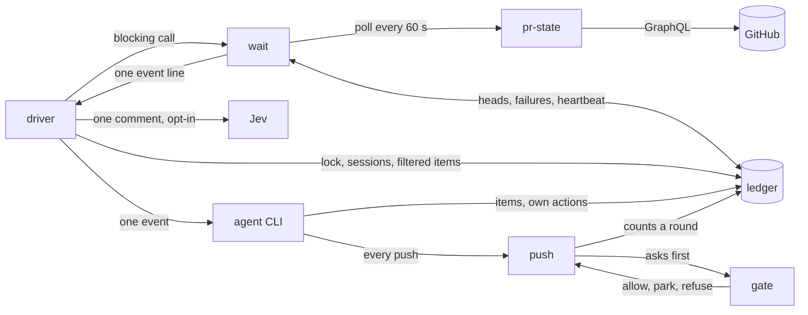
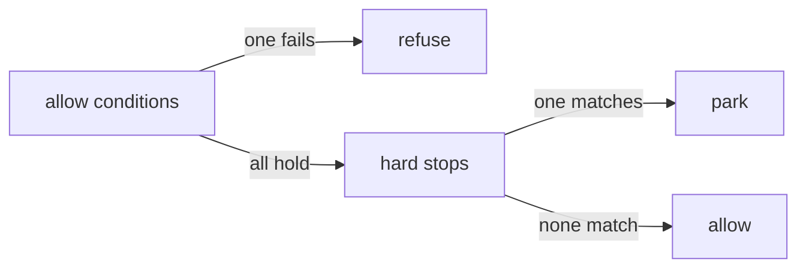

# babysit Design

## Problem

Waiting for a PR to change must not wake the LLM, and the loop must not depend on the LLM to keep going.

| Work | Owner |
|---|---|
| Watching and looping | Scripts |
| Deciding whether the goal is reached | Scripts, from GitHub state |
| Repair and triage | An agent CLI, woken only by an event that needs one |

## Goal

The driver keeps a PR moving until it is approved at its current head or merged. `evaluate` computes that from GitHub state. A model never judges it, and Jev and the agent never decide when to stop.

babysit never merges, marks a PR ready for review, requests reviews, resolves a thread, or manufactures an approval.

## Entry

`babysit <PR>` takes only a PR. There are no modes.

| PR | Behavior |
|---|---|
| The viewer is the author, `isCrossRepository` is false, and `state` is `OPEN` | Driven: the driver repairs, pushes through the gate, and replies until a stop event |
| Any other PR, such as one by another author, one from a fork, or one not open | One `check` report and one line saying why it cannot be driven, then exit 1. Nothing loops |

- A leftover mode argument, `check`, `watch`, or `drive`, is ignored with a one-line notice, not an error.
- `bash <scripts>/drive.sh <PR>` is the entry. It accepts the same PR forms as the skill.
- In an agent session, the skill runs `drive.sh` once as one long command and gives the final report when it exits. No loop runs inside the session, so a model that ends its turn early stops nothing. See [Running the driver from a session](#running-the-driver-from-a-session).

## Architecture



| Layer | Does | Never does |
|---|---|---|
| `pr-state <owner/repo> <pr>` | Runs one paginated GraphQL query and prints normalized JSON with no truncation | Keeps state or judges |
| `wait <owner/repo> <pr> --max <min> --session <token>` | Polls `pr-state`, compares it with the ledger through `evaluate`, and exits with one event line or `idle` | Repairs or marks items handled |
| `drive <PR>` | Owns the lock and the loop, runs the deterministic actions, filters comments, and invokes the agent CLI once for each event that needs it | Repairs, replies, or uses a model to decide whether to stop |
| agent | Follows the skill's single-event entry for one event, records the outcome, and exits | Loops, re-arms `wait`, or takes or clears the lock |
| gate | Decides whether a push may go out | Uses LLM judgment |
| `push` | Asks the gate about HEAD, lists the sha in the ledger, pushes it, and counts the round | Pushes a sha the gate has not judged |

`pr-state` output covers these fields.

- PR state, draft flag, author, viewer login, and `isCrossRepository`
- Base ref, head ref, head SHA, and conflict state
- Latest run of each check with its run id and attempt
- Review threads, reviews, issue comments, and review requests
- Id, author, `authorAssociation`, body, and body hash of every comment
- Author, state, and reviewed commit of each reviewer's latest opinionated review

`check <owner/repo> <pr>` reads GitHub and the ledger once and reports without writing anything.

`wait` emits one event per exit. When several items are pending, the next call returns the next one at once.

## Ledger

Path is `$(git rev-parse --path-format=absolute --git-common-dir)/babysit/<owner>/<repo>/<pr>.json`. Separate directories keep names containing `-` from colliding. Every write goes to a temp file and is renamed into place.

| Field | Writer | Purpose | Reset at session start |
|---|---|---|---|
| `started_at` | driver | Start of the 8-hour session clock | Yes |
| `rounds` | `push` | Pushes over the PR's lifetime, one round per push | No |
| `repairs.<check key>` | `push` | Repair pushes per check across heads and sessions | No |
| `replies.<thread id>` | `reply` | Agent replies per review thread over the PR's lifetime | No |
| `replies.conversation` | `reply` | Agent replies to issue comments and review bodies, which share one top-level conversation, over the PR's lifetime | No |
| `api_failures` | `wait` | Consecutive API failures across re-arms | Yes |
| `lock` | driver, `wait` | Session token and heartbeat | Replaced |
| `heads.<sha>.first_seen` | `wait` | Start of the no-CI clock | No |
| `head.sha`, `head.gen` | `wait` | Last observed head and a counter raised on every observed head change | No |
| `own.pushes` | `push` | SHA of each push, written before pushing | No |
| `own.replies` | `reply` | Body hash written before posting, then the comment id | No |
| `items.<key>` | driver, agent, `park` | Disposition, re-run id and attempt, handled body hash, and the reason for a park | No |

`rounds`, `repairs`, and `replies` survive a session restart, so the driver's automatic restart never lifts the push budget or the reply cap. Only deleting the ledger resets them. The watch `baseline` goes away with watch, and nothing reads one an older ledger still holds.

Lock rules follow.

- `wait` refreshes the heartbeat on every poll, the driver refreshes it before each agent call, and the agent's scripts refresh it before each action and gate run.
- Another session refuses to start while the heartbeat is under 70 minutes old and takes over once it is older.
- `wait` and the gate exit 3 when the token is no longer theirs, and the driver then stops without touching the lock.
- Every other stop clears the lock.
- The agent rechecks the token right before `git push`, and the push is a plain fast-forward of the start SHA, so a former owner that pushes after a takeover lands only while the remote head still equals its start, which the new owner sees as a foreign head change.

| Item | Key | Raised again when |
|---|---|---|
| Comment, review body, or thread reply | `c:<node id>` | Its body hash differs from the stored one |
| Check | `k:<check key>@<head>#<gen>` | The head changes, including back to an earlier SHA |
| Conflict | `x:<head>#<gen>` | The head changes, including back to an earlier SHA |

Check and conflict keys carry `head.gen`, so a head that moves A to B and back to A gets fresh keys instead of reusing the dispositions from its first visit.

Comments are not keyed by head. Keying them by head would re-raise every handled comment after each of the agent's own pushes and loop.

## Events

The first matching row wins.

| # | Event | Fires when | Driver does | Agent does |
|---|---|---|---|---|
| 1 | `merged` | PR is merged | Stop, exit 0 | — |
| 2 | `closed` | PR is closed without merging | Stop, exit 1 | — |
| 3 | `approved` | Some reviewer's latest opinionated review is `APPROVED` on the head commit, and no latest review requests changes | Stop, exit 0 | — |
| 4 | `ready` | READY holds | Stop, exit 0 | — |
| 5 | `limit` | 8 hours have passed, or 5 rounds are used and an item for rows 7, 10, or 11 is pending | Start a new session when 8 hours passed and `rounds` is below 5; otherwise stop, exit 1 | — |
| 6 | `stalled` | Nothing is pending and a parked item is among the READY blockers | Stop, exit 1 | — |
| 7 | `conflict` | Head conflicts with the base | Invoke the agent | Merge base |
| 8 | `check_stuck` | A check fails after 2 repair pushes for it | Park | — |
| 9 | `check_failed` | A re-runnable check fails for the first time on this head | Re-run once, and invoke the agent when GitHub refuses the re-run | Repair |
| 10 | `check_confirmed` | A run newer than the recorded re-run fails, or a check that cannot be re-run fails | Invoke the agent | Repair |
| 11 | `comment` | A comment, review body, or thread reply is new or edited | Run the [comment filter](#comment-filter), then [Jev triage](#jev-triage) when enabled, then invoke the agent for what is left | Triage |
| 12 | `idle` | `--max` expired | Re-arm `wait` | — |

| Agent action | Steps |
|---|---|
| Repair | Reset the worktree to the PR head, fix, verify locally, pass the gate, push, reply if a comment asked, record, and count one round and one repair for a check |
| Merge base | Reset the worktree to the PR head, merge the fetched base, fold any needed fix into that merge commit, verify locally, pass the gate, push, record, and count one round, or park when the conflict cannot be resolved |
| Triage | Confirm the claim against the code, then pick one outcome among Repair, reply only, and park, and park instead of replying once its thread already holds 2 agent replies, where every issue comment and review body belongs to the one `conversation` thread |
| Park | Record the item as parked, notify, and continue |

| Script | Does | Exit |
|---|---|---|
| `worktree prepare` | Fetches the PR branch into a private ref, then creates or resets the worktree, with leftover work discarded | 0, 1 head moved or unreadable, 2, 3 |
| `worktree remove` | Removes the worktree | 0, 1, 2, 3 |
| `push` | Runs the gate, lists the sha, pushes `sha:refs/heads/<branch>` with the command the gate judged, then counts one round and one repair per `--check` | 0 pushed, 1 push failed, 10 park, 11 refuse, 2, 3 |
| `reply` | Posts a thread reply or a conversation comment, refuses a third reply to one thread, refuses a body that asks a bot to approve or resolve, and lists the hash and then the id | 0, 1 post failed, 10 cap reached, 11 approval command, 2, 3 |
| `rerun` | Re-runs the failed jobs of a workflow run and records the failed run id after GitHub accepts it | 0, 1 refused, 2, 3 |
| `park` | Records the item as parked with a reason and shows one notification | 0, 2, 3 |
| `drive` | Runs the [driver loop](#driver) | 0 goal reached, 1 stopped short, 2, 3 |

An exit of 1 or 3 from `push` or `reply` with `pushed` or `posted` true in its JSON line means the action went out and only the ledger write failed, so the agent never repeats it.

Event rules follow.

- A `comment` event carries a 200-character excerpt, the body length, and the body hash, never the full body, which the driver and the agent read from `pr-state` only when they act.
- `approved` reads the reviewed commit, so an approval on an older commit never fires it. GitHub does not dismiss a stale approval on every repository, so a fix pushed after an approval leaves the PR short of the goal until a reviewer approves again.
- `approved` comes before every repairable row. A check that fails after the approval is reported in `unresolved` and not repaired, because a repair push would leave the approval on an older commit.
- Any reviewer's approval counts, a bot's included, which is why `reply` refuses to ask a bot for one.
- Only GitHub Actions check runs can be re-run, so other checks go straight to `check_confirmed`.
- A `rerun` item is pending until a newer run finishes, and that run decides it without a ledger write, closing it on a pass and firing `check_confirmed` on a failure.
- Any other pending item has no disposition yet.
- Reported, handled, and parked all count as dispositions. Only the driver records an item as reported, for a status comment or a Jev `noise` verdict, and the agent records only handled or parked. A `reported` item an older watch session left also counts, so the driver does not act on it until its text changes.
- Every stop report lists all parked items with their reasons, and all reported, pending, and unresolved items.
- A bot that rewrites one status comment on each push costs no agent call. A bot that rewrites any other comment on each push costs one triage per push, bounded by the round limit.
- A bot that answers each reply is bounded by the 2-reply cap per thread over the PR's lifetime, including a bot that answers with fresh top-level comments, since they all share the `conversation` thread.
- `wait` exits nonzero when the API keeps failing, and the driver then stops and reports.

### Never an event

- The agent's own pushes, found in `own.pushes`
- The agent's own replies, found in `own.replies` by comment id or pending body hash
- A check that is queued or pending, or moves from pending to pass
- An item already parked whose text is unchanged
- An item already reported, re-run, or handled under the same key
- A head change by itself, which only raises `head.gen` and so resets the check and conflict keys
- A requested reviewer who has not reviewed yet
- Converting the PR to draft, which only blocks READY while other events still fire
- An approval without a body, except through `approved`
- An approval on an older commit

## Driver

`drive.sh` is a plain script in the foreground. It loops, and the agent never does, so no harness has to re-arm anything and a model that ends a turn on a summary stops nothing.

1. Resolve the PR and read `pr-state` once. When the PR is not drivable, as defined in [Entry](#entry), print the `check` report and the reason, then exit 1.
2. Read the agent command from `git config --get skills.babysit.agent`, such as `claude -p`. Exit 2 when it is unset, before taking the lock.
3. Make a session token and take the lock with `ledger.sh start`. Exit 3 when another live session holds the PR.
4. Run `wait.sh` with `--max 60` and act on the event as the [Events](#events) table says. The loop owns re-arming. `idle` re-arms at no cost, so `--max` only bounds one call, and `wait` still shortens it to the 8-hour mark.
5. On a stop, remove the worktree first when the event is `merged` or `closed`, then run `ledger.sh stop`, print the final report, and exit with the event's code.

The loop stops on `merged`, `closed`, `approved`, `ready`, `stalled`, or `limit` at the rounds cap. A draft is never READY, so a draft PR ends only in `approved` or `merged` unless it stops short. `limit` with `rounds` below 5 is a time limit: the driver runs `ledger.sh stop`, makes a new token, and runs `ledger.sh start` again, with no bound on the number of sessions. `ready` is a stop too, because restarting on it would return it again at once.

### Invoking the agent

- The driver invokes the agent once per event that needs one, and never for `idle`, a deterministic action, or a comment the filter or Jev settled.
- The command is split on whitespace with no shell evaluation, and one prompt is appended as its last argument. An argument that holds a space needs a wrapper script. The prompt names the skill's single-event entry, a file holding the event line, the PR, and the session token.
- The agent command must run without prompts, with permission to edit the worktree and run babysit's scripts. Its permission rules must block a direct `git push` and any GitHub write outside `push` and `reply`. The driver cannot check either.
- The agent takes the action the event names, records the outcome, and exits. It never runs `wait`, takes or clears the lock, or removes the worktree.
- An item the agent leaves unsettled returns from `wait`. The driver invokes the agent for it at most twice with the same key and hash, then parks it with the reason `the agent left the item unrecorded`. This allows one retry, as after a reply that failed to post, and bounds agent calls on an item the agent cannot settle. An item left behind because the head moved never returns, since its check or conflict key names the old head.
- An agent that exits nonzero stops the driver with exit 1, because the agent command itself is failing.

### Exit

| Exit | When |
|---|---|
| 0 | `approved`, `merged`, or `ready` |
| 1 | Stopped short: `closed`, `stalled`, `limit` at the rounds cap, the API failing 5 times in a row, an agent that exits nonzero, or a PR that cannot be driven |
| 2 | Usage or configuration error, such as an unset `skills.babysit.agent` |
| 3 | Another session holds or took over the PR, and the driver stops without touching the lock |

## Comment filter

The driver records a review bot's status comment as reported and invokes no agent for it. A status comment needs both the author and the marker in the table below, read from the full body in `pr-state`, since the event carries only an excerpt.

| Author login in `pr-state` | Kind | Marker |
|---|---|---|
| `chatgpt-codex-connector` | Issue comment | `<!-- codex-pull-request-review-summary -->` |
| `chatgpt-codex-connector` | Issue comment or review body | `<!-- codex-review-receipt:v1 -->` |
| `coderabbitai` | Issue comment | `<!-- This is an auto-generated comment: <kind> by coderabbit.ai -->`, such as `summarize` or `rate limited` |

- A thread comment is never a status comment. Codex findings, marked `codex-code-review-finding`, and CodeRabbit findings are posted in review threads.
- A CodeRabbit review body is never a status comment. It holds the count of actionable comments and can hold nitpick or outside-diff findings.
- `<!-- coderabbit-ai-generated:v1 -->` and `<!-- This is an auto-generated comment by CodeRabbit -->` also mark CodeRabbit findings and replies, so neither one is a status marker.
- A Codex review body that carries the receipt marker only introduces findings that Codex posts as threads.
- These markers were read from PRs #443, #459, #485, #509, and #510 of this repository. A bot that changes its markers makes its status comments wake the agent again, which costs calls but hides nothing.

## Jev triage

Jev is TypeSafe's typed-judgment model. The driver asks it about each comment the filter passes, so a comment that needs nothing costs no agent call.

Jev runs only when `git config --get skills.babysit.jev` is `true` and `TYPESAFE_API_KEY` is set. A key set for another purpose never sends PR text by itself, because comments on a private repository leave the machine. Otherwise the driver invokes the agent for every comment the filter passes, as without Jev.

The request carries one comment's body, author, and kind, plus its file path when it has one. Nothing from the worktree, the environment, or other comments is sent. Jev classifies the comment as `fix`, `question`, `noise`, or `needs-human`, and code decides the action.

| Top class | Its probability | Driver does |
|---|---|---|
| `noise` | 0.7 or more | Records it as reported. The final report lists it as reported, never as handled |
| `needs-human` | 0.7 or more | Parks it with the reason `Jev: needs a human decision` |
| `fix` or `question` | Any | Invokes the agent |
| Any | Below 0.7 | Invokes the agent |
| No answer, because of an API error or an unreadable response | — | Invokes the agent. An error is never read as a verdict |

0.7 is TypeSafe's suggested starting threshold for a yes, and all of these thresholds are kept in one place in the driver.

## Reply guard

The agent posts as the PR author. CodeRabbit approves a PR when its author posts `@coderabbitai approve`, and it resolves its own threads on `@coderabbitai resolve`, which lifts a READY blocker. Either one would manufacture the goal.

- `reply` refuses a body that contains `@coderabbitai`, followed by whitespace and then the word `approve` or `resolve`, matched case-insensitively.
- The check runs before any ledger call, so a refusal writes nothing and posts nothing.
- A refusal exits 11 with `"posted":false` in its JSON line.
- The agent then parks the item with the reason `the reply asked a bot to approve or resolve`.

## READY

babysit owns this classification. Its bats suite edits one clean saved snapshot with one `jq` expression per case and reads it through a `--snapshot` input, so no test calls GitHub.

READY requires all of these.

- The PR is open, not a draft, and not conflicting.
- The latest run of every check on the head passes, unless the PR counts as having no CI.
- No latest review requests changes, no review request is pending, and `reviewDecision` is not `REVIEW_REQUIRED`.
- No review thread is unresolved.
- No item for rows 7 to 11 is pending.
- Every signal could be read.

What follows from these rules.

- A thread babysit answered blocks READY until a human resolves it, and that wait costs nothing.
- A reviewer who never started blocks READY, so silence is never read as zero feedback.
- `REVIEW_REQUIRED` with nobody requested cannot be lifted by babysit, so the driver keeps starting new sessions until a reviewer approves, the PR closes, or the user stops it.

## Gate

The gate judges one push and prints one verdict. It refuses when it cannot tell.

```
gate.sh push <owner/repo> <pr> --session <token> --worktree <path> --start <sha> -- git push origin <sha>:refs/heads/<branch>
```



| Verdict | Exit | Agent does |
|---|---|---|
| allow | 0 | Push |
| park | 10 | Do not push, park, notify |
| refuse | 11 | Do not push, resync if the remote head moved |
| none | 2 | Fix the call |
| none | 3 | Stop, another session holds the lock |

- Output is one JSON line with the reason
- An allow also carries head, branch, and start
- A park also carries matches with the category and path of each hard stop
- Any exit but 0 means do not push
- The sha in the command is the HEAD the gate checked
- A refusal prints the command it expects

## Allow conditions

The first one that fails is the reason.

| Condition |
|---|
| The viewer is the author |
| The branch is in the same repository |
| The pull request is open |
| The head branch is not the default branch |
| origin is the pull request repository for fetch and push |
| The remote head is the start commit |
| HEAD descends from the start commit and adds a commit |
| The command is exactly git push origin sha:refs/heads/branch |

- The push is a plain fast-forward
- A branch deleted before the push is recreated, which is accepted

## Hard stops

| Category | Inspects |
|---|---|
| CI and execution config | Changed and deleted paths such as the workflow directory, CI files, Makefile, Dockerfile, hook config, and agent config |
| Dependencies | Manifests, lockfiles, vendor, and every submodule pointer even when ignored |
| Secrets and outbound network | Added lines for keys, tokens, assigned literals quoted or not, URLs, and network calls, plus secret file names, deleted ones included, and commit messages |
| Test weakening | Deleted test files, added lines that skip tests or set coverage, and removed lines that held a coverage setting |
| Unreadable | Binary changes |

- Line patterns lean toward parking, so a new link in a doc also parks
- Each commit is read against its parents and a root commit against the empty tree
- Git reads with replace refs off, renames off, and no ignored submodules
- A merge of the base is read like any other commit

## Not covered

| Gap | Reason |
|---|---|
| Replies | The gate covers pushes only |
| Base merge handling | A merge that brings in a base workflow parks, which is safe |
| Protected head branch | GitHub rejects the push |
| Push settings for tags and submodules | They need a user setting |
| A remote head reset to an ancestor after the check | A plain push stays a fast-forward and restores the removed commits. A lease on the start commit would close it, but the lease flag is a force flag and the never force push rule stays absolute |
| Removed test cases | Only deleted files and added skips are read |
| Secret values with brackets, parentheses, or quotes | An unquoted value with those characters reads as a call or a reference, so it does not park |
| Mode-only changes | No line changes |
| Calls that bypass the gate | The agent command's permission rules must block a direct push |
| Comments that bypass `reply` | The agent command's permission rules must block a direct GitHub write, so the reply guard and the reply cap hold |
| Approval commands to other bots | Only CodeRabbit's are known to approve or resolve on the author's word |
| A user whose login matches a bot's | The filter reads the login, not the account type. A match only records the comment as reported, and the final report lists it |
| Steering Jev with comment text | A comment can word itself to read as `noise`. It is then reported instead of acted on, and the final report lists it |
| Review-bot commands the viewer posts, such as `@codex review` | They are not status comments, so they wake the agent unless Jev settles them |
| The gate environment | Test hooks replace the snapshot and the accepted origin |

## Decisions

| Topic | Decision |
|---|---|
| Goal | `approved` at the current head or `merged`, computed by `evaluate` from GitHub state, never judged by a model |
| Entry | One entry with no modes. A drivable PR is driven, and any other PR gets one `check` report |
| Loop owner | The driver, a plain script, so neither the loop nor its waiting depends on a harness or on the model re-arming it |
| Agent command | `git config skills.babysit.agent`, with no default, so the driver never picks a CLI or a bill for the user |
| Autonomous push | The agent only, for CI failures, review feedback, and conflicts, always a gated plain fast-forward of the start SHA, never a force push or merge |
| Eligible PRs | The driver takes PRs the viewer authored from a branch in the same repository, and `check` takes any readable PR |
| Comment input | Comments from anyone are accepted and checked against the code before acting |
| Accepted risk | On a public repository a third party can steer a fix outside every hard stop, and its local verification runs on the user's machine |
| Threads | Reply, never resolve |
| Park and continue | A parked item waits for a human while the rest continue, returns only when its text changes, and ends the session through `stalled` once only parked blockers remain |
| Worktree | The agent uses a detached HEAD worktree at `$(git-common-dir)/babysit/wt/<owner>/<repo>/<pr>`, never touches the user's checkout, and stages only changed files instead of `git add -A` |
| Conflicts | Merge the base branch, never rebase, since force push is forbidden |
| No CI | A head with no check within 10 minutes of `first_seen` counts as having no CI, and READY uses review state alone |
| Notifications | Run `osascript` on park when it is available, and skip silently otherwise |
| Limits | 5 rounds over the PR's lifetime with one round per push, and 8 hours per session from `started_at`, where `wait` shortens `--max` to hit the 8-hour mark |
| Driver lifetime | No bound. A time limit below the round cap starts a new session, and waiting costs only polling. The user stops the driver to end it sooner |
| Flaky checks | Re-run once on the first failure, and park after 2 failed repair pushes |
| API failure | Back off from 30 seconds up to 8 minutes within the `--max` deadline, exit 1 at 5 consecutive failures, exit 2 on usage errors, and exit 3 on a lost lock |
| Concurrency | One session per PR through the lock |
| Session | A session that starts the driver gets one turn, when the driver exits |
| Idle cost | `idle` re-arms inside the driver, so an unchanged PR costs no agent call |
| Agent calls | Only for repairs, merges of the base, and comments the filter and Jev leave, at most twice per item |
| Bot status comments | Settled by author and marker, never by a model |
| Jev | Opt-in through `skills.babysit.jev` plus `TYPESAFE_API_KEY`, because it sends comment text outside the machine |
| Push path | The agent pushes only through `push`, which gates, lists, pushes, and counts in one call, so no step can be skipped and a rejected push never spends a round |
| Reply cap | `reply` refuses a third agent reply to one thread over the PR's lifetime, and the agent parks the item instead |
| Approval commands | `reply` refuses to ask a bot to approve or resolve, and the agent parks the item instead |
| Notification | `park` hands comment text to `osascript` as an argument, never as script, and a failed notification never stops a park |
| Reply scan | Not gated yet, see the gaps under Gate |

## Running the driver from a session

The driver loops by itself, so a harness only needs to run one command until it exits. Each run costs one turn, when the driver exits. The per-harness adapters that re-armed `wait` inside a session are gone, and so is the loop they served.

| Harness | Mechanism | Measured evidence |
|---|---|---|
| Claude Code | Bash with `run_in_background: true`, then end the turn without polling | [A background exit started a turn about 1 second later with 0 idle turns](https://github.com/maro114510/skills/issues/306#issuecomment-6331950722). [Runs over 30 minutes were not measured](https://github.com/maro114510/skills/issues/306#issuecomment-6331972320) |
| OpenCode | Foreground Bash with a `timeout` longer than the run | [A 60-minute command under a 65-minute timeout returned exit 0 with 0 idle turns](https://github.com/maro114510/skills/issues/306#issuecomment-6331950357). Longer runs were not measured |
| Others, or a run that may outlast the harness | Give the user `bash <scripts>/drive.sh <PR>` to run in a terminal | — |

The driver can run for days, longer than any of these runs was measured. When the harness kills it, the driver's lock goes stale and its heartbeat lets the next run take over after 70 minutes, and the PR-lifetime ledger keeps the budget.

Monitor is rejected because [it stops at 30 minutes, kills the watched command, and costs one turn per stdout line](https://github.com/maro114510/skills/issues/306#issuecomment-6331950722).
