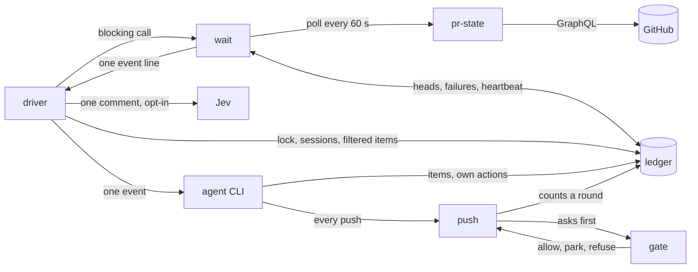
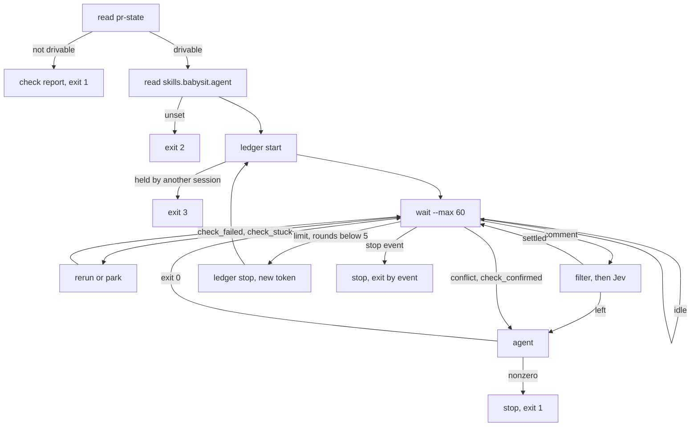
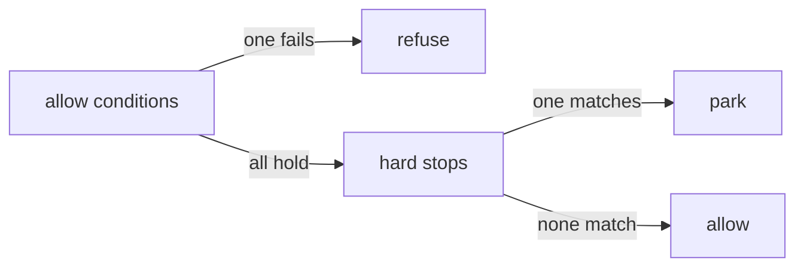

# babysit Design

## Problem

Waiting for a PR to change must not wake the LLM, and the loop must not depend on the LLM to keep going.

| Work | Owner |
|---|---|
| Watching and looping | Scripts |
| Deciding whether the goal is reached | Scripts, from GitHub state |
| Repair and triage | An agent CLI, woken only by an event that needs one |

## Goal

- The driver stops on `approved` at the current head or on `merged`
  - `evaluate` computes both from GitHub state, never a model
- babysit never merges, marks a PR ready, requests reviews, resolves a thread, or manufactures an approval

## Entry

`babysit <PR>` and `drive.sh <PR>` take only a PR.

| PR | Behavior |
|---|---|
| The viewer's own open PR from the same repository | Driven until a stop event |
| Any other PR | One `check` report with the reason, then exit 1 |

- A leftover `check`, `watch`, or `drive` argument is ignored with a notice
- In a session, the skill runs `drive.sh` once and reports when it exits

## Architecture



| Layer | Does | Never does |
|---|---|---|
| `pr-state <owner/repo> <pr>` | Runs one paginated GraphQL query and prints normalized JSON with no truncation | Keeps state or judges |
| `wait <owner/repo> <pr> --max <min> --session <token>` | Polls `pr-state`, compares it with the ledger through `evaluate`, and exits with one event line or `idle` | Repairs or marks items handled |
| `drive <PR>` | Owns the lock and the loop, and invokes the agent only for an event that needs it | Repairs, replies, or lets a model decide when to stop |
| agent | Follows the skill's single-event entry for one event, records the outcome, and exits | Loops, re-arms `wait`, or takes or clears the lock |
| gate | Decides whether a push may go out | Uses LLM judgment |
| `push` | Asks the gate about HEAD, lists the sha in the ledger, pushes it, and counts the round | Pushes a sha the gate has not judged |

`pr-state` output covers these fields.

- PR state, draft flag, author, viewer login, and `isCrossRepository`
- Base ref, head ref, head SHA, and conflict state
- Latest run of each check with its run id and attempt
- Review threads, reviews, issue comments, and review requests
- Id, author, `authorAssociation`, body, and body hash of every comment
- Author, state, and reviewed commit of each reviewer's latest opinionated review

`check <owner/repo> <pr>` reads GitHub and the ledger once and reports without writing anything.

`wait` emits one event per exit. When several items are pending, the next call returns the next one at once.

## Ledger

Path is `$(git rev-parse --path-format=absolute --git-common-dir)/babysit/<owner>/<repo>/<pr>.json`. Separate directories keep names containing `-` from colliding. Every write goes to a temp file and is renamed into place.

| Field | Writer | Purpose | Reset at session start |
|---|---|---|---|
| `started_at` | driver | Start of the 8-hour session clock | Yes |
| `rounds` | `push` | Push budget, one round per push | No |
| `repairs.<check key>` | `push` | Repair pushes per check across heads | No |
| `replies.<thread id>` | `reply` | Agent replies per review thread | No |
| `replies.conversation` | `reply` | Agent replies to issue comments and review bodies, which share one top-level conversation | No |
| `api_failures` | `wait` | Consecutive API failures across re-arms | Yes |
| `lock` | driver, `wait` | Session token and heartbeat | Replaced |
| `heads.<sha>.first_seen` | `wait` | Start of the no-CI clock | No |
| `head.sha`, `head.gen` | `wait` | Last observed head and a counter raised on every observed head change | No |
| `own.pushes` | `push` | SHA of each push, written before pushing | No |
| `own.replies` | `reply` | Body hash written before posting, then the comment id | No |
| `items.<key>` | driver, agent, `park` | Disposition, re-run id and attempt, handled body hash, and the reason for a park | No |

An older ledger's `baseline` is ignored.

Lock rules follow.

- `wait` refreshes the heartbeat on every poll, the driver refreshes it before each agent call, and the agent's scripts refresh it before each action and gate run.
- Another session refuses to start while the heartbeat is under 70 minutes old and takes over once it is older.
- `wait` and the gate exit 3 when the token is no longer theirs, and the driver then stops without touching the lock.
- Every other stop clears the lock.
- The agent rechecks the token right before `git push`, and the push is a plain fast-forward of the start SHA, so a former owner that pushes after a takeover lands only while the remote head still equals its start, which the new owner sees as a foreign head change.

| Item | Key | Raised again when |
|---|---|---|
| Comment, review body, or thread reply | `c:<node id>` | Its body hash differs from the stored one |
| Check | `k:<check key>@<head>#<gen>` | The head changes, including back to an earlier SHA |
| Conflict | `x:<head>#<gen>` | The head changes, including back to an earlier SHA |

Check and conflict keys carry `head.gen`, so a head that moves A to B and back to A gets fresh keys instead of reusing the dispositions from its first visit.

Comments are not keyed by head. Keying them by head would re-raise every handled comment after each of the agent's own pushes and loop.

## Events

The first matching row wins.

| # | Event | Fires when | Driver does | Agent does |
|---|---|---|---|---|
| 1 | `merged` | PR is merged | Stop, exit 0 | — |
| 2 | `closed` | PR is closed without merging | Stop, exit 1 | — |
| 3 | `approved` | Some reviewer's latest opinionated review is `APPROVED` on the head commit, and no latest review requests changes | Stop, exit 0 | — |
| 4 | `ready` | READY holds | Stop, exit 0 | — |
| 5 | `limit` | 8 hours have passed, or 5 rounds are used and an item for rows 7, 10, or 11 is pending | New session while `rounds` is below 5, otherwise stop, exit 1 | — |
| 6 | `stalled` | Nothing is pending and a parked item is among the READY blockers | Stop, exit 1 | — |
| 7 | `conflict` | Head conflicts with the base | Invoke the agent | Merge base |
| 8 | `check_stuck` | A check fails after 2 repair pushes for it | Park | — |
| 9 | `check_failed` | A re-runnable check fails for the first time on this head | Re-run once, or invoke the agent when refused | Repair |
| 10 | `check_confirmed` | A run newer than the recorded re-run fails, or a check that cannot be re-run fails | Invoke the agent | Repair |
| 11 | `comment` | A comment, review body, or thread reply is new or edited | Filter, then Jev, then invoke the agent | Triage |
| 12 | `idle` | `--max` expired | Re-arm `wait` | — |

| Agent action | Steps |
|---|---|
| Repair | Reset the worktree to the PR head, fix, verify locally, pass the gate, push, reply if a comment asked, record, and count one round and one repair for a check |
| Merge base | Reset the worktree to the PR head, merge the fetched base, fold any needed fix into that merge commit, verify locally, pass the gate, push, record, and count one round, or park when the conflict cannot be resolved |
| Triage | Confirm the claim against the code, then pick one outcome among Repair, reply only, and park, and park instead of replying once its thread already holds 2 agent replies, where every issue comment and review body belongs to the one `conversation` thread |
| Park | Record the item as parked, notify, and continue |

| Script | Does | Exit |
|---|---|---|
| `worktree prepare` | Fetches the PR branch into a private ref, then creates or resets the worktree, with leftover work discarded | 0, 1 head moved or unreadable, 2, 3 |
| `worktree remove` | Removes the worktree | 0, 1, 2, 3 |
| `push` | Runs the gate, lists the sha, pushes `sha:refs/heads/<branch>` with the command the gate judged, then counts one round and one repair per `--check` | 0 pushed, 1 push failed, 10 park, 11 refuse, 2, 3 |
| `reply` | Posts a thread reply or a conversation comment, refuses a third reply to one thread or a body that asks a bot to approve or resolve, and lists the hash and then the id | 0, 1 post failed, 10 cap reached, 11 approval command, 2, 3 |
| `rerun` | Re-runs the failed jobs of a workflow run and records the failed run id after GitHub accepts it | 0, 1 refused, 2, 3 |
| `park` | Records the item as parked with a reason and shows one notification | 0, 2, 3 |
| `drive` | Runs the driver loop | 0 goal reached, 1 stopped short, 2, 3 |

An exit of 1 or 3 from `push` or `reply` with `pushed` or `posted` true in its JSON line means the action went out and only the ledger write failed, so the agent never repeats it.

Event rules follow.

- A `comment` event carries a 200-character excerpt, the body length, and the body hash, never the full body, which the driver and the agent read from `pr-state` only when they act.
- `approved` reads the reviewed commit, so an approval on an older commit never fires it
- `approved` comes before every repair, because a repair push would make the approval stale
  - A check failing after the approval stays in `unresolved`
- Any reviewer's approval counts, a bot's included
- Only GitHub Actions check runs can be re-run, so other checks go straight to `check_confirmed`.
- A `rerun` item is pending until a newer run finishes, and that run decides it without a ledger write, closing it on a pass and firing `check_confirmed` on a failure.
- Any other pending item has no disposition yet.
- Reported, handled, and parked all count as dispositions
  - Only the driver records reported, for a status comment or Jev noise
  - A reported item in an older ledger also stays settled until its text changes
- Every stop report lists all parked items with their reasons, and all reported, pending, and unresolved items.
- A bot that rewrites one comment on each push costs one triage per push unless it is a status comment, bounded by the round limit.
- A bot that answers each reply is bounded by the 2-reply cap per thread, including a bot that answers with fresh top-level comments, since they all share the `conversation` thread.
- `wait` exits nonzero when the API keeps failing, and the driver then stops and reports.

### Never an event

- The agent's own pushes, found in `own.pushes`
- The agent's own replies, found in `own.replies` by comment id or pending body hash
- A check that is queued or pending, or moves from pending to pass
- An item already parked whose text is unchanged
- An item already reported, re-run, or handled under the same key
- A head change by itself, which only raises `head.gen` and so resets the check and conflict keys
- A requested reviewer who has not reviewed yet
- Converting the PR to draft, which only blocks READY while other events still fire
- An approval without a body, except through `approved`
- An approval on an older commit

## Driver

- `drive.sh` owns the loop and re-arms `wait`, so neither a harness nor the model does
- It invokes the agent once per event that needs one
- It stops on `merged`, `closed`, `approved`, `ready`, `stalled`, or the rounds cap
  - `ready` stops it because a new session would return `ready` at once



- The agent command is split on whitespace without shell evaluation, and the prompt is appended as the last argument
  - The prompt names the single-event entry, the event file, the PR, and the session token
  - The command runs without prompts, and its permission rules block a direct push and any GitHub write outside `push` and `reply`
- The agent handles one event, records the outcome, and exits
  - It never runs `wait`, touches the lock, or removes the worktree
- An item still unsettled after two agent calls with the same key and hash is parked
- `merged` and `closed` remove the worktree before `ledger stop`

| Exit | When |
|---|---|
| 0 | `approved`, `merged`, or `ready` |
| 1 | `closed`, `stalled`, `limit` at the rounds cap, API failure, agent failure, or a PR that cannot be driven |
| 2 | Usage or configuration error |
| 3 | Another session holds the PR |

## Comment filter

A review bot's status comment is recorded as reported without an agent call. Both the author and the marker must match.

| Author | Kind | Marker |
|---|---|---|
| `chatgpt-codex-connector` | Issue comment | `codex-pull-request-review-summary` |
| `chatgpt-codex-connector` | Issue comment or review body | `codex-review-receipt:v1` |
| `coderabbitai` | Issue comment | `This is an auto-generated comment: <kind> by coderabbit.ai` |

- Thread comments and CodeRabbit review bodies never match
  - Both carry findings
- Generic CodeRabbit markers never match
  - They also tag findings
- A bot that changes its markers only costs agent calls

## Jev triage

- Jev runs only when `skills.babysit.jev` is `true` and `TYPESAFE_API_KEY` is set
  - A key alone never sends comment text off the machine
- A request carries one comment's body, author, kind, and path

| Jev verdict | Driver does |
|---|---|
| `noise` at 0.7 or more | Record as reported |
| `needs-human` at 0.7 or more | Park |
| Anything else, or no answer | Invoke the agent |

## READY

babysit owns this classification. Its bats suite edits one clean saved snapshot with one `jq` expression per case and reads it through a `--snapshot` input, so no test calls GitHub.

READY requires all of these.

- The PR is open, not a draft, and not conflicting.
- The latest run of every check on the head passes, unless the PR counts as having no CI.
- No latest review requests changes, no review request is pending, and `reviewDecision` is not `REVIEW_REQUIRED`.
- No review thread is unresolved.
- No item for rows 7 to 11 is pending.
- Every signal could be read.

What follows from these rules.

- A thread babysit answered blocks READY until a human resolves it, and that wait costs nothing.
- A reviewer who never started blocks READY, so silence is never read as zero feedback.
- `REVIEW_REQUIRED` with nobody requested cannot be lifted by babysit, so the driver keeps starting new sessions until a reviewer approves, the PR closes, or the user stops it.

## Gate

The gate judges one push and prints one verdict. It refuses when it cannot tell.

```
gate.sh push <owner/repo> <pr> --session <token> --worktree <path> --start <sha> -- git push origin <sha>:refs/heads/<branch>
```



| Verdict | Exit | Agent does |
|---|---|---|
| allow | 0 | Push |
| park | 10 | Do not push, park, notify |
| refuse | 11 | Do not push, resync if the remote head moved |
| none | 2 | Fix the call |
| none | 3 | Stop, another session holds the lock |

- Output is one JSON line with the reason
- An allow also carries head, branch, and start
- A park also carries matches with the category and path of each hard stop
- Any exit but 0 means do not push
- The sha in the command is the HEAD the gate checked
- A refusal prints the command it expects

## Allow conditions

The first one that fails is the reason.

| Condition |
|---|
| The viewer is the author |
| The branch is in the same repository |
| The pull request is open |
| The head branch is not the default branch |
| origin is the pull request repository for fetch and push |
| The remote head is the start commit |
| HEAD descends from the start commit and adds a commit |
| The command is exactly git push origin sha:refs/heads/branch |

- The push is a plain fast-forward
- A branch deleted before the push is recreated, which is accepted

## Hard stops

| Category | Inspects |
|---|---|
| CI and execution config | Changed and deleted paths such as the workflow directory, CI files, Makefile, Dockerfile, hook config, and agent config |
| Dependencies | Manifests, lockfiles, vendor, and every submodule pointer even when ignored |
| Secrets and outbound network | Added lines for keys, tokens, assigned literals quoted or not, URLs, and network calls, plus secret file names, deleted ones included, and commit messages |
| Test weakening | Deleted test files, added lines that skip tests or set coverage, and removed lines that held a coverage setting |
| Unreadable | Binary changes |

- Line patterns lean toward parking, so a new link in a doc also parks
- Each commit is read against its parents and a root commit against the empty tree
- Git reads with replace refs off, renames off, and no ignored submodules
- A merge of the base is read like any other commit

## Not covered

| Gap | Reason |
|---|---|
| Replies | The gate covers pushes only |
| Base merge handling | A merge that brings in a base workflow parks, which is safe |
| Protected head branch | GitHub rejects the push |
| Push settings for tags and submodules | They need a user setting |
| A remote head reset to an ancestor after the check | A plain push stays a fast-forward and restores the removed commits. A lease on the start commit would close it, but the lease flag is a force flag and the never force push rule stays absolute |
| Removed test cases | Only deleted files and added skips are read |
| Secret values with brackets, parentheses, or quotes | An unquoted value with those characters reads as a call or a reference, so it does not park |
| Mode-only changes | No line changes |
| Calls that bypass the gate | The agent command's permission rules must block a direct push |
| Comments that bypass `reply` | The agent command's permission rules must block them |
| Approval commands the guard does not know | Only known bot commands are refused |
| A user whose login matches a bot's | The filter reads the login, and a match is only reported |
| Comment text that steers Jev toward noise | The comment is only reported |
| Bot commands the viewer posts | They wake the agent unless Jev settles them |
| The gate environment | Test hooks replace the snapshot and the accepted origin |

## Decisions

| Topic | Decision |
|---|---|
| Loop owner | The driver, so the loop depends on neither a harness nor the model |
| Agent command | `skills.babysit.agent` with no default, so the driver never picks a CLI for the user |
| Autonomous push | The agent only, for CI failures, review feedback, and conflicts, always a gated plain fast-forward of the start SHA, never a force push or merge |
| Eligible PRs | The driver takes PRs the viewer authored from a branch in the same repository, and `check` takes any readable PR |
| Comment input | Comments from anyone are accepted and checked against the code before acting |
| Accepted risk | On a public repository a third party can steer a fix outside every hard stop, and its local verification runs on the user's machine |
| Threads | Reply, never resolve |
| Park and continue | A parked item waits for a human while the rest continue, returns only when its text changes, and ends the session through `stalled` once only parked blockers remain |
| Worktree | The agent uses a detached HEAD worktree at `$(git-common-dir)/babysit/wt/<owner>/<repo>/<pr>`, never touches the user's checkout, and stages only changed files instead of `git add -A` |
| Conflicts | Merge the base branch, never rebase, since force push is forbidden |
| No CI | A head with no check within 10 minutes of `first_seen` counts as having no CI, and READY uses review state alone |
| Notifications | Run `osascript` on park when it is available, and skip silently otherwise |
| Limits | 5 rounds per PR with one round per push, and 8 hours per session from `started_at`, where `wait` shortens `--max` to hit the 8-hour mark |
| Driver lifetime | No bound, because waiting costs only polling |
| Flaky checks | Re-run once on the first failure, and park after 2 failed repair pushes |
| API failure | Back off from 30 seconds up to 8 minutes within the `--max` deadline, exit 1 at 5 consecutive failures, exit 2 on usage errors, and exit 3 on a lost lock |
| Concurrency | One session per PR through the lock |
| Session | A session that starts the driver gets one turn, when the driver exits |
| Idle cost | An unchanged PR costs no agent call |
| Jev | Opt-in, because it sends comment text off the machine |
| Push path | The agent pushes only through `push`, which gates, lists, pushes, and counts in one call, so no step can be skipped and a rejected push never spends a round |
| Reply cap | `reply` refuses a third agent reply to one thread per PR, and the agent parks the item instead |
| Approval commands | `reply` refuses a body asking a bot to approve or resolve before writing anything, and the agent parks the item instead |
| Notification | `park` hands comment text to `osascript` as an argument, never as script, and a failed notification never stops a park |
| Reply scan | Not gated yet, see the gaps under Gate |

## Running the driver from a session

A harness only runs one command until it exits.

| Harness | Mechanism | Measured evidence |
|---|---|---|
| Claude Code | Bash with `run_in_background: true`, then end the turn without polling | [A background exit started a turn about 1 second later with 0 idle turns](https://github.com/maro114510/skills/issues/306#issuecomment-6331950722). [Runs over 30 minutes were not measured](https://github.com/maro114510/skills/issues/306#issuecomment-6331972320) |
| OpenCode | Foreground Bash with a `timeout` longer than the run | [A 60-minute command under a 65-minute timeout returned exit 0 with 0 idle turns](https://github.com/maro114510/skills/issues/306#issuecomment-6331950357). Longer runs were not measured |
| Others, or a run that may outlast the harness | Give the user `drive.sh` to run in a terminal | — |

A driver the harness kills leaves a stale lock, which the next run takes over after 70 minutes.

Monitor is rejected because [it stops at 30 minutes, kills the watched command, and costs one turn per stdout line](https://github.com/maro114510/skills/issues/306#issuecomment-6331950722).
