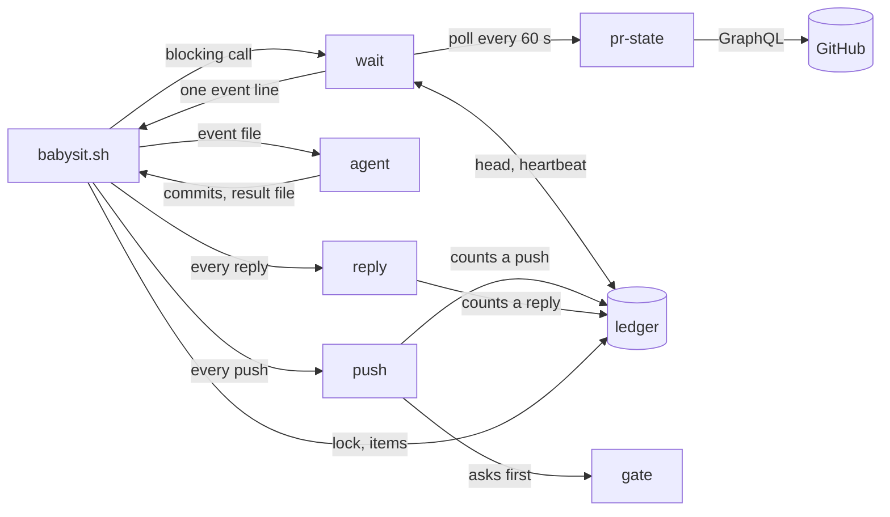
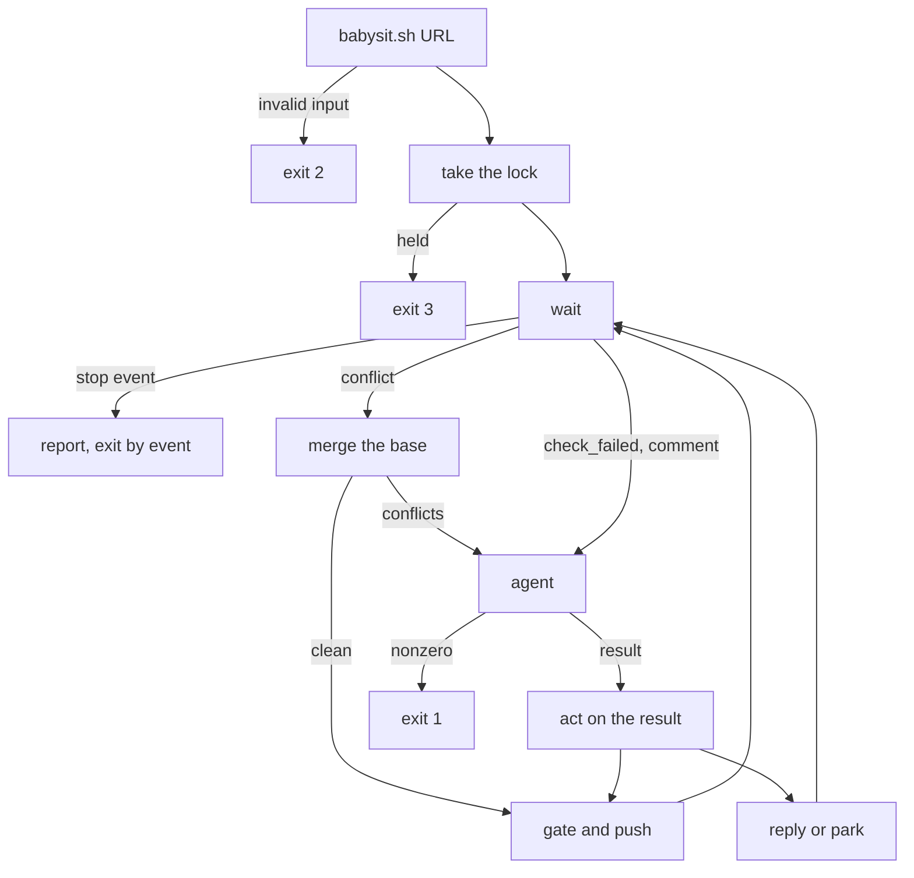
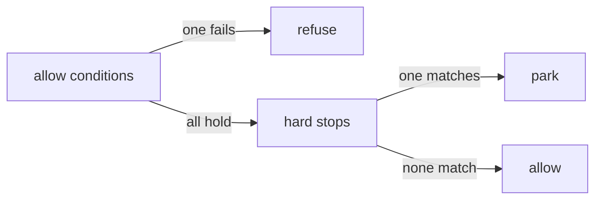

# babysit Design

## Purpose

- babysit moves your own PR to its goal
  - The goal is a merge, or a human approval on the head commit while every check passes and GitHub reports it as mergeable
  - Scripts compute the goal from GitHub state, never a model
- Scripts do every step whose result is fixed by its input, and the agent is invoked only for judgment
- babysit never merges, marks a PR ready, requests reviews, resolves a thread, or asks a bot to approve

## Interface

```
babysit <PR URL> [--reset-budget]
```

| Input | Result |
|---|---|
| The URL of the viewer's own open PR from the same repository | Runs until a stop event |
| `--reset-budget` | Sets the push and reply budgets back to zero before running |
| The URL of a PR another automation owns, as Writers defines | Exit 2, naming the owner |
| Any other PR, another form or argument, or an unset `skills.babysit.agent` | Exit 2 |

| Exit | Meaning |
|---|---|
| 0 | The goal is reached or the PR is merged |
| 1 | The PR is closed, a budget is spent, the API failed 5 times in a row, a push or reply went out unrecorded, or the agent exited nonzero |
| 2 | Usage or configuration error |
| 3 | Another run holds the PR |

- `skills.babysit.agent` in git config is the agent command, such as `claude -p`
  - It has no default, so babysit never picks a CLI for the user
  - It is split on whitespace without shell evaluation, and the prompt is appended as the last argument
- The agent command must be unable to push or write to GitHub
  - babysit cannot check this, and its safety depends on it
  - The agent never needs either, because `babysit.sh` pushes and replies

## Writers

- At most one writer pushes to or replies on a PR at a time
- A PR body line that holds only `<!-- automation-owner: <id> -->` names automation `<id>` as the PR's only writer
  - `<id>` is letters, digits, `.`, `_`, and `-`, and the first such line counts
  - An automation that opens a PR for itself writes the line, as orchestrate-epic does, and babysit never writes it
- babysit refuses an owned PR at start, the gate refuses each push to it, and `reply` refuses each reply on it
  - A run that started before the line was added stops at its next push or reply
  - An unreadable owner counts as owned
- The line outlives the owner's session, so an owner whose session died still holds the PR
- A human hands the PR over by deleting the line, and nothing tells the former owner
  - Delete it only once the owner no longer works on the PR, or both write again
- A PR without the line is the viewer's own PR, driven as before

## Split

| Scripts | Agent |
|---|---|
| Wait for PR state and compute the goal | Find and fix the cause of a failing check |
| Prepare the worktree and merge the base | Resolve a conflict the merge left |
| Gate, push, reply, and record | Judge a comment against the code, then fix it, draft a reply, or ask to park it |
| Park, cap budgets, and lock the PR | |

## Architecture



| Layer | Does | Never does |
|---|---|---|
| `pr-state <owner/repo> <pr>` | Runs one paginated GraphQL query and prints normalized JSON with no truncation | Keeps state or judges |
| `wait <owner/repo> <pr>` | Polls `pr-state`, compares it with the ledger through `evaluate`, and exits with one event line | Acts on an event |
| `babysit.sh` | Owns the lock and the loop, runs every deterministic step, and invokes the agent only for judgment | Lets a model decide when to stop |
| agent | Reads one event, edits and commits in the worktree, writes one result file, and exits | Pushes, writes to GitHub, or touches the ledger |
| gate | Decides whether a sha may be pushed | Uses LLM judgment |
| `push` | Asks the gate, lists the sha in the ledger, pushes it, and counts it | Pushes a sha the gate has not judged |
| `reply` | Posts a thread reply or a PR comment and counts it | Resolves a thread or asks a bot to approve |

`babysit.sh` hands its run token to the scripts it calls through the environment, never to the agent, so no interface takes a token.

`pr-state` output covers these fields.

- PR state, draft flag, author, viewer login, and `isCrossRepository`
- `automationOwner`, the `<id>` of the owner line that Writers defines, or null
- Base ref, head ref, head SHA, and conflict state
- Latest run of each check
- Review threads, reviews, issue comments, and review requests
- Id, author, `authorAssociation`, body, and body hash of every comment
- Author, author type, state, and reviewed commit of each reviewer's latest opinionated review

## Loop



- `babysit.sh` prepares the worktree at the PR head before every agent call
- The prompt names the goal, the event file, the worktree, and the result file
- The agent writes one of these outcomes, and `babysit.sh` acts on it

| Outcome | Allowed for | `babysit.sh` does |
|---|---|---|
| `fixed`, with commits and an optional reply | Every event | Gate and push, then reply, then record handled |
| `reply`, with the text | `comment` | Reply, then record handled |
| `none` | `comment` | Record handled |
| `park`, with the reason | Every event | Park |

- A missing, unreadable, or disallowed result leaves the item unsettled, and the second time it is parked
  - A check or conflict is never recorded handled while it still fails
- A gate park parks the item, and a gate refusal waits for the next event when the remote head moved, otherwise parks
- `babysit.sh` refreshes the heartbeat every minute while the agent runs
- `merged` and `closed` remove the worktree before the lock is cleared
- Every stop prints the parked items with their reasons and the pending items

## Events

`wait` blocks until one event fires, and the first matching row wins.

| # | Event | Fires when | `babysit.sh` does |
|---|---|---|---|
| 1 | `merged` | The PR is merged | Stop, exit 0 |
| 2 | `closed` | The PR is closed without merging | Stop, exit 1 |
| 3 | `goal` | A human's latest review approves the head commit, no latest review requests changes, every check on the head passes, and GitHub reports the head as `MERGEABLE` | Stop, exit 0 |
| 4 | `budget` | The push budget is spent while a conflict, failing check, or comment is pending | Stop, exit 1 |
| 5 | `conflict` | The head conflicts with the base | Merge the base, and invoke the agent only for conflicts |
| 6 | `check_failed` | A check fails on the head | Invoke the agent to repair |
| 7 | `comment` | A comment, review body, or thread reply is new or edited | Invoke the agent to triage |

- A comment event carries a 200-character excerpt, and the agent reads the full body from `pr-state`
- A bot's approval never counts toward the goal
- An approval on an older commit never counts, and a repair push makes the approval stale, so the PR waits for a new one
- A failing check is repaired at once without a re-run, because flaky checks are rare here
- A parked item waits for a human, returns only when its text changes, and never stops the loop
- A reply that the reply budget refuses parks the item

### Never an event

- The agent's own pushes and replies, found in `own.pushes` and `own.replies`
- A check that is queued or pending, or moves from pending to pass
- An item already handled or parked whose key and text are unchanged
- A head change by itself, which only raises `head.gen`
- A requested reviewer who has not reviewed yet
- Converting the PR to draft

## Scripts

| Script | Does | Exit |
|---|---|---|
| `worktree prepare` | Fetches the PR branch into a private ref, then creates or resets the worktree, with leftover work discarded | 0, 1 head moved or unreadable, 2, 3 |
| `worktree remove` | Removes the worktree | 0, 1, 2, 3 |
| `push` | Runs the gate, lists the sha, pushes `sha:refs/heads/<branch>`, then counts one push | 0, 1, 4, 10 park, 11 refuse, 2, 3 |
| `reply` | Posts a thread reply, or a PR comment for an issue comment or review body, then counts one reply | 0, 1, 4, 10 budget spent, 11 approval command or another automation owns the PR, 2, 3 |
| `park` | Records the item as parked with a reason and shows one notification | 0, 2, 3 |

| Exit | Meaning for `push` and `reply` |
|---|---|
| 0 | Went out and was recorded |
| 4 | Went out, but the ledger write failed |
| 1, 2, 3, 10, 11 | Nothing went out |

- `reply` refuses a body asking a bot to approve or resolve before writing anything
- Notifications use `osascript` on macOS, and a missing or failed notification never stops a park

## Ledger

Path is `$(git rev-parse --path-format=absolute --git-common-dir)/babysit/<owner>/<repo>/<pr>.json`. Separate directories keep names containing `-` from colliding. Every write goes to a temp file and is renamed into place. Every field lives as long as the PR, and only `--reset-budget` resets the budgets.

| Field | Writer | Purpose |
|---|---|---|
| `pushes` | `push` | Push budget of 5 per PR |
| `replies` | `reply` | Reply budget of 10 per PR |
| `lock` | `babysit.sh`, `wait` | Run token and heartbeat |
| `head.sha`, `head.gen` | `wait` | Last observed head and a counter raised on every observed head change |
| `own.pushes` | `push` | SHA of each push, written before pushing |
| `own.replies` | `reply` | Body hash written before posting, then the comment id |
| `items.<key>` | `babysit.sh`, `park` | Disposition, handled body hash, and the reason for a park |

| Item | Key | Raised again when |
|---|---|---|
| Comment, review body, or thread reply | `c:<node id>` | Its body hash differs from the stored one |
| Check | `k:<check key>#<gen>` | The head changes, including back to an earlier SHA |
| Conflict | `x:<gen>` | The head changes, including back to an earlier SHA |

- Comments are not keyed by head, because that would re-raise every handled comment after each push
- `wait` refreshes the heartbeat on every poll
- Another run refuses to start while the heartbeat is under 70 minutes old and takes over once it is older
- A script exits 3 when the run token is no longer the lock's, and `babysit.sh` then stops without touching the lock
- Every other stop clears the lock
- `push` rechecks the token right before `git push`, and the push is a plain fast-forward of the start SHA, so a former owner's late push lands only while the remote head still equals its start

## Gate

The gate judges one sha and prints one verdict. It refuses when it cannot tell.

```
gate.sh <owner/repo> <pr> --worktree <path> --start <sha> --sha <sha> --branch <branch>
```



| Verdict | Exit | `push` does |
|---|---|---|
| allow | 0 | Push |
| park | 10 | Do not push |
| refuse | 11 | Do not push |
| none | 2 | Fix the call |
| none | 3 | Stop, another run holds the lock |

- Output is one JSON line with the reason
- A park also carries the category and path of each hard stop
- `push` alone builds the push command from the sha and the branch

## Allow conditions

The first one that fails is the reason.

| Condition |
|---|
| The viewer is the author |
| The branch is in the same repository |
| The pull request is open |
| No other automation owns the pull request, as Writers defines |
| The head branch is not the default branch |
| origin is the pull request repository for fetch and push |
| The remote head is the start commit |
| The sha is the worktree's HEAD |
| The sha descends from the start commit and adds a commit |

- The push is a plain fast-forward
- A branch deleted before the push is recreated, which is accepted

## Hard stops

| Category | Inspects |
|---|---|
| CI and execution config | Changed and deleted paths such as the workflow directory, CI files, Makefile, Dockerfile, hook config, and agent config |
| Dependencies | Manifests, lockfiles, vendor, and every submodule pointer even when ignored |
| Secrets and outbound network | Added lines for keys, tokens, assigned literals quoted or not, URLs, and network calls, plus secret file names, deleted ones included, and commit messages |
| Test weakening | Deleted test files, added lines that skip tests or set coverage, and removed lines that held a coverage setting |
| Unreadable | Binary changes |

- Line patterns lean toward parking, so a new link in a doc also parks
- Each commit is read against its parents and a root commit against the empty tree
- Git reads with replace refs off, renames off, and no ignored submodules
- A merge of the base is read like any other commit

## Not covered

| Gap | Reason |
|---|---|
| Replies | The gate covers pushes only |
| Base merge handling | A merge that brings in a base workflow parks, which is safe |
| Protected head branch | GitHub rejects the push |
| Push settings for tags and submodules | They need a user setting |
| A remote head reset to an ancestor after the check | A plain push stays a fast-forward and restores the removed commits. A lease on the start commit would close it, but the lease flag is a force flag and the never force push rule stays absolute |
| Removed test cases | Only deleted files and added skips are read |
| Secret values with brackets, parentheses, or quotes | An unquoted value with those characters reads as a call or a reference, so it does not park |
| Mode-only changes | No line changes |
| A PR opened before its owner wrote the owner line | Nothing marks it, so babysit drives it |
| A human pushing or replying on an owned PR | The owner line binds automations only |
| An agent command that can push or write to GitHub | babysit cannot detect it, so the user must configure the command without that access |
| Approval commands the guard does not know | Only known bot commands are refused |
| A head whose checks have not registered yet | It reads as passing, so an approval right after a push can end the run early |
| A PR nobody approves | babysit waits until the user stops it |
| The gate environment | Test hooks replace the snapshot and the accepted origin |

## Decisions

| Topic | Decision |
|---|---|
| Interface | One command, one PR URL, and one optional flag, and anything else is an error |
| Goal | A merge, or a human approval on the head with every check passing and a known `MERGEABLE` state, so an unknown state waits |
| Loop owner | `babysit.sh`, so the loop depends on neither a harness nor the model |
| Agent scope | Judgment and edits in the worktree only, while pushes, replies, and records stay in scripts |
| Autonomous push | `babysit.sh` only, for failing checks, review feedback, and conflicts, always a gated plain fast-forward of the start SHA, never a force push or merge |
| Comment input | Comments from anyone are accepted and checked against the code before acting |
| Accepted risk | On a public repository a third party can steer a fix outside every hard stop, and its local verification runs on the user's machine |
| Threads | Reply, never resolve |
| Worktree | A detached HEAD worktree at `$(git-common-dir)/babysit/wt/<owner>/<repo>/<pr>`, never the user's checkout, staging only changed files instead of `git add -A` |
| Conflicts | Merge the base branch, never rebase, since force push is forbidden |
| Budgets | 5 pushes and 10 replies per PR, reset only by `--reset-budget` |
| Lifetime | No bound, because waiting costs only polling |
| Failing checks | Repair at once without a re-run, since the last 100 CI runs here had 1 failure and no re-run |
| Bot comments | No special handling until their cost is measured |
| API failure | Back off from 30 seconds up to 8 minutes, and exit 1 at 5 consecutive failures |
| Concurrency | One run per PR through the lock |
| Writers | An owner line in the PR body, because it lives on GitHub, so it holds across hosts and after the owner's session dies, and babysit reads it without knowing the owner. A label needs repository setup, and GitHub's handling of a missing one is undocumented. Reading another tool's lock or branch names would tie babysit to that tool, and a shared lock would hold only on one host |
| Idle cost | An unchanged PR costs no agent call |
| Push path | Only `push` pushes, and it gates, lists, pushes, and counts in one call, so a rejected push never spends the budget |
| Notification | `park` hands comment text to `osascript` as an argument, never as script |
| Reply scan | Not gated yet, see the gaps under Gate |
| Harness | A harness runs `babysit.sh` once, as measured for [Claude Code](https://github.com/maro114510/skills/issues/306#issuecomment-6331950722) and [OpenCode](https://github.com/maro114510/skills/issues/306#issuecomment-6331950357), and Monitor is rejected because [it stops at 30 minutes and costs a turn per output line](https://github.com/maro114510/skills/issues/306#issuecomment-6331950722) |
