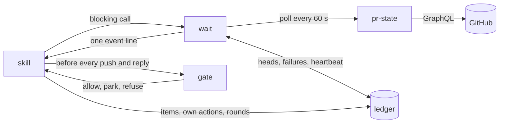

# babysit Design

## Problem

Waiting for a PR to change must not wake the LLM.

| Work | Owner |
|---|---|
| Watching | Scripts |
| Repair | LLM, woken only by a change |

## Architecture



| Layer | Does | Never does |
|---|---|---|
| `pr-state <owner/repo> <pr>` | Runs one paginated GraphQL query and prints normalized JSON with no truncation | Keeps state or judges |
| `wait <owner/repo> <pr> --max <min> --session <token>` | Polls `pr-state`, compares it with the ledger, and exits with one event line or `idle` | Repairs or marks items handled |
| skill | Runs the action for each event and records the outcome | Wakes on a timer |
| gate | Decides whether a push or reply may go out | Uses LLM judgment |

`pr-state` output covers these fields.

- PR state, draft flag, author, viewer login, and `isCrossRepository`
- Base ref, head ref, head SHA, and conflict state
- Latest run of each check with its run id and attempt
- Review threads, reviews, issue comments, and review requests
- Id, author, `authorAssociation`, and body hash of every comment

| Mode | Behavior |
|---|---|
| `check` | Reads GitHub and the ledger once and reports without writing anything |
| `watch` | Default. Loops on `wait` and reports each event without writing code |
| `drive` | Loops on `wait`, repairs, and pushes through the gate |

`wait` emits one event per exit. When several items are pending, the next call returns the next one at once.

## Ledger

Path is `$(git rev-parse --path-format=absolute --git-common-dir)/babysit/<owner>/<repo>/<pr>.json`. Separate directories keep names containing `-` from colliding. Every write goes to a temp file and is renamed into place.

| Field | Writer | Purpose | Reset at session start |
|---|---|---|---|
| `started_at`, `rounds` | skill | Limits | Yes |
| `repairs.<check key>` | skill | Repair pushes per check across heads | Yes |
| `replies.<thread id>` | skill | Agent replies per review thread | Yes |
| `replies.conversation` | skill | Agent replies to issue comments and review bodies, which share one top-level conversation | Yes |
| `api_failures` | `wait` | Consecutive API failures across re-arms | Yes |
| `lock` | skill, `wait` | Session token and heartbeat | Replaced |
| `heads.<sha>.first_seen` | `wait` | Start of the no-CI clock | No |
| `head.sha`, `head.gen` | `wait` | Last observed head and a counter raised on every observed head change | No |
| `own.pushes` | skill | SHA of each push, written before pushing | No |
| `own.replies` | skill | Body hash written before posting, then the comment id | No |
| `items.<key>` | skill | Disposition, re-run id and attempt, and handled body hash | No |

Lock rules follow.

- `wait` refreshes the heartbeat on every poll, and the skill refreshes it before each action and gate run.
- Another session refuses to start while the heartbeat is under 70 minutes old and takes over once it is older.
- `wait` and the gate exit 3 when the token is no longer theirs, and the skill then stops without touching the lock.
- Every other stop clears the lock.
- The skill rechecks the token right before `git push`, and the push is a plain fast-forward of the start SHA, so a former owner that pushes after a takeover lands only while the remote head still equals its start, which the new owner sees as a foreign head change.

| Item | Key | Raised again when |
|---|---|---|
| Comment, review body, or thread reply | `c:<node id>` | Its body hash differs from the stored one |
| Check | `k:<check key>@<head>#<gen>` | The head changes, including back to an earlier SHA |
| Conflict | `x:<head>#<gen>` | The head changes, including back to an earlier SHA |

Check and conflict keys carry `head.gen`, so a head that moves A to B and back to A gets fresh keys instead of reusing the dispositions from its first visit.

Comments are not keyed by head. Keying them by head would re-raise every handled comment after each of the agent's own pushes and loop.

## Events

The first matching row wins.

| # | Event | Fires when | check, watch | drive |
|---|---|---|---|---|
| 1 | `merged` | PR is merged | Stop and report | Stop and report |
| 2 | `closed` | PR is closed without merging | Stop and report | Stop and report |
| 3 | `ready` | READY holds | Stop and report | Stop and report |
| 4 | `limit` | 8 hours have passed, or 5 rounds are used and an item for rows 6, 9, or 10 is pending | Stop and report | Stop and report |
| 5 | `stalled` | Nothing is pending and a parked item is among the READY blockers | Stop and report | Stop and report |
| 6 | `conflict` | Head conflicts with the base | Report | Merge base |
| 7 | `check_stuck` | A check fails after 2 repair pushes for it | Report | Park |
| 8 | `check_failed` | A re-runnable check fails for the first time on this head | Report | Re-run once |
| 9 | `check_confirmed` | A run newer than the recorded re-run fails, or a check that cannot be re-run fails | Report | Repair |
| 10 | `comment` | A comment, review body, or thread reply is new or edited | Report | Triage |
| 11 | `idle` | `--max` expired | Re-arm `wait` | Re-arm `wait` |

| Drive action | Steps |
|---|---|
| Repair | Reset the worktree to the PR head, fix, verify locally, pass the gate, push, reply if a comment asked, record, and count one round and one repair for a check |
| Merge base | Reset the worktree to the PR head, merge the fetched base, fold any needed fix into that merge commit, verify locally, pass the gate, push, record, and count one round, or park when the conflict cannot be resolved |
| Triage | Confirm the claim against the code, then pick one outcome among Repair, reply only, and park, and park instead of replying once its thread already holds 2 agent replies, where every issue comment and review body belongs to the one `conversation` thread |
| Park | Record the item as parked, notify, and continue |

Event rules follow.

- Only GitHub Actions check runs can be re-run, so other checks go straight to `check_confirmed`.
- A `rerun` item is pending until a newer run finishes, and that run decides it without a ledger write, closing it on a pass and firing `check_confirmed` on a failure.
- Any other pending item has no disposition yet.
- In watch, reported, handled, and parked all count as dispositions.
- In drive, only handled and parked count, so drive still acts on items watch reported.
- Only drive parks items, so `stalled` fires only in drive.
- Every stop report lists all parked, reported, and unresolved items in every mode.
- A bot that rewrites one comment on each push costs one triage per push, bounded by the round limit.
- A bot that answers each reply is bounded by the 2-reply cap per thread, including a bot that answers with fresh top-level comments, since they all share the `conversation` thread.
- `wait` exits nonzero when the API keeps failing, and the skill then stops and reports.

### Never an event

- The agent's own pushes, found in `own.pushes`
- The agent's own replies, found in `own.replies` by comment id or pending body hash
- A check that is queued or pending, or moves from pending to pass
- An item already parked whose text is unchanged
- An item already reported, re-run, or handled under the same key
- A head change by itself, which only raises `head.gen` and so resets the check and conflict keys
- A requested reviewer who has not reviewed yet
- Converting the PR to draft, which only blocks READY while other events still fire
- An approval without a body

## READY

babysit owns this classification. Its bats suite edits one clean saved snapshot with one `jq` expression per case and reads it through a `--snapshot` input, so no test calls GitHub.

READY requires all of these.

- The PR is open, not a draft, and not conflicting.
- The latest run of every check on the head passes, unless the PR counts as having no CI.
- No latest review requests changes, no review request is pending, and `reviewDecision` is not `REVIEW_REQUIRED`.
- No review thread is unresolved.
- No item for rows 6 to 10 is pending.
- Every signal could be read.

What follows from these rules.

- A thread babysit answered blocks READY until a human resolves it, and that wait costs nothing.
- A reviewer who never started blocks READY, so silence is never read as zero feedback.
- `REVIEW_REQUIRED` with nobody requested cannot be lifted by babysit, so the session runs until the 8-hour limit.

## Gate

The gate runs before every push and every reply and prints one verdict with a reason. A verdict it cannot determine is `refuse`. `skills/babysit/scripts/gate.sh` implements it.

```
gate.sh push  <owner/repo> <pr> --session <token> --worktree <path> --start <sha> -- git push origin <sha>:refs/heads/<branch>
gate.sh reply <owner/repo> <pr> --session <token> --body-file <file|->
```

| Verdict | Exit | Meaning | Drive does |
|---|---|---|---|
| `allow` | 0 | Every allow condition holds | Push or post |
| `park` | 10 | A hard stop matched | Do not push, park, and notify |
| `refuse` | 11 | An allow condition failed or was unreadable | Do not push, and resync if the remote head moved |
| none | 2 | Usage error | Fix the call |
| none | 3 | The lock belongs to another session | Stop without touching the lock |

- Output is one JSON line. An allow for a push carries `head`, `branch`, and `start`, and a park carries `matches`, the category and path of each hard stop.
- Any exit but 0 means do not push or post. A gate that stops before a verdict prints `refuse`.
- `<sha>` is the `HEAD` the gate verified, so a commit made after the check cannot go out unchecked. A refusal names the command it expects.

Allow conditions follow, and the first that fails is the reason.

1. The viewer is the PR author.
2. `isCrossRepository` is false.
3. The PR is open.
4. The head branch is neither the repository's default branch nor protected, since a push there would reach the default branch without review.
5. `origin`, for fetching and pushing and after URL rewrite rules, resolves to the PR's repository.
6. The remote head equals the worktree's start SHA, and `HEAD` descends from it and adds a commit.
7. The push is exactly `git push origin <sha>:refs/heads/<branch>`: no force flag, no `+` refspec, no other target.
8. Git is not set to push more than that. `push.followTags` can send tags that start a release workflow, and `push.recurseSubmodules` sends submodule commits, so either one set to push makes the gate refuse.
9. No hard stop matches.

A plain push is a fast-forward by Git itself, and condition 6 keeps it one. A branch deleted between the check and the push is recreated, which is accepted, since the PR is already gone.

| Hard stop | Inspects |
|---|---|
| CI and execution config | Changed paths including deletions, such as `.github/**`, other CI configs, `Makefile`, `*.mk`, `Dockerfile`, hook configs like `prek.toml` and `.husky/**`, `.envrc`, and agent config such as `.claude/**` and `AGENTS.md` |
| Dependencies | Changed paths such as manifests, lockfiles, `go.mod`, `go.sum`, `.gitmodules`, and `vendor/**`, and any moved submodule pointer, even when `.gitmodules` says to ignore it |
| Secrets and outbound network | Added lines only, for key headers, known token prefixes, literals assigned to `*KEY`, `*TOKEN`, or `*SECRET`, new URLs, and network calls like `curl`, `wget`, `fetch`, and HTTP clients. Also files named like a secret, and commit messages |
| Test weakening | Deleted test files, a test file with fewer test declarations than before, and added lines that skip or focus tests or lower coverage thresholds |
| Unreadable | A binary change and a path with a control character, which the heuristics cannot read, so a person does |

The line heuristics lean toward parking, because a park costs a person a look and a miss costs a leak. They read every added line of every file, so a new link in a doc, a prose word like `ssh`, or a bare `fit(` in application code parks the push.

Diff range rules follow.

- An ordinary push is inspected commit by commit, each against its parents, because a secret that one commit adds and the next removes still lands in the remote history. Every git read must succeed, since a diff that failed to print would otherwise look empty.
- Git reads with replace refs off, rename detection off, and no submodule ignored, so the bytes inspected are the bytes pushed.
- A base merge is the one commit the base's history does not already hold, with `<start>` as its first parent and a commit of that history as its second. The gate fetches the base tip and accepts a second parent that is the tip or an ancestor of it, so a base that moved on after the merge does not refuse it.
- The gate recomputes the automatic merge with `git merge-tree --write-tree <start> <second parent>`.
- Conflicted paths and paths where `HEAD` differs from that result go through the hard stops as whole paths, including a path that now equals `<start>` again.
- Base changes therefore never park a fix, and a resolution that drops a base change is still inspected.
- A base merge followed by another commit is no base merge, and the whole range is inspected.
- A reply is checked against allow conditions 1 to 3, and its body against the secrets heuristic and for images, whose address GitHub fetches and so can carry data out.

## Decisions

| Topic | Decision |
|---|---|
| Autonomous push | Drive only, for CI failures, review feedback, and conflicts, always a gated plain fast-forward of the start SHA, never a force push or merge |
| Eligible PRs | Drive takes PRs the viewer authored from a branch in the same repository, and check and watch take any readable PR |
| Comment input | Comments from anyone are accepted and checked against the code before acting |
| Accepted risk | On a public repository a third party can steer a fix outside every hard stop, and its local verification runs on the user's machine |
| Threads | Reply, never resolve |
| Park and continue | A parked item waits for a human while the rest continue, returns only when its text changes, and ends the session through `stalled` once only parked blockers remain |
| Worktree | Drive uses a detached HEAD worktree at `$(git-common-dir)/babysit/wt/<owner>/<repo>/<pr>`, never touches the user's checkout, and stages only changed files instead of `git add -A` |
| Conflicts | Merge the base branch, never rebase, since force push is forbidden |
| No CI | A head with no check within 10 minutes of `first_seen` counts as having no CI, and READY uses review state alone |
| Notifications | Run `osascript` on park when it is available, and skip silently otherwise |
| Limits | 5 rounds with one round per push, or 8 hours from `started_at`, and `wait` shortens `--max` to hit the 8-hour mark |
| Flaky checks | Re-run once on the first failure, and park after 2 failed repair pushes |
| API failure | Back off from 30 seconds up to 8 minutes within the `--max` deadline, exit 1 at 5 consecutive failures, exit 2 on usage errors, and exit 3 on a lost lock |
| Concurrency | One session per PR through the lock |
| Session | Operating rule is to run babysit in a dedicated session, because a background exit injects a turn into the session that started it |
| Idle cost | Each wait is bounded, so an unchanged PR costs one turn per `--max` instead of zero |
| Reply scan | Replies pass the gate's secrets heuristic |

## Waiting adapters

Every harness keeps one contract. One call blocks until `wait` exits, and each exit costs exactly one turn.

| Harness | Mechanism | `--max` | Idle cost | Measured evidence |
|---|---|---|---|---|
| Claude Code | Bash with `run_in_background: true`, then end the turn without polling | 25 min | 1 turn per 25 min | [A background exit started a turn about 1 second later with 0 idle turns](https://github.com/maro114510/skills/issues/306#issuecomment-6331950722), and [runs over 30 minutes were not measured](https://github.com/maro114510/skills/issues/306#issuecomment-6331972320) |
| OpenCode | Foreground Bash with `timeout` set to `--max` plus 5 minutes | 55 min | 1 turn per 55 min | [A 60-minute command under a 65-minute timeout returned exit 0 with 0 idle turns](https://github.com/maro114510/skills/issues/306#issuecomment-6331950357) |
| Others | Not measured, so only `check` is supported | — | — | — |

Monitor is rejected because [it stops at 30 minutes, kills the watched command, and costs one turn per stdout line](https://github.com/maro114510/skills/issues/306#issuecomment-6331950722).
