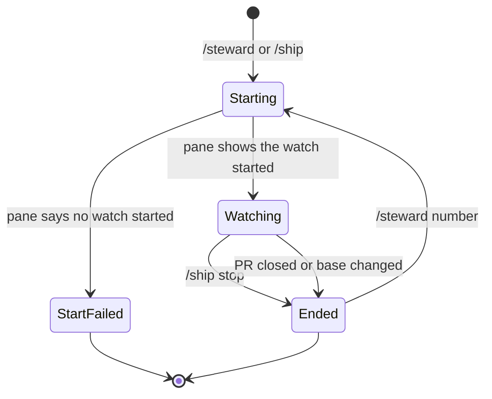
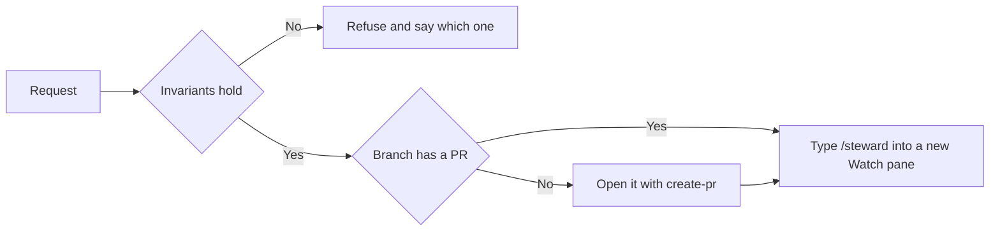

# Claude Watch

## Overview

A person working in OpenCode or DeepSeek Harness hands one pull request to the official Claude Code watch, started by `/steward` or `/ship`, and can check or stop it. Those commands start only from a line typed into an interactive Claude Code session, so the `claude-watch` skill types them into a Claude Code pane through Herdr.

The watch does the repair work: failing checks, review comments, and base conflicts. The skill holds only the launch, the state read, the stop, and the guards below. Claude Code owns the watch's behavior and limits, and they may change with any release.

| Responsible for | Not responsible for |
|---|---|
| Starting, reading, and stopping one watch per pull request | Repair logic, polling, and push or merge caps, which the watch owns |
| Keeping the watch inside the limits Claude Code sets | Per-repository watch rules, which live in the target repository's `.claude/skills/steward/SKILL.md` |
| Opening the pull request with `create-pr` when none exists | Merging or approving, which stay with a person, so the skill refuses a pull request with auto-merge on |

## Domain Model

| Concept | Definition |
|---|---|
| Watch | The official Claude Code loop on one pull request, started by `/steward` or `/ship` |
| Watch pane | A Herdr pane running Claude Code for one Watch, in its own clone or worktree |
| Launch line | One of `/steward [<number>]`, `/ship [<args>]`, or `/ship stop`, the only text the skill types into a Watch pane |
| End line | The `Stopped watching pull request` line the pane shows when a Watch ends |

## Scenarios

### Starting a watch

A person asks the skill to watch a branch's pull request.

The skill types `/ship` instead only when the person asks for it, because `/ship` writes the pull request in English and ignores the repository's template.

The skill reports Watching only after the pane shows that the watch started. When the pane says no watch started, with a line such as `Nothing started` or `/steward didn't start.`, the skill reports Start failed with that line. A pull request that carries a PR Steward label is one such case.

### Reading and stopping

The skill reports state from `herdr agent read` on the Watch pane and from `gh pr view`. A stop types `/ship stop` and reports the End line.

## Invariants

- The skill starts only on the person's explicit request.
- The skill types nothing into a Watch pane but a Launch line. A typed message lifts the Watch's merge guards for that turn.
- The pull request has auto-merge off, because a push from the Watch can let the host merge it.
- The person trusts everyone who can merge to the base branch or push to the pull request branch, because the Watch runs their code with the person's credentials. The skill cannot check this, so it asks the person to confirm it before each launch.
- A Watch pane runs in its own clone or worktree, so the person's checkout and branch are never switched.
- Claude Code in a Watch pane is 2.1.330 or later, runs in auto mode, never in `bypassPermissions`, and has no permission rule or hook that `/ship terms` reports as a way around its limits.
- The skill refuses a request that breaks an invariant above, and says which one.
- The skill's name is never `ship`, `ship-local`, or `steward`, which Claude Code reserves.

## References

- The `herdr` skill for the Herdr CLI
