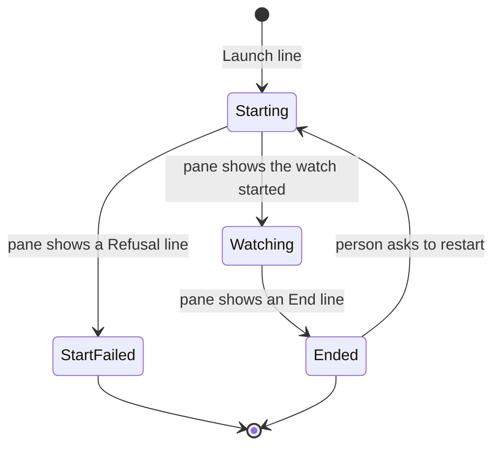
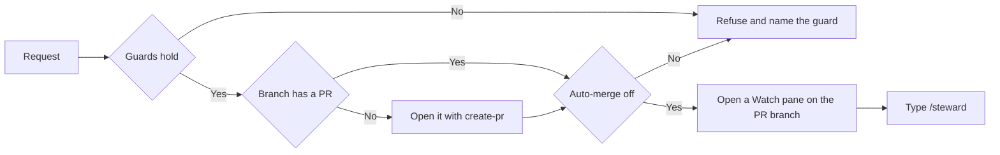

# Claude Watch

## Overview

A person working in OpenCode or DeepSeek Harness inside Herdr hands one GitHub pull request to the official Claude Code watch, started by `/steward` or `/ship`, and can check or stop it. Those commands start only from a line typed into an interactive Claude Code session, so the `claude-watch` skill types them into a Claude Code pane through Herdr.

The watch does the repair work: failing checks, review comments, and base conflicts. The skill holds only the launch, the state read, the stop, and the guards below. Claude Code owns the watch's behavior, the conditions under which it starts, and its limits, and they may change with any release. The skill therefore copies none of them: it relays what Claude Code says, and adds before a launch only the guards in the invariants below. When a guard and getting a watch started conflict, the guard wins.

| Responsible for | Not responsible for |
|---|---|
| Starting, reading, and stopping one watch per pull request | Repair logic, polling, and push or merge caps, which the watch owns |
| Refusing a launch that breaks a guard | Start conditions that Claude Code enforces itself, such as the pull request being the person's own, which the skill reports as Claude Code states them |
| Opening the pull request with `create-pr` when none exists | Merging or approving, which neither the skill nor the watch requests, and per-repository watch rules, which live in the target repository's `.claude/skills/steward/SKILL.md` |

## Domain Model

| Concept | Definition |
|---|---|
| Watch | The official Claude Code loop on one pull request, started by `/steward` or `/ship` |
| Watch pane | A Herdr pane running Claude Code for one Watch, in a clone or worktree of its own that has the pull request's branch checked out |
| Launch line | One of `/steward [<args>]`, `/ship [<args>]`, or `/ship stop`, the only text the skill types into a Watch pane |
| Refusal line | A line that says no watch started, such as one that starts `Nothing started` or contains `/steward didn't start.` |
| End line | A line that starts `Stopped watching`, which the pane shows when a Watch ends, with the reason |

A Watch ends for many reasons, such as `/ship stop`, a merged or closed pull request, or seven days passing. The End line is the only signal the skill relies on, so it does not track those reasons itself.

## Scenarios

### Starting a watch

A person asks the skill to watch a branch's pull request.

The skill checks auto-merge only once the pull request exists, so a pull request that `create-pr` just opened is checked too.

`/steward` starts only with the pull request's branch checked out, so the Watch pane checks out that branch as pushed. Git lets one clone check out a branch in only one worktree, so the pane uses a separate clone when the person's checkout is on that branch.

The skill types `/ship` in place of `/steward` only when the person asks for it, which adds Claude Code's review before the watch. A missing pull request is still opened with `create-pr`, because `/ship` writes it in English and ignores the repository's template.

The skill reports Watching only after the pane shows that the watch started. Claude Code documents no line for a start, so which pane output counts as a start is left to the implementation, but the absence of a Refusal line never counts as one. On a Refusal line, it reports Start failed with that line as Claude Code wrote it. When the pane waits at a prompt or dialog, the skill reports it and leaves the answer to the person.

### Reading and stopping

The skill reports state from `herdr agent read` on the Watch pane and from `gh pr view`, and reports the End line when one appears.

A stop types `/ship stop`. When Claude is working at that moment, the Watch ends only after the current turn, and what that turn pushes or posts still reaches the pull request, so the skill says so and keeps reporting the Watch as running until the End line appears. Pressing `Esc` to cut the turn short stays with the person.

## Invariants

- The skill starts or restarts a Watch only on the person's explicit request.
- The skill runs only inside a Herdr session, and only for a pull request on GitHub, because it drives the pane through Herdr and opens and reads the pull request with `create-pr` and `gh`.
- The skill types nothing into a Watch pane but a Launch line, and answers no prompt or dialog there. A typed message lifts the Watch's merge guards for that turn.
- The pull request has auto-merge off at launch, because a push from the Watch can let the host merge it.
- The person trusts everyone who can merge to the base branch or push to the pull request branch, because the Watch runs their code with the person's credentials. The skill cannot check this, so it asks the person to confirm it before each launch.
- A Watch pane runs in its own clone or worktree, so the person's checkout and branch are never switched.
- Claude Code in a Watch pane is 2.1.330 or later, runs in auto mode, never in `bypassPermissions`, and has no permission rule or hook that `/ship terms` reports as a way around its limits.
- The skill refuses a request that breaks an invariant above, and says which one.
- The skill's name is never `ship`, `ship-local`, or `steward`, which Claude Code reserves.

## Accepted Risks

- Claude Code documents that `/ship` and `/steward` do not start from a program. Typing them through Herdr started a watch on Claude Code 2.1.330 in a manual check, but no source guarantees it, so a release can stop it. The skill then reports Start failed with Claude Code's Refusal line.
- A program from the branch, such as a test, can merge or force-push with the person's credentials, because Claude Code checks only the command that starts it. Only the repository's branch rules prevent that.
- The person's checkout does not receive the Watch's pushes, so a commit made there needs a pull before it can be pushed.
- The skill reads no authoritative running state, because `/tasks` is not a Launch line. A Watch that ends without an End line, such as when Claude Code exits, shows only as the pane no longer running Claude Code.

## References

- The `herdr` skill for the Herdr CLI
- [Get a pull request ready with /ship and /steward](https://code.claude.com/docs/en/ship-command) for the watch's behavior, limits, and what can still lead to a merge
- [Troubleshoot /ship and /steward](https://code.claude.com/docs/en/ship-command-troubleshooting) for the Refusal lines and End lines
