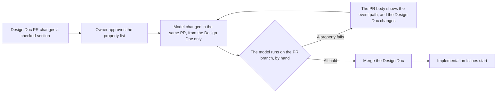

# Design Verification

## Intent

A design change to orchestrate-epic is checked by a model before any code implements it, so a defect in the design is found by a machine instead of by a careful reader or a run. The person who owns the design decides what must hold; the model only says whether the design written in `orchestrate-epic.md` makes it hold.

| Responsible for | Not responsible for |
|---|---|
| Whether the next-action table, the working marker, holds, answers, re-run requests, verdicts, and draft state of `orchestrate-epic.md` keep the properties below | Whether the properties are the right requirements, which the owner decides |
| Keeping the model and the Design Doc it checks in step | Whether `oe-ready.jq` implements the design |
| A counterexample a reviewer can read | An Issue's acceptance criteria, which CI and pr-verify observe by running |
| | Turning GitHub's response into facts, several Issues at once, two sessions, and concurrent edits of one Issue body |
| | A write to the draft state that fails, anything between oe verdict's head read, its status, and its mark ready, and a clone that opts out of the draft state |

When finding a defect conflicts with keeping the model small, finding the defect wins only for a defect of the kinds listed under Scope.

## Scope

The model holds one Issue. It keeps what the three known defects and the draft state's properties needed and nothing else:

| Kept | Because |
|---|---|
| A distinct identity for each agent start, and results that carry the start that produced them | A late verdict counted for a newer Verifier start |
| The order of events, with "newer than" read from that order and never from a flag set since a start | A re-run request stalled because an older working marker decided first |
| An answer that asks for no code change | An answer that changes no code led to a dead end |
| A clock that can differ between the host that writes a marker and GitHub | The marker's start time comes from the host, and the 2-minute grace after an end is about the size of a skew |
| Whether the PR is ready for review, whether the person made its latest conversion to a draft, and a success that verified nothing | The draft state's properties read them. The person's only draft action is converting the PR to a draft to hold it |

An agent may outlive its marker and write a result after a later start, so the model lets any ended or outlived start emit its result. At most 2 starts can still write at once; a later start drops the oldest, which then writes nothing, and the build prints this bound. A check can fail whatever the person's view, but only on the first commit an Owner pushes after a repair starts, and a person rerunning a failed check is not modeled.

## Properties

Each property names the Design Doc text it comes from. The owner approves the list, in their own language, before a model checks it, and approves each change to it.

| Property | Statement | From `orchestrate-epic.md` |
|---|---|---|
| No double start | No agent starts while the working marker is live | Invariants |
| A result belongs to its start | A push, a question, or a verdict gives a result, or ends a marker, only for the start that produced it | Working marker |
| A person's input takes effect | After an answer or a re-run request, the next read starts the agent it asks for, unless a fact newer than the input, or a fact about the Issue, its dependencies, the PR's state, or CI, decides first | Hold, Re-run request |
| No dead end | For each view the person can keep, every state of an open Issue reached without the person deleting the branch or closing anything has some sequence of agent results and CI results, with the person replying only as that view says and merging only a PR that oe marked ready for review, that ends in such a merge. A person who sees a defect in the code answers that it must change. A person who sees none asks for a re-run where the Issue accepts one, and otherwise answers that no code changes, after which the Owner pushes nothing. A state after the person closed a PR, deleted a branch, or converted the PR to a draft is the person's own decision and is not checked | Purpose, Source of Truth |
| Starts are bounded | Between two inputs from the person, the number of agent starts is bounded | Repair signals, row 8 |
| Ready only when judged | oe marks a PR ready for review only on a head with a success verdict that verified something | Draft state |
| Not ready while repaired | From the start of an Owner until the next Verifier start, the PR is not ready for review by oe | Draft state |
| The person's draft holds | A PR whose latest conversion to a draft the person made is never marked ready by oe | Draft state |

A property is kept only with a change to the model that makes it fail, so a property that can never fail is not mistaken for one that holds. Each such change, and each known defect listed under Scope, is a switch in the model that restores it, and the build fails unless every switch breaks the property it names and every property has a switch. A property or a check weakened until it passes therefore fails the build, so the person states what must hold and the check, not a review, catches a regression.

## The Model

| Decision | Reason |
|---|---|
| Lean 4 without Mathlib, with a pinned toolchain | Its types reject a malformed model, and a rule of one table row can be proved over every state, not only the reachable ones |
| Written from `orchestrate-epic.md` alone, never from `oe-ready.jq`, and every rule cites the Design Doc text it encodes | A model copied from the code agrees with the code on every defect the two share |
| A term the Design Doc leaves undefined, such as which of two equal times is newer, is decided in the model and written back into the Design Doc in the same pull request | The model is where the ambiguity surfaces |
| Every property fails the build when it does not hold, and prints the shortest event path to the state that breaks it | A report that only prints passes CI |
| Every property is checked by an exhaustive search over reachable states that the build runs as compiled code; a proof is optional | Trusting the compiler is far less of a risk than a model that misreads the design |
| It lives under `formal/orchestrate-epic/`, outside `skills/` | A plugin install ships nothing of it |

## Operation

| Rule | Detail |
|---|---|
| Checked sections | Every section of `orchestrate-epic.md` that a property cites: Purpose, Invariants, and Source of Truth |
| When CI runs the model | On a push to `main` that changes `orchestrate-epic.md`, this document, or `formal/`, because a change here can redefine a property without touching the model, and on demand for a pull request branch. It is not a required check and does not run on every pull request, so a defect it finds after the merge is repaired by a new pull request |
| A Design Doc change that leaves the model alone | The model records a hash of the checked sections and of this document's Properties table, and CI fails when the hash differs, so a property weakened here does not pass on the old model. Updating it is a reviewed edit that says the model still matches |
| Order | A child Issue that changes the next-action table starts only after the Design Doc change that defines it has merged with its model |
| Who writes the model | The agent that writes the Design Doc change. An implementation agent never edits the model to make its code pass |
| A defect the model finds | The pull request body quotes the event path and names the Design Doc change that removes it. The defect becomes a switch in the model, and the Issue that implements the fix replays the path as a test of the code |
| The toolchain | Changed only on purpose, in its own pull request |
| Checking the code against the model | Not yet. Once `oe-ready.jq` implements the current table, the model prints its decision for every reachable state and a bats test compares `next_action` with it |
| Removing the model | When three changes in a row to the checked sections find no counterexample, while a reader or a run still finds a defect there, the model is removed through a Discussion |

## Accepted Risks

- The model checks the properties it is given. A wrong or missing property passes, and only the owner's review of the list catches it
- The model is a translation of prose. A misreading in that translation passes unless a cited line shows it to a reviewer
- Until the code is checked against the model, `oe-ready.jq` can drift from a design the model has checked
- A hash change can be accepted without a real look at the model

## References

- `orchestrate-epic.md` for the design the model checks
- `development-pipeline.md` for where a Design Doc change sits before an Epic
