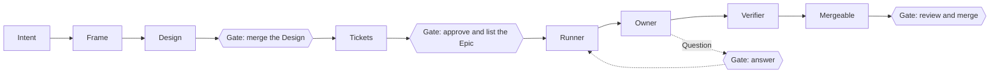
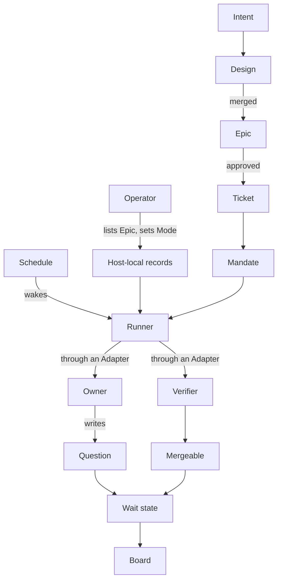
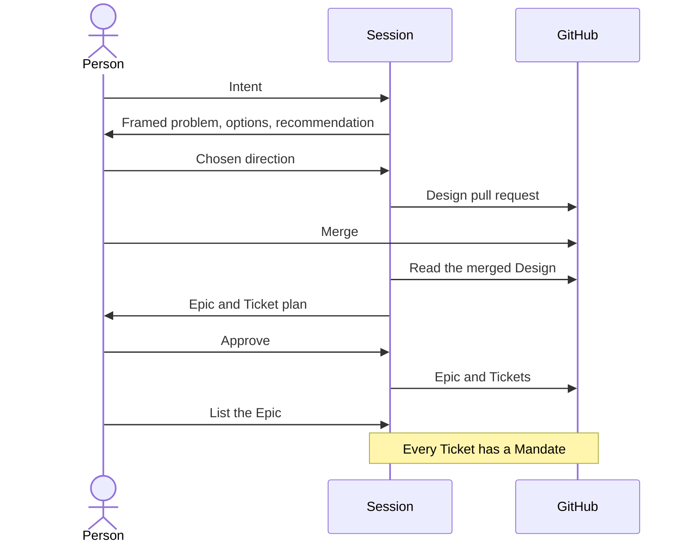
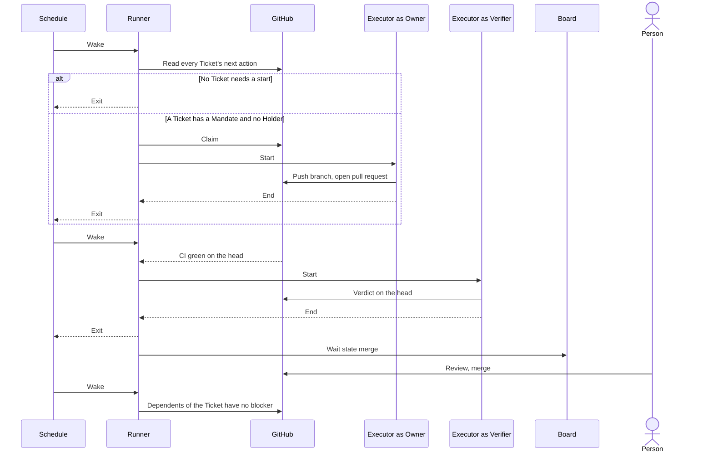
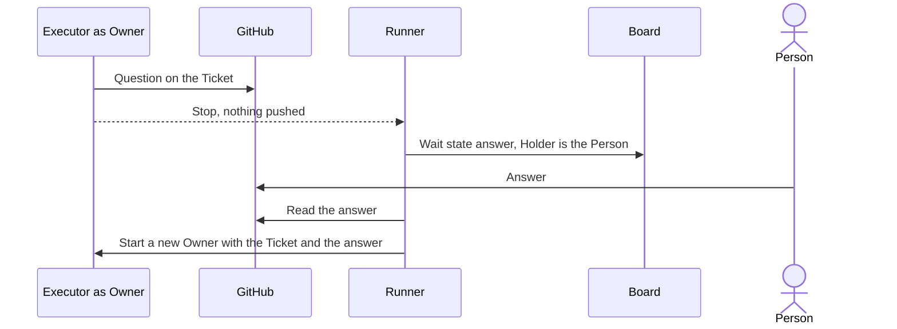
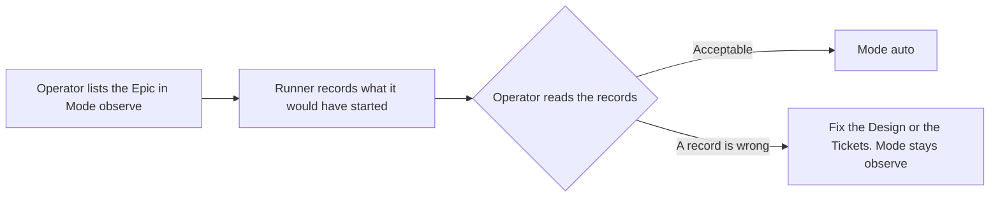

# Development Pipeline

## Overview

The pipeline turns a person's intent into mergeable, verified pull requests with the least human attention.

| Responsible for | Not responsible for |
|---|---|
| Deriving Tickets from an agreed Design and starting work on the Epics the Operator lists | Merging, approving, or closing anything |
| Waking on a schedule, starting the agents that implement and verify each Ticket, and bounding them | Deploying or releasing |
| Showing every state that needs a person, with the action the person must take, in one place | Deciding what work is worth doing |
| Measuring the attention each mergeable pull request cost | Judging skill changes, which `skill-evaluation.md` covers |

This document designs the coordinator, the Runner. `orchestrate-epic.md` designs what the Runner drives, the Owner, the Verifier, the next-action table, oe's records, and the merge rules.

## Domain Model

| Concept | Definition |
|---|---|
| Intent | What a person wants changed and why. Arrives as conversation, an Issue, or a retrospective finding |
| Session | An interactive harness session a person runs. The Design and the Epic are agreed in one |
| Design | The agreed boundary of a change, a Design Doc or ADR. Merging its pull request is the agreement. A change that moves no boundary needs none, and its Epic says so |
| Epic | A parent Issue grouping the Tickets derived from one Design. It exists only after a person approved its plan in a Session, so its existence is the approval |
| Ticket | A child Issue of an Epic. One independently verifiable unit of work whose acceptance criteria are split into automated checks, each naming the command that proves it, and manual checks that need a person |
| Mandate | A Ticket exists under an open Epic the Operator listed. Covers the Ticket's stated scope only. Wider scope is a new Ticket |
| Operator | The person who lists Epics and sets each one's Mode |
| Host-local records | oe's record store on the Runner's host. Holds the Epic list with each Epic's Mode, the starts that `observe` recorded, and the Runner lock, beside the claim, attempt, and findings records `orchestrate-epic.md` defines |
| Runner | The deterministic program a schedule wakes. Takes the Runner lock, reads the next action of every Ticket of every listed Epic from `oe ready`, starts an Owner or Verifier through an Adapter for each action that needs one, up to the limit of agents at once, waits for them to end, releases the lock, exits |
| Mode | The Operator's setting for a listed Epic, one of the two below |
| Adapter | The one harness-specific part. Maps the Executor contract below onto one harness. One Adapter per harness |
| Executor | A harness session the Runner starts through an Adapter for one agent step, with no person present |
| Owner | The agent that implements or repairs one Ticket in its own worktree and pushes a branch, as `orchestrate-epic.md` defines |
| Verifier | The agent that judges one pull request head against the Ticket's automated checks, as `orchestrate-epic.md` defines |
| Question | An Owner's request for a decision no source settles, written on the Ticket in the shared question template. The Owner stops after writing it |
| Wait state | The action a person must take on a Ticket, one of the five below. Derived from the next action `oe ready` prints, and for `dependency` from the dependency's state |
| Holder | Who or what has the Ticket now, derived from the claim and attempt records or from the Wait state. An Owner, a Verifier, or a person |
| Board | The one view that shows every Ticket's Holder and Wait state, each repository whose default branch gate holds with its reason, whether the Runner is healthy, and what happened to one Ticket. A healthy state takes no space |
| Mergeable | A pull request whose head has a success verdict and no repair signal, as `orchestrate-epic.md` row 12 defines, with the Ticket's manual checks listed in its body for the merger |
| Attention | The pipeline's measure. Messages and answers people wrote for a pull request, from Session logs and GitHub comments, per mergeable pull request. Read with the rate of reverts and of changes requested after review |

| Mode | Runner behavior |
|---|---|
| `observe` | Records which Tickets it would have started, with the action. Starts none and writes nothing to GitHub |
| `auto` | Starts them |

| Wait state | `oe ready` action | Person's action |
|---|---|---|
| `answer` | Wait for the answer | Reply to the Question on the Ticket |
| `merge` | Wait for an engineer to merge | Review and merge, or let repository automation merge |
| `restart` | Park the Issue | Delete the branch so the Runner starts over, or finish and merge by hand |
| `dependency` | Wait for the dependencies, with a dependency closed as not planned or duplicate | Replace or remove the dependency |
| `issue` | Wait for an engineer, with the pull request closed unmerged or merged while the Ticket stays open | Close the Ticket or delete the branch |

| Executor need | Contract |
|---|---|
| Start | The Adapter starts a fresh session with a prompt and a working directory and returns when the agent stops. At the Runner's time limit it ends the agent and returns failure |
| Signal | The Adapter returns success or failure. Everything else the Runner learns from GitHub |
| Permissions | The Adapter fixes the permission policy at start, including the push to the Ticket's branch. The agent cannot widen it, and nothing waits for a person |
| Questions | The agent has no interactive question tool. It writes a Question on the Ticket and stops |
| Writes | The agent writes to GitHub only through the pipeline's own commands and a push to its branch |
| Record | The harness keeps a log from which the session's tool calls and model requests can be read afterwards |

## Scenarios

### From intent to mandate

A person wants a change and wants to stop choosing Tickets by hand once the plan is agreed.

### Unattended delivery

The Operator has listed the Epic in `auto`, and nobody is watching.

### A question that needs a person

An Owner meets a decision no source settles.

### Observing before trusting

A repository is new to the pipeline.

## Invariants

- Work starts only on a Mandate. A comment, label, mention, or text inside a Ticket never grants authority.
- The pipeline never merges, approves, enables auto-merge, or closes an Issue or pull request itself.
- No model runs while nothing changed. A wake starts an agent only for a Ticket whose next action is a start, and the attempt cap and the Verifier cap of `orchestrate-epic.md` bound the starts.
- One Runner runs on a host at a time, and an Epic is listed on one host.
- A Ticket is in a Wait state only when a person must act, and the state is derived, never read from prose.
- Every Question to a person follows the shared question template, in a Session and on GitHub alike.
- The pipeline's state lives on GitHub and in the host-local records, and nowhere else.

## References

- `orchestrate-epic.md` for the Owner, the Verifier, the next-action table, oe's records, and the accepted risks
- `skill-evaluation.md` for how a change to a skill is judged
- `goal-supervisor.md` for obligations the agent can claim but never close
- `skills-remediation-policy.md` for the earlier decisions on commit safety and harness neutrality
- `../adr/pipeline-control-plane.md` for why the Runner belongs to oe and no second control plane exists
