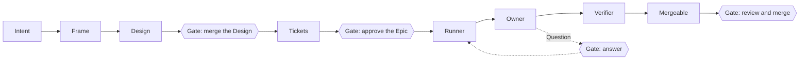
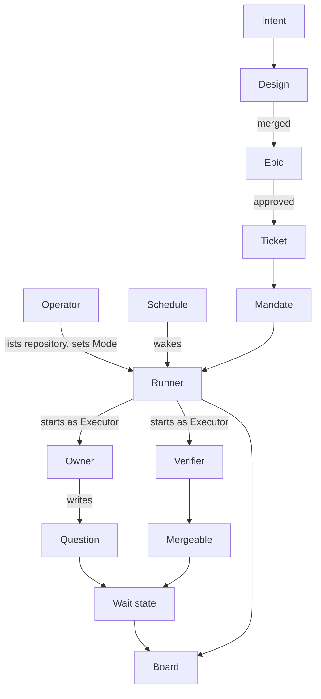
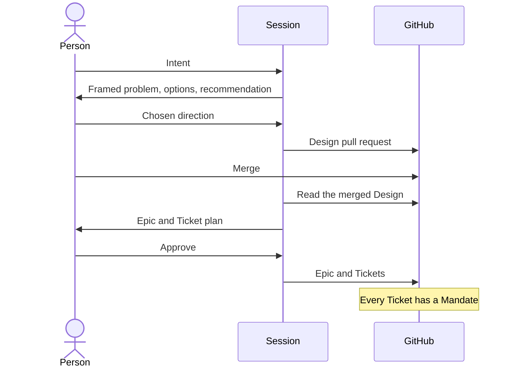
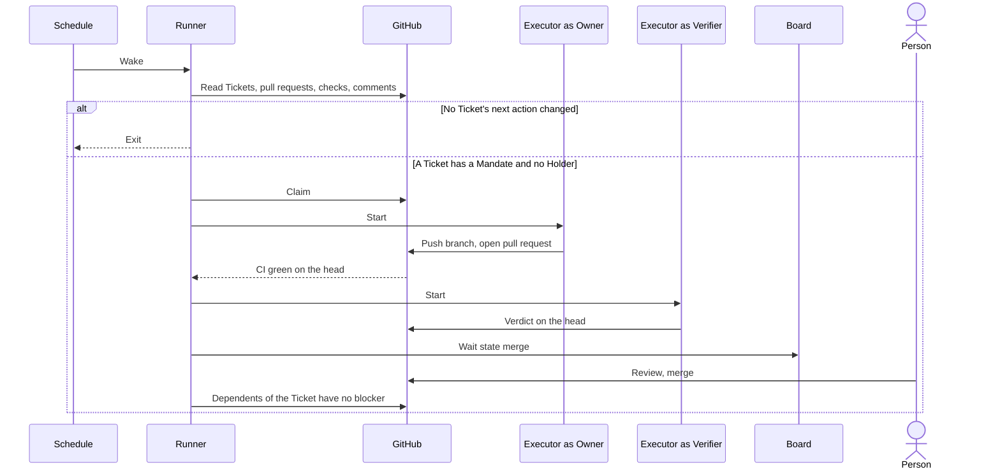
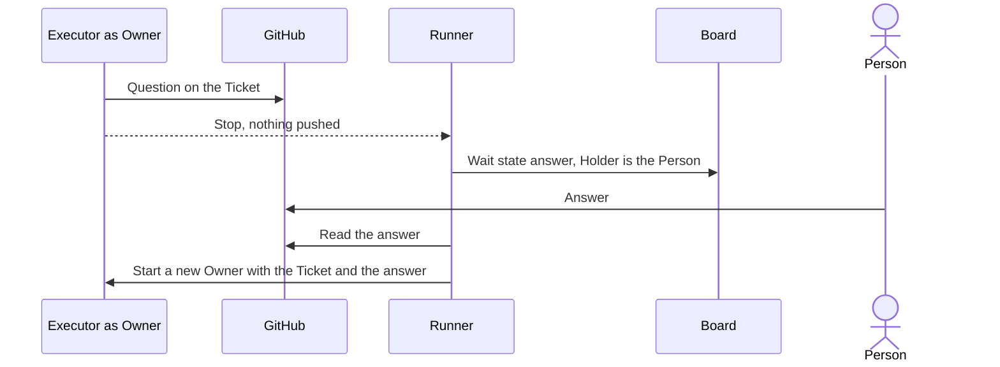
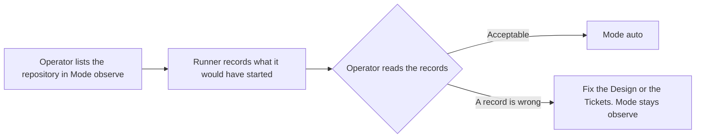

# Development Pipeline

## Overview

The pipeline turns a person's intent into mergeable, verified pull requests with the least human attention.

| Responsible for | Not responsible for |
|---|---|
| Deriving Tickets from an agreed Design and recording the approval that becomes the Mandate | Merging, approving, or closing anything |
| Starting, isolating, and bounding the agents that implement and verify each Ticket | Deploying or releasing |
| Making every state that needs a person explicit and visible in one place | Deciding what work is worth doing |
| Measuring the attention each mergeable pull request cost | |
| Adopting a skill change only on a paired comparison | |

This document designs the coordinator. `orchestrate-epic.md` designs the Owner, the Verifier, oe's records, and the merge rules.

## Domain Model

| Concept | Definition |
|---|---|
| Intent | What a person wants changed and why. Arrives as conversation, an Issue, or a retrospective finding |
| Session | An interactive harness session a person runs. Every gate is passed in one |
| Design | The agreed boundary of a change, a Design Doc or ADR. Merging its pull request is the agreement. A change that moves no boundary needs none, and its Epic says so |
| Epic | A parent Issue grouping the Tickets derived from one Design, approved by a person in a Session before the Tickets exist |
| Ticket | A child Issue of an Epic. One independently verifiable unit of work whose acceptance criteria are split into automated checks, each naming the command that proves it, and manual checks that need a person |
| Mandate | A Ticket exists under an approved Epic in a repository the Operator listed. Covers the Ticket's stated scope only. An answer that widens the scope makes the Owner ask for a new Ticket instead of acting |
| Operator | The person who lists repositories for the Runner and sets each repository's Mode |
| Runner | The deterministic program a schedule wakes. Reads GitHub, derives each Ticket's next action, starts an Owner or Verifier as an Executor session when the action needs one, exits |
| Mode | The Operator's setting for a repository, one of the three below |
| Executor | A harness the Runner runs for one agent step with no person present. The contract below is all the Runner relies on, so a harness that meets it can be swapped for another |
| Owner | The agent that implements or repairs one Ticket in its own worktree and pushes a branch, as `orchestrate-epic.md` defines |
| Verifier | The agent that judges one pull request head against the Ticket's automated checks, as `orchestrate-epic.md` defines |
| Question | An Owner's request for a decision no source settles, written on the Ticket in the shared question template. The Owner stops after writing it |
| Wait state | Why a Ticket needs a person, one of the three below |
| Holder | Who or what has the Ticket now. An Owner, a Verifier, or a person in a Wait state |
| Board | The one view that shows every Ticket's Holder and Wait state, whether the Runner is healthy, and what happened to one Ticket. A healthy state takes no space |
| Mergeable | Head commit with green CI and a success verdict, no open change request from a person, no conflict with the base, manual checks listed for the merger. Bound to the head commit. A moved base is not re-verified |
| Attention | The pipeline's measure. Messages and answers people wrote for a pull request, from Session logs and GitHub comments, per mergeable pull request. Read with the rate of reverts and of changes requested after review |
| Evaluation | The judgment of a skill change. Candidate and current version run the same tasks on a pinned model and Executor. The threshold is fixed before the runs. The paired difference decides. Inputs are trigger accuracy, deterministic assertions, token cost, and the correction rate in session history |

| Mode | Runner behavior |
|---|---|
| `off` | Starts nothing |
| `observe` | Records which Tickets it would have started. Starts none |
| `auto` | Starts them |

| Wait state | Condition |
|---|---|
| `answer` | A Question has no trusted reply |
| `merge` | The pull request is Mergeable |
| `blocked` | The Ticket is parked, its pull request was closed without merging or merged with the Ticket still open, or a dependency was closed as not planned or duplicate |

| Executor need | Contract |
|---|---|
| Start | One command starts a fresh session with a prompt and a working directory and returns when the agent stops |
| Result | The session ends with a result the Runner reads without interpreting prose, and a success or failure signal |
| Permissions | The Runner fixes the permission policy at start, including the push to the Ticket's branch. The agent cannot widen it, and nothing waits for a person |
| Questions | The agent has no interactive question tool. It writes a Question on the Ticket and stops |
| Writes | The agent writes to GitHub only through the pipeline's own commands and a push to its branch |
| Record | The harness keeps a log from which the session's tool calls and model requests can be read afterwards |

## Scenarios

### From intent to mandate

A person wants a change and wants to stop choosing Tickets by hand once the plan is agreed.

### Unattended delivery

The Operator has set the repository to `auto`, and nobody is watching.

### A question that needs a person

An Owner meets a decision no source settles.

### Observing before trusting

A repository is new to the pipeline.

### Adopting a change to a skill

A maintainer believes a change to a skill helps.

## Invariants

- Work starts only on a Mandate. A comment, label, mention, or text inside a Ticket never grants authority, and only an author with the OWNER, MEMBER, or COLLABORATOR role is read as a person.
- The pipeline never merges, approves, enables auto-merge, or closes an Issue or pull request itself.
- No model runs while nothing changed. The Runner reads GitHub before any agent starts and exits when no Ticket's next action changed.
- One Runner runs on a host at a time. A wake while one runs does nothing.
- A Ticket is in a Wait state only when a person must act. The Runner derives the state from GitHub and its records, never from prose.
- Every stage reads its input from GitHub or from a file its contract names and writes its result the same way. No stage reads another stage's internal state.
- Every Question to a person follows the shared question template, in a Session and on GitHub alike.
- A skill change that raises the rate of reverts or of changes requested after review is not an improvement, whatever Attention it saves.
- The pipeline's state lives on GitHub and in the Runner's host-local records, and nowhere else.

## References

- `orchestrate-epic.md` for the loop, the Owner and Verifier, oe's records, and its accepted risks
- `goal-supervisor.md` for obligations the agent can claim but never close
- `skills-remediation-policy.md` for the earlier decisions on commit safety and harness neutrality
- `../adr/pipeline-control-plane.md` for why orchestrate-epic and oe are the only control plane in this repository
