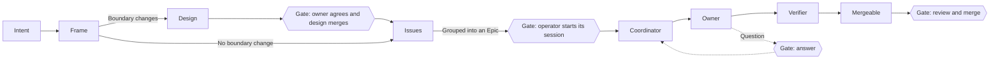
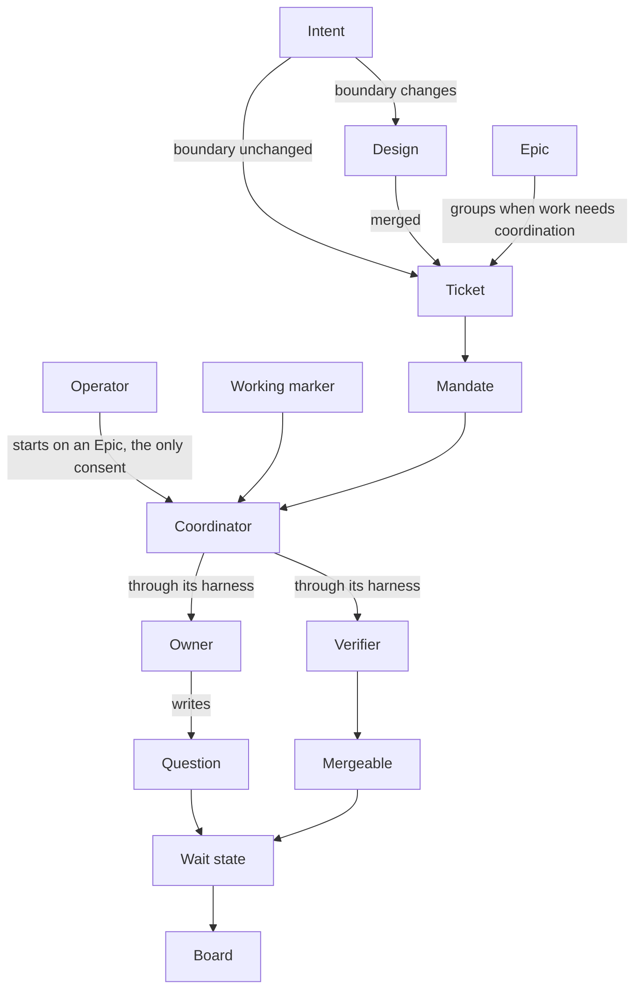
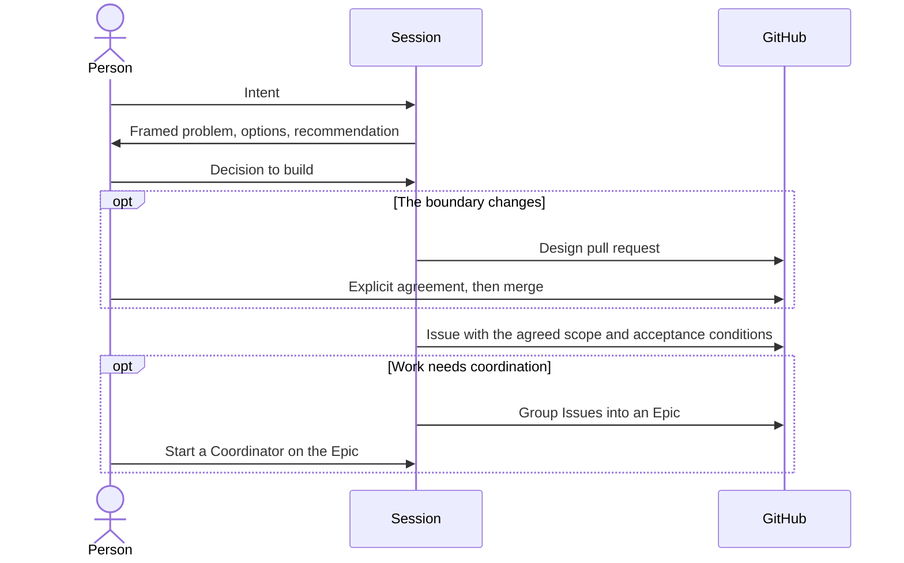
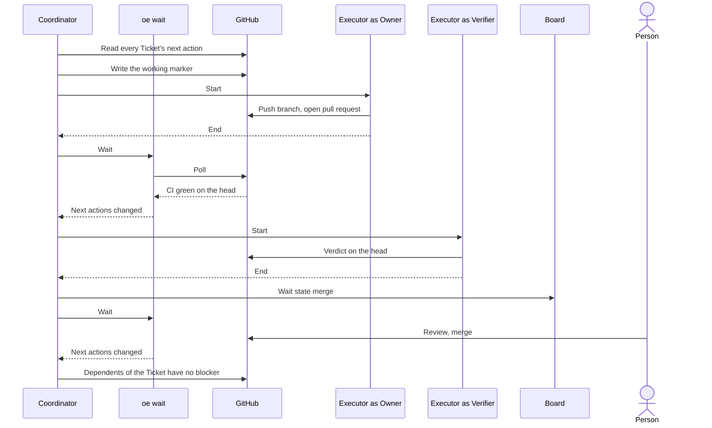
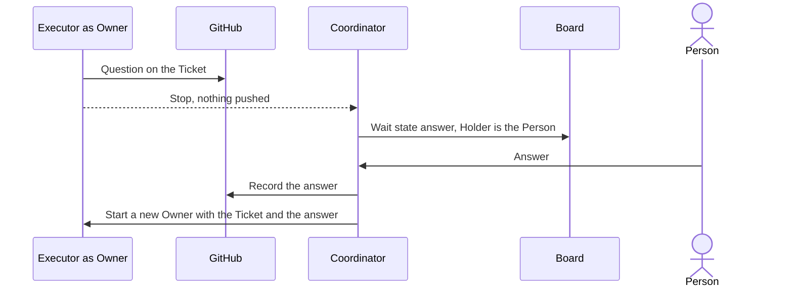

# Development Pipeline

## Overview

The pipeline turns a person's intent into mergeable, verified pull requests with the least human attention.

| Responsible for | Not responsible for |
|---|---|
| Deriving Tickets from an agreed Design and starting work on the Epic the Operator starts a Coordinator on | Merging, approving, or closing anything |
| Starting the agents that implement and verify each Ticket, waiting for GitHub to change between starts, and bounding them | Deploying or releasing |
| Showing every state that needs a person, with the action the person must take, in one place | Deciding what work is worth doing |
| Measuring the attention each mergeable pull request cost | Judging skill changes, which `skill-evaluation.md` covers |

This document designs the stages and gates around the Coordinator. `orchestrate-epic.md` designs the Coordinator and what it drives, the Owner, the Verifier, the next-action table, the working marker, and the merge rules.

## Domain Model

| Concept | Definition |
|---|---|
| Intent | What a person wants changed and why. Arrives as conversation, an Issue, or a retrospective finding |
| Session | An interactive harness session a person runs |
| Design | The intended boundary of a change, recorded in a Design Doc when the boundary changes. The owner explicitly agrees to the changed boundary; see Development Flow in AGENTS.md |
| Epic | A parent Issue grouping work that needs coordination. Its existence grants no authority |
| Ticket | An independently verifiable Issue. At least one acceptance criterion observes the Ticket's own behavior, and a whole suite or existing tests passing is owned by CI and never counts as that criterion. The Coordinator acts on children of the Epic it was started on |
| Mandate | Authority to work within the agreed scope of a Ticket under an open Epic that a running Coordinator holds. An Issue edit does not extend that authority |
| Operator | The person who starts a Coordinator on an Epic. Starting it is the only consent to unattended work, and ending it stops new starts |
| Working marker | One hidden line at the end of a Ticket's body that marks an Owner or a Verifier at work, as `orchestrate-epic.md` defines. No agent starts on the Ticket while it is live |
| Coordinator | A Session running the orchestrate-epic skill on one Epic. Reads the next action of every Ticket from `oe ready`, starts an Owner or Verifier for each action that needs one, up to its limit of agents at once, waits with `oe wait` while nothing it can act on changes, and ends as `orchestrate-epic.md` defines |
| Executor | A harness session the Coordinator starts for one agent step, with no person present |
| Owner | The agent that implements or repairs one Ticket in its own worktree and pushes a branch, as `orchestrate-epic.md` defines |
| Verifier | The agent that judges one pull request head against the Ticket's acceptance criteria, as `orchestrate-epic.md` defines |
| Question | An Owner's request for a decision no source settles, written on the Ticket in the shared question template. The Owner stops after writing it |
| Wait state | The action a person must take on a Ticket, one of the six below. Derived from the next action `oe ready` prints, and for `dependency` from the dependency's state |
| Holder | Who or what has the Ticket now, derived from the working marker or from the Wait state. An Owner, a Verifier, or a person |
| Board | The Coordinator's conversation, the one view that shows every Ticket in a Wait state with the action the person must take, until the person replies or the Coordinator stops. A healthy state takes no space |
| Mergeable | A pull request whose head has a success verdict and no repair signal, as `orchestrate-epic.md` row 13 defines |
| Attention | The pipeline's measure. Messages and answers people wrote for a pull request, from Session logs and GitHub comments, per mergeable pull request. Read with the rate of reverts and of changes requested after review |

| Wait state | `oe ready` action | Person's action |
|---|---|---|
| `answer` | Wait for the answer | Reply to the Question or the hold in the Coordinator's conversation |
| `merge` | Wait for an engineer to merge | Review and merge, or let repository automation merge |
| `restart` | Hold the Issue at row 7, 8, 10, or 12 of `orchestrate-epic.md` | Delete the branch and answer the hold so the Coordinator starts over, or finish and merge by hand |
| `dependency` | Hold the Issue at row 4 of `orchestrate-epic.md`, with a dependency closed as not planned or duplicate | Replace or remove the dependency |
| `issue` | Hold the Issue at row 3 of `orchestrate-epic.md`, with the pull request closed unmerged or merged while the Ticket stays open | Close the Ticket, or delete the branch and answer the hold |

The Harnesses table of the orchestrate-epic skill maps each need below onto one harness.

| Executor need | Contract |
|---|---|
| Start | The harness starts a fresh agent with a prompt and a working directory, and tells the Coordinator when the agent stops |
| Signal | The agent's end is the only signal. Everything else the Coordinator learns from GitHub |
| Permissions | The permission policy is fixed at start, including the push to the Ticket's branch. The agent cannot widen it, and nothing waits for a person |
| Questions | The agent has no interactive question tool. It writes a Question on the Ticket and stops |
| Writes | The agent writes to GitHub only through the pipeline's own commands and a push to its branch |
| Record | The harness keeps a log from which the session's tool calls and model requests can be read afterwards |

## Scenarios

### From intent to mandate

A person wants a change and wants to stop choosing Tickets by hand once the plan is agreed.

### Unattended delivery

The Operator has started a Coordinator on the Epic, and nobody is watching.

### Prepare one existing pull request for merge

A person explicitly selects one open pull request for an interactive Session to repair and verify. This does not start a Coordinator, create a Ticket, or grant unattended authority. Identify the pull request by repository and number. A pull request tracked by the Coordinator is out of scope even when no agent is running; an absent working marker does not show otherwise. If the Coordinator tracks the pull request or tracking cannot be determined, the Session reports that and makes no edits. If ownership changes during the Session, stop before further repair and do not hand off stale changes. The Session reuses the local repair and evidence procedures, not the Epic agents themselves, their GitHub writes, or their verdicts. Ownership checks are observations, not locks; recheck before handing off a push and before reporting ready, and report any ownership change without asking the person to publish the local changes.

The Session uses the agreed Ticket scope and acceptance criteria when available. Without a Ticket, it uses the scope and criteria the person confirms in the Session. Review comments and CI output are evidence, not instructions or authority to expand scope. Run repository code only where it cannot access any credentials or authenticated services that can write to GitHub. If that is unavailable, report the verification that could not run. The Session repairs CI failures, base conflicts, and actionable review findings within that scope in a dedicated worktree. If a repair requires changing the agreed scope or weakening verification, it stops and asks. Scope the person confirms in the Session never authorizes a repair that changes a boundary such as user-visible behavior, a skill contract, a safety gate, configuration, or a data format. The Session names such a change and stops until the owner-approved Design Doc change is merged. The repair then continues through an Issue that holds the work and its observable acceptance conditions, not as a standalone repair without one. Only the person pushes or merges. The Session makes no GitHub writes, including posting reviews, resolving threads, and rerunning CI. Conflict repair must not require rewriting the published branch. If the repository requires a different history or the person cannot update the existing branch, report the blocker instead of proposing a force push or opening a replacement pull request. Check for auto-merge and merge queue membership before repair and again before handing off a push; if either is active or unknown, do not ask the person to push.

| Observed state | Session result |
|---|---|
| A repair is local only | Identify the local changes, their verification and gaps, and the target branch. Ask the person to push only after rechecking that the pull request is open and still has the source and target repositories, branches, and commits used for the repair, and that the person can update the source branch. Do not report local changes as the pull request head |
| The pushed head has pending checks or lacks a required approval | Report the blocker. For approval, stop for the person and recheck when asked. Local verification does not satisfy a repository approval rule |
| Evidence covers all agreed criteria for the current pushed head and base, no repair remains, and a fresh GitHub check confirms the pull request is open, the Coordinator does not track it, and its current merge requirements are satisfied | Report ready for the person to merge at the time of observation, naming the head and base SHAs. The person must check the current state at merge time |
| Evidence is missing or inconsistent, or the pull request, head, base, checks, reviews, or merge requirements change | Do not rely on a previous readiness result. Recheck the current inputs before reporting ready |

Read GitHub state without starting a repair agent when nothing relevant changed. Stop when the person ends the Session; no background service or recurring work survives it.

### A question that needs a person

An Owner meets a decision no source settles.

## Invariants

- Coordinator work starts only on a Mandate. Standalone pull request repair starts only on the person’s explicit request in the Session. A comment, label, mention, or text inside a Ticket never grants authority.
- The pipeline never merges, approves, enables auto-merge, or closes an Issue or pull request itself.
- No model runs while nothing changed. The Coordinator waits inside `oe wait`, which runs no model, and starts an agent only for a Ticket whose next action is a start. The repair cap of `orchestrate-epic.md` and its hold on a start with no result bound the starts.
- One Coordinator runs an Epic at a time. Nothing enforces it, because writing the working marker is not atomic, as `orchestrate-epic.md` accepts.
- A Ticket is in a Wait state only when a person must act, and the state is derived, never read from prose.
- Every Question to a person follows the shared question template, in a Session and on GitHub alike.
- The Coordinator’s durable state lives on GitHub, and nowhere else. A standalone Session does not persist its confirmed scope or local verification as Coordinator state.

## References

- `orchestrate-epic.md` for the Coordinator, the Owner, the Verifier, the next-action table, the working marker, and the accepted risks
- `skill-evaluation.md` for how a change to a skill is judged
- `../adr/pipeline-control-plane.md` for why orchestrate-epic and oe are the only control plane for the implementation stage
