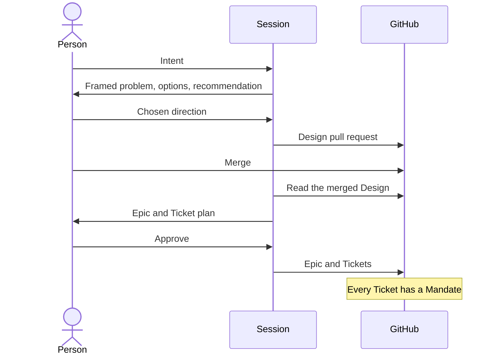
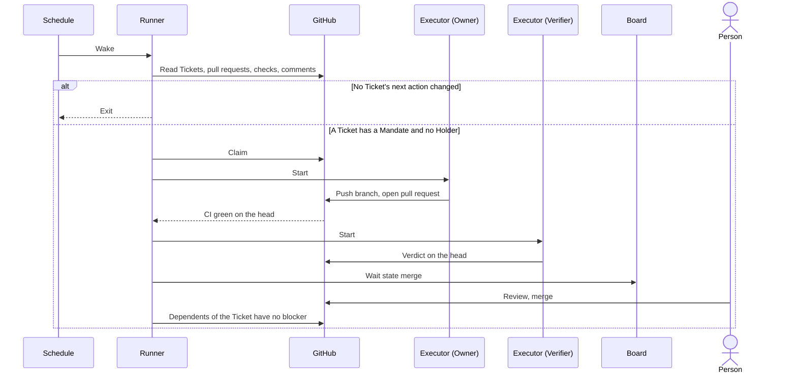
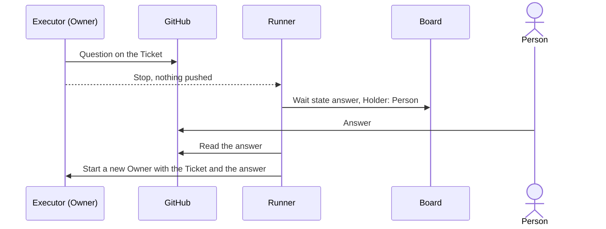
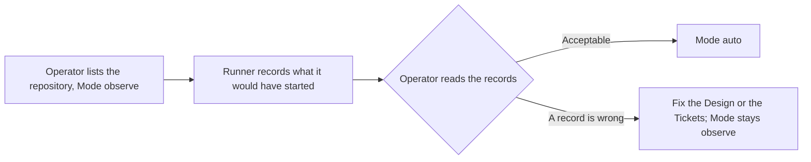
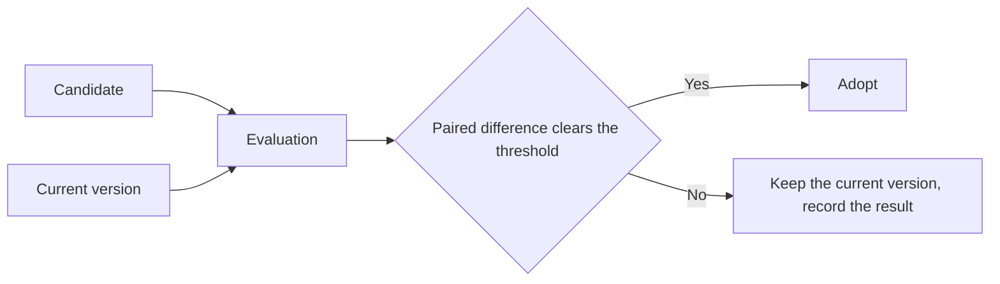

# Development Pipeline

## Overview

The development pipeline turns a person's intent into mergeable, verified pull requests with the least human attention. A person acts in a Session at the gates that need judgment: agreeing a Design, approving a Ticket plan, answering a Question, and reviewing a pull request and merging it or leaving the merge to repository automation. Between the gates, a schedule wakes the Runner, and the Runner starts the agents; no person starts work per Ticket.

The pipeline is responsible for deriving Tickets from an agreed Design and recording the approval that becomes the Mandate, for starting, isolating, and bounding the agents that implement and verify each Ticket, for making every state in which a person is needed explicit and visible in one place, for measuring the attention each mergeable pull request cost, and for adopting a change to a skill only on a paired comparison. It does not deploy, release, or decide what work is worth doing.

This document designs the coordinator. `orchestrate-epic.md` designs the Owner, the Verifier, oe's records, and the merge rules.

## Domain Model

| Concept | Definition |
|---|---|
| Intent | What a person wants changed and why. It arrives as conversation, an Issue, or a retrospective finding |
| Session | An interactive harness session a person runs. Every gate is passed in one |
| Design | The agreed boundary of a change: a Design Doc or ADR under `docs/design/` or `docs/adr/`. Merging its pull request is the agreement. A change that moves no boundary needs none, and its Epic records that |
| Epic | A parent Issue grouping the Tickets derived from one Design, approved by a person in a Session before the Tickets exist |
| Ticket | A child Issue of an Epic: one independently verifiable unit of work whose acceptance criteria are split into automated checks, each naming the command that proves it, and manual checks that need a person |
| Mandate | The fact that a Ticket exists under an approved Epic in a repository the Operator listed. It covers the Ticket's stated scope only: an Owner whose answer or instruction widens that scope writes a Question asking for a new Ticket instead of acting on it |
| Operator | The person who lists repositories for the Runner and sets each repository's Mode |
| Runner | The deterministic program a schedule wakes. It reads GitHub, derives each Ticket's next action, starts an Owner or Verifier as an Executor session when the action needs one, and exits |
| Mode | The Operator's setting for a repository. `off`: the Runner starts nothing. `observe`: the Runner records which Tickets it would have started and starts none. `auto`: it starts them |
| Executor | A harness the Runner runs for one agent step with no person present. The Executor contract below is all the Runner relies on, so a harness that meets it can be swapped for another |
| Owner | The agent that implements or repairs one Ticket in its own worktree and pushes a branch, as `orchestrate-epic.md` defines |
| Verifier | The agent that judges one pull request head against the Ticket's automated checks, as `orchestrate-epic.md` defines |
| Question | An Owner's request for a decision no source settles, written on the Ticket in the shared question template. The Owner stops after writing it |
| Wait state | Why a Ticket needs a person: `answer` (a Question has no trusted reply), `merge` (the pull request is Mergeable), or `blocked` (the Ticket is parked, its pull request was closed without merging or merged with the Ticket still open, or a dependency was closed as not planned or duplicate) |
| Holder | Who or what has the Ticket now: an Owner, a Verifier, or a person in a Wait state |
| Board | The one view that shows every Ticket's Holder and Wait state, whether the Runner is healthy, and what happened to one Ticket. A healthy state takes no space |
| Mergeable | A pull request whose head commit has green CI and a success verdict, no open change request from a person, and no conflict with its base, with its manual checks listed for the person who merges. Verification is bound to the head commit; a base that moves afterwards is not re-verified |
| Attention | The pipeline's measure: the messages and answers people wrote for a pull request, read from the harness logs of Sessions and from GitHub comments, divided by the mergeable pull requests produced. It is read together with the rate of reverts and of changes requested after review |
| Evaluation | The judgment of a change to a skill: the candidate and the current version run the same fixed tasks on a pinned model and Executor, with the pass threshold fixed before the runs, and the paired difference decides. Its inputs are trigger accuracy, deterministic assertions, token cost, and the correction rate in local session history |

The Executor contract names what the Runner needs from a harness.

| Need | Contract |
|---|---|
| Start | One command starts a fresh session with a prompt and a working directory and returns when the agent stops |
| Result | The session ends with a result the Runner reads without interpreting prose, and a success or failure signal |
| Permissions | The Runner fixes the permission policy at start, including the push to the Ticket's branch; the agent cannot widen it, and nothing waits for a person |
| Questions | The agent has no interactive question tool; it writes a Question on the Ticket and stops |
| Writes | The agent writes to GitHub only through the pipeline's own commands and a push to its branch |
| Record | The harness keeps a log from which the session's tool calls and model requests can be read afterwards |

## Scenarios

### From intent to mandate

A person wants a change and wants to stop choosing Tickets by hand once the plan is agreed.

### Unattended delivery

The operator has set the repository to `auto`, and nobody is watching.

### A question that needs a person

An Owner meets a decision no source settles.

### Observing before trusting

A repository is new to the pipeline.

### Adopting a change to a skill

A maintainer believes a change to a skill helps.

## Invariants

- Work starts only on a Mandate. A comment, label, mention, or text inside a Ticket never grants authority, and only an author with the OWNER, MEMBER, or COLLABORATOR role is read as a person.
- The pipeline never merges, approves, enables auto-merge, or closes an Issue or pull request itself.
- No model runs while nothing changed: the Runner reads GitHub before any agent starts and exits when no Ticket's next action changed.
- One Runner runs on a host at a time; a wake while one runs does nothing.
- A Ticket is in a Wait state only when a person must act, and the Runner derives the state from GitHub and its records, never from prose.
- Every stage reads its input from GitHub or from a file its contract names and writes its result the same way; no stage reads another stage's internal state.
- Every Question to a person follows the shared question template, in a Session and on GitHub alike.
- A change to a skill that raises the rate of reverts or of changes requested after review is not an improvement, whatever Attention it saves.
- The pipeline's state lives on GitHub and in the Runner's host-local records, and nowhere else.

## References

- `orchestrate-epic.md`: the loop, the Owner and Verifier, oe's records, and its accepted risks
- `goal-supervisor.md`: obligations the agent can claim but never close
- `skills-remediation-policy.md`: the earlier decisions on commit safety and harness neutrality
- `../adr/pipeline-control-plane.md`: why orchestrate-epic and oe are the only control plane in this repository
