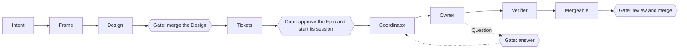
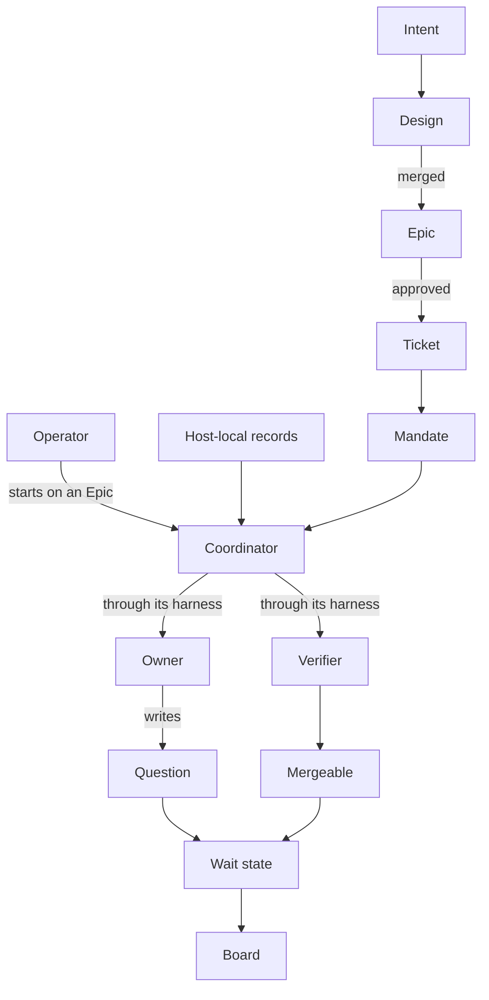
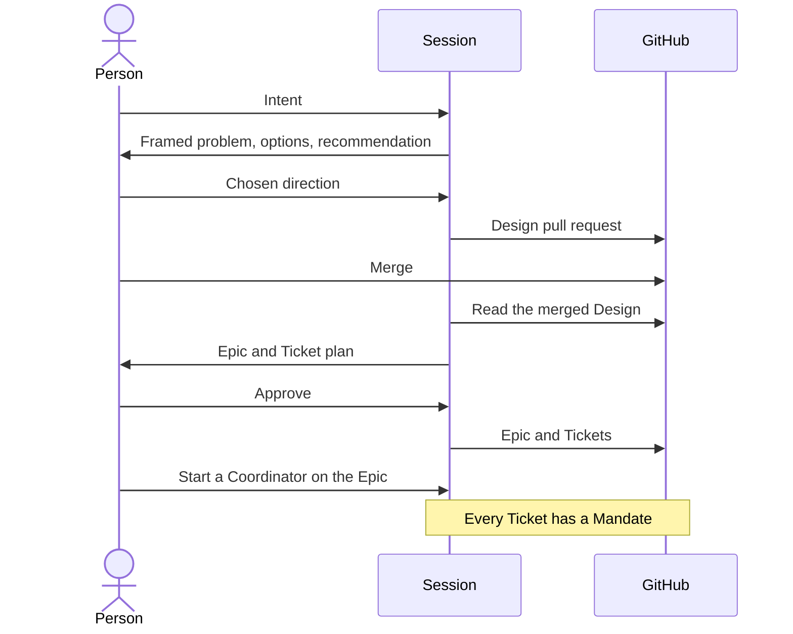
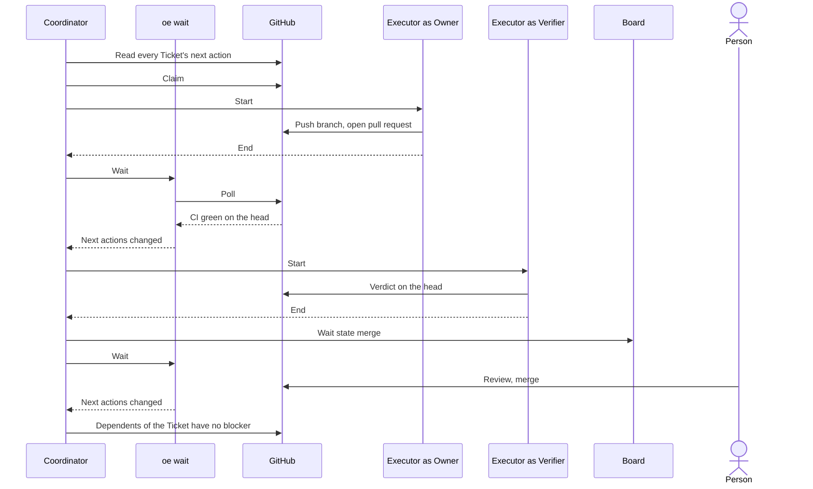

# Development Pipeline

## Overview

The pipeline turns a person's intent into mergeable, verified pull requests with the least human attention.

| Responsible for | Not responsible for |
|---|---|
| Deriving Tickets from an agreed Design and starting work on the Epic the Operator starts a Coordinator on | Merging, approving, or closing anything |
| Starting the agents that implement and verify each Ticket, waiting for GitHub to change between starts, and bounding them | Deploying or releasing |
| Showing every state that needs a person, with the action the person must take, in one place | Deciding what work is worth doing |
| Measuring the attention each mergeable pull request cost | Judging skill changes, which `skill-evaluation.md` covers |

This document designs the stages and gates around the Coordinator. `orchestrate-epic.md` designs the Coordinator and what it drives, the Owner, the Verifier, the next-action table, oe's records, and the merge rules.

## Domain Model

| Concept | Definition |
|---|---|
| Intent | What a person wants changed and why. Arrives as conversation, an Issue, or a retrospective finding |
| Session | An interactive harness session a person runs. The Design and the Epic are agreed in one |
| Design | The agreed boundary of a change, a Design Doc or ADR. Merging its pull request is the agreement. A change that moves no boundary needs none, and its Epic says so |
| Epic | A parent Issue grouping the Tickets derived from one Design. It exists only after a person approved its plan in a Session, so its existence is the approval |
| Ticket | A child Issue of an Epic. One independently verifiable unit of work whose acceptance criteria each name the command that proves it. Work that needs a person is its own Issue, blocked by the Ticket and outside the Epic |
| Mandate | A Ticket exists under an open Epic that a running Coordinator holds. Covers the Ticket's stated scope only. Wider scope is a new Ticket |
| Operator | The person who starts a Coordinator on an Epic. Starting it is the only consent to unattended work, and ending it stops new starts |
| Host-local records | oe's state on the Coordinator's host, as `orchestrate-epic.md` lays it out: one lock per Epic, each Ticket's claim, attempt, and verdict records, and each Epic's board pane and running wait |
| Coordinator | A Session running the orchestrate-epic skill on one Epic. Takes the Epic's lock, reads the next action of every Ticket from `oe ready`, starts an Owner or Verifier for each action that needs one, up to its limit of agents at once, waits with `oe wait` while nothing it can act on changes, and ends as `orchestrate-epic.md` defines |
| Executor | A harness session the Coordinator starts for one agent step, with no person present |
| Owner | The agent that implements or repairs one Ticket in its own worktree and pushes a branch, as `orchestrate-epic.md` defines |
| Verifier | The agent that judges one pull request head against the Ticket's acceptance criteria, as `orchestrate-epic.md` defines |
| Question | An Owner's request for a decision no source settles, written on the Ticket in the shared question template. The Owner stops after writing it |
| Wait state | The action a person must take on a Ticket, one of the six below. Derived from the next action `oe ready` prints, and for `dependency` from the dependency's state |
| Holder | Who or what has the Ticket now, derived from the claim and attempt records or from the Wait state. An Owner, a Verifier, or a person |
| Board | The one view that shows every Ticket's Holder and Wait state, whether a Coordinator holds the Epic's lock, and what happened to one Ticket. A healthy state takes no space |
| Mergeable | A pull request whose head has a success verdict and no repair signal, as `orchestrate-epic.md` row 11 defines |
| Attention | The pipeline's measure. Messages and answers people wrote for a pull request, from Session logs and GitHub comments, per mergeable pull request. Read with the rate of reverts and of changes requested after review |

| Wait state | `oe ready` action | Person's action |
|---|---|---|
| `answer` | Wait for the answer | Reply to the Question in the Coordinator's conversation or on the Ticket |
| `merge` | Wait for an engineer to merge | Review and merge, or let repository automation merge |
| `restart` | Park the Issue | Delete the branch so the Coordinator starts over, or finish and merge by hand |
| `dependency` | Wait for the dependencies, with a dependency closed as not planned or duplicate | Replace or remove the dependency |
| `issue` | Wait for an engineer, with the pull request closed unmerged or merged while the Ticket stays open | Close the Ticket or delete the branch |

The Harnesses table of the orchestrate-epic skill maps each need below onto one harness.

| Executor need | Contract |
|---|---|
| Start | The harness starts a fresh agent with a prompt and a working directory, and tells the Coordinator when the agent stops |
| Signal | The agent's end is the only signal. Everything else the Coordinator learns from GitHub |
| Permissions | The permission policy is fixed at start, including the push to the Ticket's branch. The agent cannot widen it, and nothing waits for a person |
| Questions | The agent has no interactive question tool. It writes a Question on the Ticket and stops |
| Writes | The agent writes to GitHub only through the pipeline's own commands and a push to its branch |
| Record | The harness keeps a log from which the session's tool calls and model requests can be read afterwards |

## Scenarios

### From intent to mandate

A person wants a change and wants to stop choosing Tickets by hand once the plan is agreed.

### Unattended delivery

The Operator has started a Coordinator on the Epic, and nobody is watching.

### A question that needs a person

An Owner meets a decision no source settles.

## Invariants

- Work starts only on a Mandate. A comment, label, mention, or text inside a Ticket never grants authority.
- The pipeline never merges, approves, enables auto-merge, or closes an Issue or pull request itself.
- No model runs while nothing changed. The Coordinator waits inside `oe wait`, which runs no model, and starts an agent only for a Ticket whose next action is a start. The attempt cap and the Verifier cap of `orchestrate-epic.md` bound the starts.
- One Coordinator runs an Epic on a host at a time, which `oe lock` enforces on that host only.
- A Ticket is in a Wait state only when a person must act, and the state is derived, never read from prose.
- Every Question to a person follows the shared question template, in a Session and on GitHub alike.
- The pipeline's state lives on GitHub and in the host-local records, and nowhere else.

## References

- `orchestrate-epic.md` for the Coordinator, the Owner, the Verifier, the next-action table, oe's records, and the accepted risks
- `skill-evaluation.md` for how a change to a skill is judged
- `../adr/pipeline-control-plane.md` for why orchestrate-epic and oe are the only control plane for the implementation stage
