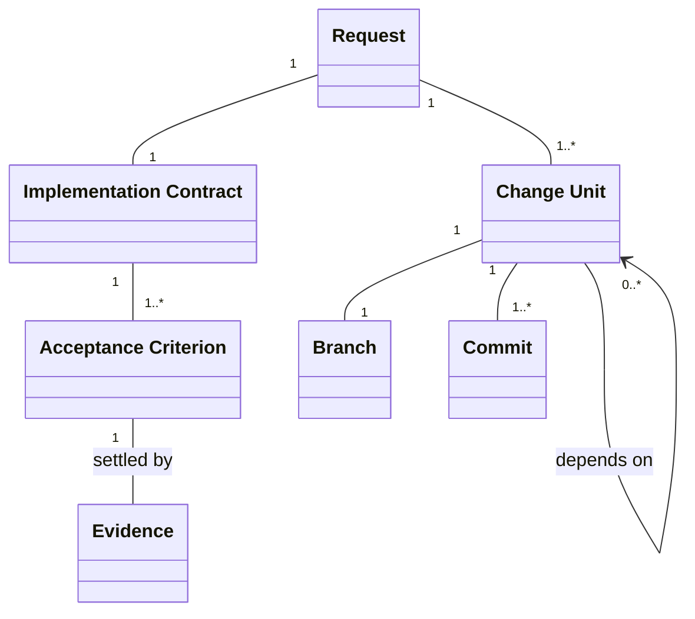
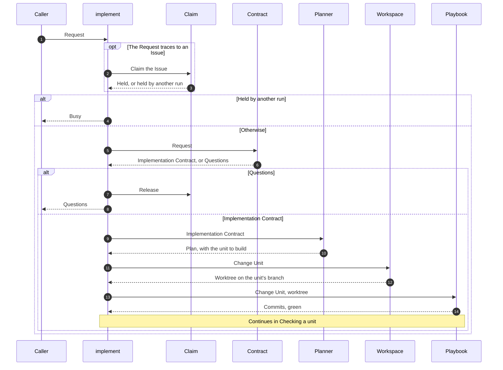
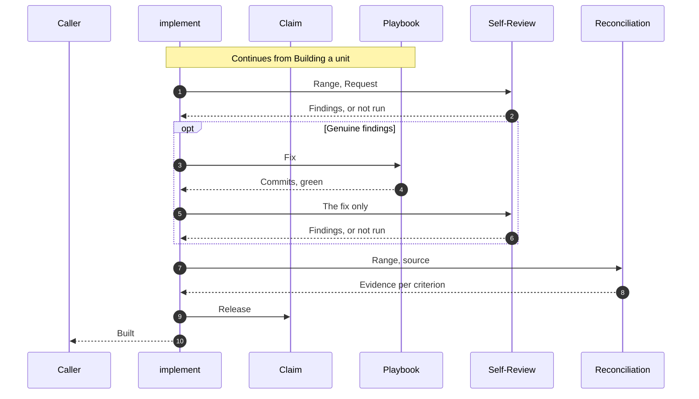
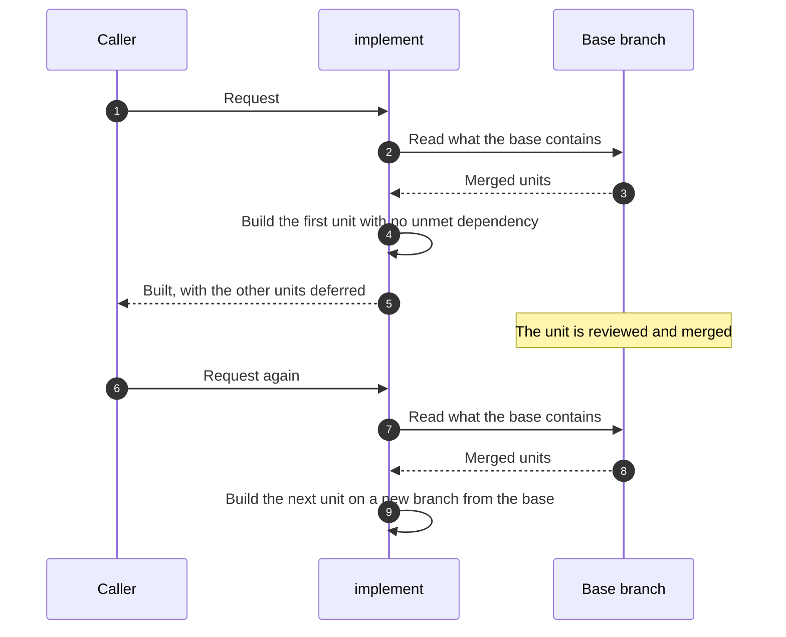

# implement

## Overview

implement turns one Request into one Change Unit, committed and verified on its own branch. It does not know who called it: every run ends by handing its Result back to the caller and stopping.

| Component | Does | Takes | Returns |
|---|---|---|---|
| Claim | Keeps at most one run per Issue at a time within this clone | Issue | Held, or held by another run |
| Contract | Derives the Implementation Contract from the sources | Request, repository, linked sources | Implementation Contract, or Questions |
| Planner | Splits the Contract into Change Units, and picks the first one whose dependencies the base already contains | Implementation Contract, base | Plan, with the unit to build |
| Workspace | Prepares the worktree for the unit: continues the unmerged branch that already holds it, or starts a new branch from the fetched base | Change Unit | Worktree on the unit's branch |
| Playbook | Builds the unit test first through the procedure for its task type, commits each step through `commit`, and runs the checks the diff can affect | Change Unit, worktree | Commits, green |
| Self-Review | Reviews a Range in a fresh session: first its scope against the Request alone, then its correctness | Range, Request | Findings, or not run |
| Reconciliation | Re-fetches the source and settles each Acceptance Criterion with Evidence | Range, source | Evidence per criterion |

| Left to others | Who |
|---|---|
| Scope, priority, and design direction no source settles | Whoever answers the Questions |
| Keeping the Deferred Units for later runs | The caller |
| Checks the source lists as manual | The engineer |
| Pushing, and opening and merging a pull request | The caller |

## Domain Model

| Concept | Definition |
|---|---|
| Request | What the requester asked for, with every answer given to its Questions since. It may trace to an Issue |
| Implementation Contract | The agreed reading of a Request: goal and actor, current and desired behavior, requirements, specification, scope and non-goals, Acceptance Criteria, constraints, prerequisites, and Decisions |
| Acceptance Criterion | A pass or fail outcome, quoted verbatim from the source or marked derived. A behavior criterion names what a user or caller observes; a structure or content criterion names what an artifact contains |
| Decision | A choice no source settles, with its basis and the rejected alternative |
| Trigger | A condition under which a choice is not the run's to make: Acceptance in doubt, Premise in doubt, Sources contradict, or Unsettled critical decision |
| Question | One open choice in the shared template: its context, criteria, options, and a recommendation |
| Change Unit | One kind of change a reviewer verifies at once, such as a structure change, a behavior change, a bug fix, or a mechanical bulk change. Units of one Request are separated only by kind, by area, by independence, or by needing a separate revert, never by size alone. About 200 to 400 lines of production code is a guide, not a limit. A Request with no reason to split is one unit |
| Deferred Unit | A Change Unit of the Plan that this run does not build |
| Range | Every commit from the merge base with the base branch to HEAD |
| Finding | One problem a review reports in a Range |
| Evidence | An observation on the final state that settles one Acceptance Criterion, tagged behavior or static |
| Result | What a run hands back. Busy: another run holds the Issue. Questions: the open choices. Built: the Range, the Evidence per criterion, the Findings left, whether Self-Review ran, and the Deferred Units |

## Scenarios

### Building a unit

A caller wants a request turned into one committed unit without being asked anything the sources settle.

### Checking a unit

A caller wants the built unit reviewed and settled against the source before anyone relies on it.

### Delivering a request of several units

A caller wants a request too large for one review split so that no unit is built on an unreviewed one.

## Invariants

- A run behaves the same whoever calls it.
- Until the Plan exists, a run changes nothing in the repository except the Claim. It works only in the worktree of its unit's branch, and never switches, pulls, or stashes the shared checkout.
- The Claim lasts only while a run runs. The unit's branch, not the Claim, carries unfinished work to the next run.
- A branch holds one Change Unit.
- A fact the repository or another source can establish is never asked.
- Only an explicit statement or an established repository convention settles a critical decision, never inference.
- Whenever a Trigger fires, in any component, the run ends with Questions, keeping the work done so far and releasing the Claim.
- A unit is built only on a base that already contains every unit it depends on.
- A unit ends only at a green commit that closes a Playbook cycle.
- Every new or changed test was seen to fail at its assertion before the production change, except a test that pins preserved behavior, which is seen to fail against a deliberate break instead. A bug-fix test fails on the pre-fix code for the reported reason.
- A test is never weakened or deleted to reach green. A deleted test names where its coverage now lives.
- Self-Review and Reconciliation read only their own inputs, never the Plan or the Decisions, so each can run apart from implement.
- Self-Review never changes the worktree. A Self-Review that did not run is reported as not run, never as clean.
- An Acceptance Criterion without Evidence is unsatisfied. A green check run is never Evidence for a criterion that does not name that check.
- A Result reports the Request as done only when no unit is deferred and every Acceptance Criterion has Evidence.

## References

- `orchestrate-epic.md` for pr-owner, which calls implement, and pr-verify, which applies the same Evidence rules
- `development-pipeline.md` for where implementation sits in the pipeline
