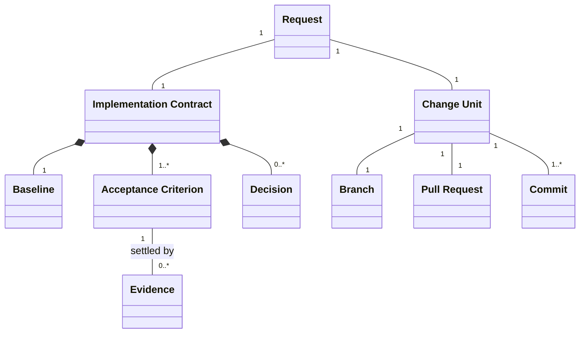
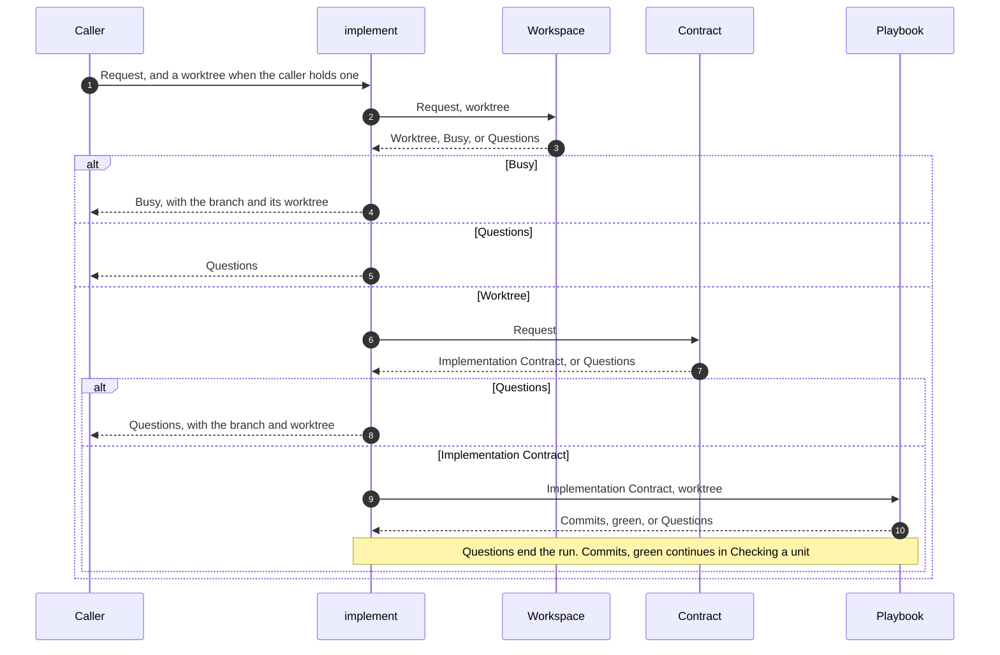
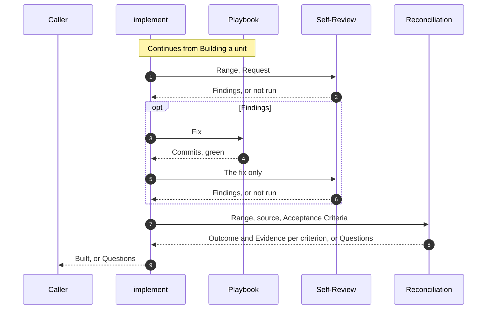

# implement

## Overview

implement turns one Request into one Change Unit, committed and verified on its own branch. Every run ends by handing its Result back to the caller and stopping.

| Component | Does | Takes | Returns |
|---|---|---|---|
| Workspace | Works in the worktree the caller hands over. Without one, creates the branch and its worktree; for an Issue, that branch is the Lock | Request, and a worktree when the caller holds one | Worktree, Busy, or Questions |
| Contract | Observes the Baseline, and writes what the sources lack beside them | Request, repository, linked sources | Implementation Contract, or Questions |
| Playbook | Builds the unit test first through the procedure for its task type, and runs the checks the diff can affect | Implementation Contract, worktree | Commits, green, or Questions |
| Self-Review | Reviews a Range in a fresh session: first its scope against the Request alone, then its correctness | Range, Request | Findings, or not run |
| Reconciliation | Re-fetches the source, and settles with Evidence each Acceptance Criterion it now states and each derived one | Range, source, Acceptance Criteria | Outcome and Evidence per criterion, or Questions |

| Left to others | Who |
|---|---|
| Scope, priority, and design direction no source settles | Whoever answers the Questions |
| Splitting work into Issues of one Change Unit each | Whoever files the Issues |
| Dropping an Acceptance Criterion or moving it to another Issue; implement only drafts the edit | A person, by editing the Issue |
| The worktree and the Lock when the caller hands a worktree over or a run returns Busy | The caller |
| Checking the Range before anything is published, pushing, and opening and merging a pull request | The caller |

## Domain Model

| Concept | Definition |
|---|---|
| Request | What the requester asked for, with every answer given to its Questions since. It may trace to an Issue |
| Implementation Contract | The Request and its sources, which a run never rewrites, and what the run adds beside them: the Baseline, the Acceptance Criteria, and the Decisions |
| Baseline | Observed, never inferred: the current behavior and the desired difference per Acceptance Criterion, and the existing behavior the change touches and must keep. A bug is stated as a class of conditions, not as the one reported case |
| Acceptance Criterion | A pass or fail outcome, quoted verbatim from the source, or derived with its basis: a source sentence or a Baseline difference. A behavior criterion names what a user or caller observes, its failure paths included; a structure or content criterion names what an artifact contains |
| Outcome | Satisfied, or unsatisfied with its reason, which is no evidence or failure observed |
| Decision | A choice no source settles, with its basis and the rejected alternative. The Decisions also hold one line per critical area the change touches, naming the source that settled it or the Question that asked it |
| Trigger | A condition under which a choice is not the run's to make: Acceptance in doubt, Premise in doubt, Sources contradict, or Unsettled critical decision. Acceptance in doubt includes a criterion that neither a checkout of the repository nor its CI can observe, and one that Reconciliation leaves unsatisfied. Premise in doubt includes existing behavior the change would keep that can defeat its goal, an open Issue it is blocked by, a missing prerequisite, and a Request that needs more than one Change Unit, whose Question asks to split its Issue |
| Question | One open choice in the shared template: its context, criteria, options, and a recommendation |
| Change Unit | One kind of change a reviewer verifies at once, such as a structure change, a behavior change, a bug fix, or a mechanical bulk change. Work needs separate units only by kind, by area, by independence, or by needing a separate revert. About 200 to 400 lines of production code is a guide, not a limit |
| Lock | The Issue's fixed-name branch on origin. Creating it fails when it exists, so one Issue has one branch at a time |
| Range | Every commit from the merge base with the base branch to HEAD |
| Finding | One problem a review reports in a Range |
| Evidence | A recorded observation of the real artifact, through the interface the criterion names, that someone else can rerun: a final observation, or a failing or break observation that shows a test can fail. A `file:line` citation is Evidence only for a structure or content criterion |
| Result | What a run hands back. Busy: the Lock exists, with its branch and, when one exists on this host, its worktree. Questions: the open choices, with the branch and worktree when they exist. Built: the Range, the Evidence per criterion, the Findings left, and whether Self-Review ran |

## Scenarios

### Building a unit

A caller wants a request turned into one committed unit without being asked anything the sources settle.

### Checking a unit

A caller wants the built unit reviewed and settled against the source before anyone relies on it.

## Invariants

- A run behaves the same whoever calls it. Only its inputs decide what it does.
- A run handed a worktree works there and takes no Lock. Otherwise a run for an Issue takes the Lock, and returns Busy when the Lock exists. A run without an Issue starts a new branch from the fetched base.
- A run resumes earlier work only in a worktree handed to it. When the Issue is still open and a pull request from its branch is merged, the run ends with Questions instead of Busy.
- A run works only in its worktree, and never switches, pulls, or stashes the shared checkout.
- Until the Implementation Contract exists with no Question open, a run creates nothing but the Lock and its worktree, and commits nothing.
- With a person present, a run shows the Baseline, the Acceptance Criteria, and the Decisions, and goes on without waiting for approval.
- One Request is one Change Unit, one branch, and one pull request.
- A fact the repository or another source can establish is never asked.
- Only an explicit statement or an established repository convention settles a critical decision, never inference.
- When a Trigger fires in any component, the run ends with Questions, keeping the work done so far.
- A bug-fix test covers every combination of the defect's class of conditions, or the Result names each combination left out.
- Each new or changed test is committed test-only before the production change, and seen to fail at its assertion on that commit. A test that pins preserved behavior is seen to fail against a deliberate break instead. A bug-fix test fails on the pre-fix code for the reported reason.
- No later commit changes a test's lines or the fixtures and helpers it uses. Changing them takes a new test-only commit, observed to fail again.
- A run that returns Built ends at a green commit.
- A test is never weakened or deleted to reach green. A deleted test names where its coverage now lives.
- Self-Review is started on every run that returns Built. It never changes the worktree, and one that did not complete is reported as not run, never as clean.
- Self-Review reads only the Range and the Request, and Reconciliation only the Range, the source, and the Acceptance Criteria as written text, never the Decisions, so each can run apart from implement.
- A final observation is taken on the final HEAD, with `git status` empty before and after it. A failing observation is taken on the test-only commit. A break observation records the commit it starts from and the break.
- An observation through a fake or a stub settles only the code between the interface it drives and the fake.
- A green check run is never Evidence for a criterion that does not name that check.
- An Acceptance Criterion without Evidence is unsatisfied.
- A run returns Built only when every Acceptance Criterion is satisfied.

## References

- `orchestrate-epic.md` for pr-owner, which calls implement with a worktree, oe claim, which creates the same branch name, and pr-verify, which applies the same Evidence rules to the Issue's own criteria
- `development-pipeline.md` for where implementation sits in the pipeline
- `skill-evaluation.md` for the paired comparison a change to the skill passes before adoption
