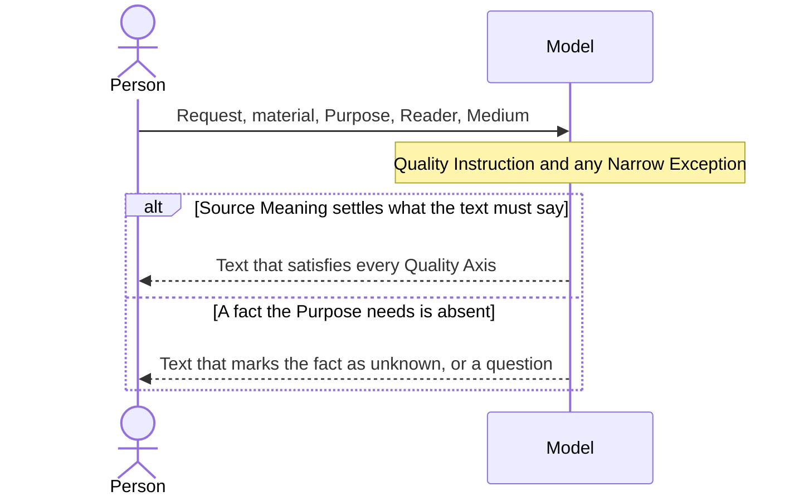
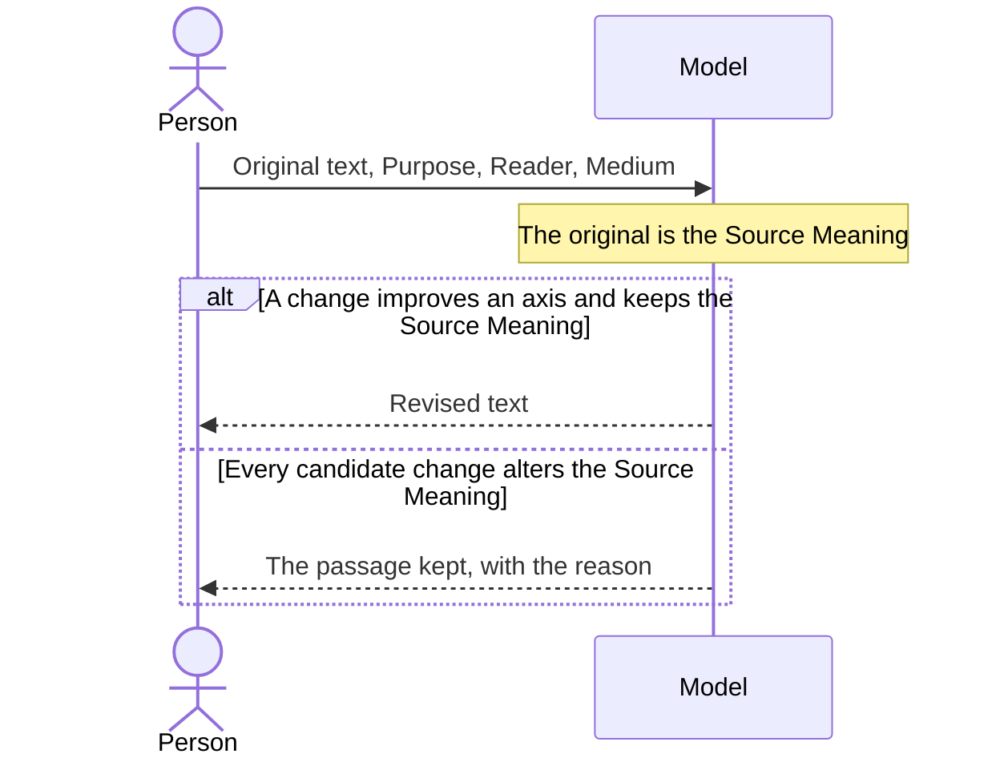
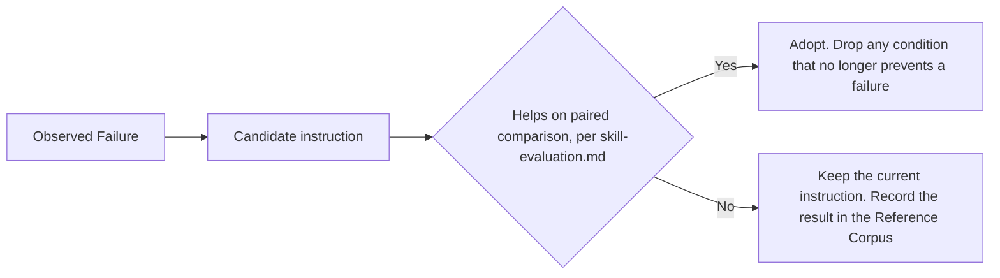

# Japanese Writing Quality

## Overview

When a model generates or revises Japanese text, it receives one short Quality Instruction, so that a Reader with none of the writer's context reads the text once, top to bottom, and understands and can use the Source Meaning exactly. The instruction states what the text must satisfy. It never states the order of work.

| Responsible for | Not responsible for |
|---|---|
| The goal and the Quality Axes a Japanese text must satisfy | Checking whether the Source Meaning is true, which `write-researched-document` covers |
| Which axis yields when two conflict | Shortening a text, which `extreme-compact` covers |
| Narrow Exceptions a document type or a person asks for | Typesetting the Medium renders, such as spacing between Japanese and Latin script or paragraph indentation |
| Keeping the Reference Corpus out of the runtime instruction | Word lists, scanners, lint, scores, review rounds, or step sequences |

## Domain Model

| Concept | Definition |
|---|---|
| Writing Task | One generation of new Japanese text or one revision of an existing text |
| Purpose | What the Reader must be able to do with the text, such as decide, implement, or understand |
| Reader | The person the text addresses, with the prior knowledge the text may assume |
| Medium | Where the text is shown, with its conventions for notation and layout, such as Markdown rendered on GitHub |
| Source Meaning | What the inputs state: facts, claims, stance, weight, conditions, limits, negations, causes, certainty, actors and objects, and sources. In a revision, the original text. In a generation, the material and the request |
| Quality Instruction | The short text given to the model on every Writing Task. It holds the goal, the Quality Axes, and at most a few concrete conditions the axes alone fail to produce. It names no theory, tool, or command |
| Narrow Exception | A notation or style convention a document type or a person requires, applied only within that scope |
| Reference Corpus | Research, comparisons of existing approaches, and failure history. Maintainers read it to change the Quality Instruction |
| Observed Failure | A defect found in real output: changed meaning, unnatural language, broken structure, a notation mismatch, or a Reader's misreading |

| Quality Axis | The text satisfies it when |
|---|---|
| Communication | A Reader with none of the writer's context reads it once, top to bottom, and can interpret and use the meaning the Purpose needs, as intended |
| Meaning | It keeps the Source Meaning and adds nothing absent from it. A sentence that only introduces or links what the Source Meaning holds is not an addition. A summary drops only what the Purpose does not need. What the Source Meaning marks as unknown stays unknown, and where it says nothing, the text adds neither an answer nor a doubt |
| Structure | Text the Reader looks things up in, such as a README, a notice, a spec, or a summary, takes the shape of its content: parallel items as a list, items compared on the same attributes as a table, ordered steps as a numbered list, separate topics under headings. Text the Reader follows from start to end, such as an argument, an essay, a paper, or a letter, stays prose, and each paragraph carries one step of the thought, often across several items of the material. Sections and importance are shown by headings, order, and indentation, not by emphasis markup or decorative symbols. Where the Medium has no headings, indentation alone carries the hierarchy. No placement implies a relation the Source Meaning does not state |
| Line | Each sentence or list item states one thing. Claim, reason, purpose, condition, exception, and contrast are stated within and between sentences, without leaps, restatement, or abstract filler. No aside makes the Reader jump into brackets, dashes, or notes and back |
| Language | Words fit the context and their usual collocations. Each phrase sits near what it modifies. Commas are as few as one-pass parsing allows: one marks the end of a clause or long modifier, or keeps a phrase from attaching to the wrong word. An omitted subject or argument is not a defect when the Reader recovers its role from context |
| Notation | Punctuation, mixing of Japanese and Latin script, and formatting follow the Medium. No ASCII space is inserted beside Latin letters or digits inside Japanese unless the Medium requires one |

Brevity, density, rhythm, beauty, and voice are preferences beneath the Quality Axes. Their right level depends on the Purpose, and deliberate rhetoric or creative openness stays.

## Scenarios

### Generating a text

A person wants a Japanese text written for a Reader and a Purpose.

### Revising a text

A person wants an existing Japanese text to read better without saying anything new.

### Changing the Quality Instruction

A maintainer finds an Observed Failure and wants the Quality Instruction to prevent it.

The comparison includes no instruction at all as a baseline.

## Invariants

- A Writing Task never changes the Source Meaning to gain brevity, naturalness, fewer detector findings, or a higher score.
- The text never claims a stance, experience, opinion, or voice the Source Meaning does not hold.
- Keeping the Source Meaning is not verifying it. Nothing in this design marks a text as true.
- A detector finding or a model-assigned score is a candidate for a person to read, never an acceptance criterion and never an automatic edit.
- The Quality Instruction grows only through Changing the Quality Instruction. The Reference Corpus never enters a Writing Task.
- A Narrow Exception overrides only Notation and the preferences, and only within its scope. It never overrides Meaning.

## References

- `japanese-writing-goal-instruction.md`, the ADR choosing a goal-based instruction over a symptom catalog
- `skill-evaluation.md` for how a candidate instruction is judged
- Reiter and Dale, Building Natural Language Generation Systems: https://www.cambridge.org/core/books/abs/building-natural-language-generation-systems/microplanning/FEB90C3A816AD6A873A1BE85B69A9D0B
- Mann and Thompson, Rhetorical Structure Theory: https://www.sfu.ca/rst/01intro/intro.html
- Degen, The Rational Speech Act Framework: https://www.annualreviews.org/content/journals/10.1146/annurev-linguistics-031220-010811
- Goldreich, Juba, and Sudan, A Theory of Goal-Oriented Communication: https://dspace.mit.edu/entities/publication/855e63ae-a2e2-4193-8c1f-3b1f9bd1f0f1
- NAIST Text Corpus, predicate-argument structure and coreference: https://doi.org/10.5715/jnlp.17.2_25
- Agency for Cultural Affairs, 公用文作成の考え方, 2022: https://www.bunka.go.jp/koho_hodo_oshirase/hodohappyo/93651301.html
- W3C, Requirements for Japanese Text Layout: https://www.w3.org/TR/jlreq/
- Gao et al., a review of natural language generation evaluation, Computational Linguistics 2025: https://aclanthology.org/2025.cl-2.9/
