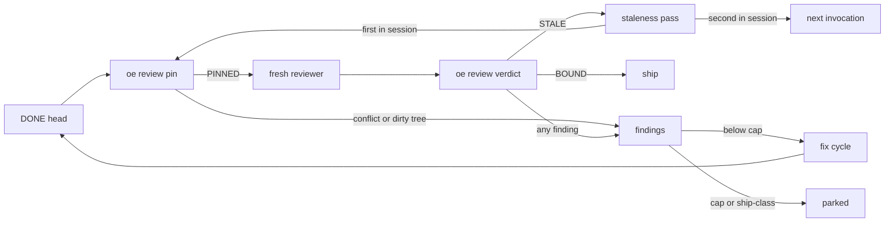
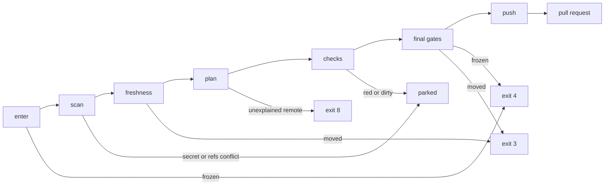
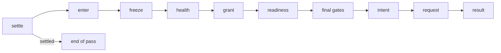

# orchestrate-epic v2 Contract

The normative contract that `oe` and the candidate prose implement. Epic #277 decisions D1 to D7 apply throughout.

## 1. Authority

- A behavior change lands in the same PR as the edit to this file that allows it.
- There is no JSON Schema. Go types and fixtures in `oe/` are the schema; this file fixes names, meanings, and invariants.
- Each recovery case in §8 becomes a named test in the Issue beside it. There is no separate crash-matrix document.
- `rule-inventory.tsv` traces every current rule to its v2 disposition. CI runs `tests/check-rule-inventory.sh`. An Issue that takes over a row fills its owner. The inventory becomes `complete` in #292.
- The current skill stays on v1 until the cutover in #293.

## 2. Terms

| Term | Meaning |
|---|---|
| `ME` | The login `gh api user` returns; it authors every loop comment |
| Loop comment | A comment by `ME` that starts with a v2 marker |
| Trusted comment | Author association `OWNER`, `MEMBER`, or `COLLABORATOR`, and a body that starts with neither `<!--` nor `orchestrate-epic` |
| Strict command | A trusted comment whose every non-blank trimmed line is the same one of the seven `epic-*` commands, in lowercase. Anything else is context |
| Comment ID | GitHub's numeric `databaseId`. Every window and ordering compares IDs, never timestamps |
| Full read | Every page read, no GraphQL errors beside data, no connection at its node limit. Anything less is partial |

Trust guards against model mistakes, not forgery: a human and the loop share one identity.

## 3. Comment Format

Every loop comment starts with `<!-- oe:v2 <kind> <key> -->`.

| Kind | Body | Written |
|---|---|---|
| `state` | One fenced `json` object | Edited in place by its single writer |
| `note` | Japanese prose from the templates | Posted once per key, never edited |

Every state object carries `protocol_version: 2`, `entity`, `key`, `revision`, and `updated_by`, the writer's lease token. `revision` grows with every write.

`oe` exits 6 and writes nothing when it finds any of these:

- a loop comment with a v1 marker: a body starting `<!-- orchestrate-epic` or `orchestrate-epic:`, or `orchestrate-epic ` followed by `state:`, `ledger:`, `post-merge:`, or `Q&A:`
- a protocol version other than the integer 2
- JSON that fails to parse, has an unknown or missing field, or has a key that differs from its marker
- two state comments by `ME` with one key

A marker on anyone else's comment is ignored. `oe` never deletes a comment; a human resolves duplicates and v1 leftovers.

## 4. Entities

| Entity | Key | Lives on | Single writer | Issue |
|---|---|---|---|---|
| Lease | `lease` | Epic comment | coordination | #285 |
| Ledger | `ledger` | Epic comment | coordination | #285 |
| Post-merge record | `post-merge` | Epic comment | landing | #290 |
| Issue state | `issue:<n>` | Child Issue comment | coordination, through §5 only | #285 |
| Notes | §7 | Epic or child Issue | the comment writer | #285 |
| Push and PR | branch, PR | GitHub | `oe ship publish` only | #289 |
| Merge | PR | GitHub | `oe land merge` only | #290 |
| Labels | none | never | never read or written | #282 |

Branches, PRs, and Issue state are read, never inferred. The worktree is never a source of truth.

### 4.1 Lease

Fields: `token`, `host`, `pid`, `started_at`, `renewed_at`.

| Situation | Result |
|---|---|
| Host-wide lock `${XDG_STATE_HOME:-$HOME/.local/state}/oe/locks/<owner>-<repo>-<epic>.lock` held by another process | Exit 7 |
| No lease, or `pid` 0 | Write a lease with a fresh token |
| Held by another token | Exit 7 |
| Held from this host by a `pid` that is not running | Reclaim; the holder is provably dead |
| Held from another host, however old | Exit 7; a human deletes it |
| Own token gone before a mutating command | Exit 7; never re-acquire mid-session |
| Clean session end | Set `pid` to 0 |

Renew `renewed_at` at most once a minute. This detects a second Publisher; it is not a distributed lock.

- The lock is a `flock` held by one `oe` process for one command; the lease names the session across its commands.
- `oe lease acquire --pid <pid>` records the session's process, such as the agent harness, and prints the token. With `--lease-token` it resumes only a lease that still carries that token.
- Every other coordination command takes `--lease-token` and re-reads the lease before each write.

### 4.2 Ledger

Fields: `n`, `counters`, `freeze`, `freeze_seq`, `release_watermark`.

- `counters` holds `used` and `bound` for `worker_dispatches`, `reviewer_passes`, and `fix_cycles`, bounded 5n, 4n, and 2n.
- `n` counts dispatchable Issues not done at creation or release, at least 1. Bounds change only on release.
- `freeze` is null or `{seq, reason, merge_sha, health, released}`, and `released` is required. A freeze holds the Epic while `released` is false. `epic-release` sets it true and keeps the record: health reads the retained `merge_sha` and `health` as history, so the same result reads `HANDLED`, whereas clearing `freeze` would freeze the Epic again on the result it was released from. A later freeze replaces the record with a new `seq` and `released` false. Nothing is inferred from `release_watermark` or the notes, which only decide which `epic-release` comment is consumed.
- The freeze write comes first, then the note `freeze:<seq>`. Any read of a frozen ledger posts a missing note before reading a release.
- A reservation that would take any counter above its bound reserves nothing and freezes the Epic instead, with the reason `<counter> <used> + <n> > <bound>` for each such counter. A reservation without a ledger exits 8.

### 4.3 Post-merge Record

Fields: `pr`, `issue`, `reviewed_sha`, `verified_base`, `phase`, `merge_sha`, `requested_at`.

`phase` is one of `intent`, `merged`, `merged-unverified-base`, `head-moved`, `rejected`, `unknown`, `not-merged`.

- `requested_at` is GitHub's clock at the intent.
- Only the two merged phases carry `merge_sha`.
- A result resolves only an intent or an unknown record for the same pull request and head, and a repeat writes nothing.

### 4.4 Issue State

| Field | Meaning |
|---|---|
| `branch` | `feat/issue-<n>`, or the branch an applied redo chose |
| `cycle` | 0 to 2; fix cycles since the last retry or redo |
| `consecutive_failures` | 0 or 1; a second FAILED parks |
| `head_sha` | The last recorded head, or null |
| `approval` | Null, or `reviewed_sha`, `verified_base`, and `review_evidence` as one value |
| `review_evidence` | `behavior_change`, `basis`, and criteria with text, result, kind, and evidence |
| `pending_findings` | Findings handed to the fix cycle in flight |
| `unresolved_blockers` | What parked the Issue |
| `decision` | Null, or the latest applied command, its comment ID, and a redo branch |
| `signal_watermark` | Comment ID; everything at or below it is consumed |
| `context` | Retained human comments: ID, author, time, digest, kind |
| `publish` | Null, or `sha`, `prev_sha`, `base`, `branch`, `pr`, `phase`; `prev_sha` is the remote head when the intent was recorded |
| `repair` | Null, or `pr`, `head`, `since` of the last repair |
| `stale_pass` | Empty, or the lease-token digest of the session that ran the latest staleness pass |

## 5. Transitions

Each transition writes the whole object after a full read. The writer exits 7 if `revision` moved since that read.

| Transition | Requires | Effect |
|---|---|---|
| `start` | No state | Creates it: `cycle` 0, no head, no approval, watermark at the highest comment ID read |
| `record_worker_result` | A report whose Issue, branch, and worktree match | DONE sets `head_sha`, resets failures, clears approval, and empties `pending_findings`, which ends the fix cycle in flight. BLOCKED needs its question note first. FAILED adds a failure; a second parks. A BLOCKED or FAILED worker's commits, read from its worktree, set `head_sha` and clear approval |
| `record_head` | `oe`'s own integration merge, or a sync to the PR head | Sets `head_sha`, clears approval |
| `begin_fix` | `cycle` below 2, a confirmed ledger reservation, findings | Sets pending findings, `cycle` plus 1, clears approval; a repair also sets `repair` |
| `bind_approval` | Pins unchanged, evidence validated and scanned, no open finding | Sets approval; `head_sha` equals `reviewed_sha`; empties both lists |
| `invalidate_approval` | Approval set | Clears approval |
| `mark_stale` | A staleness pass | Clears approval and records this session in `stale_pass` |
| `park` | Blockers | Sets blockers, empties pending findings, clears approval. A head the worker committed before it stopped sets `head_sha` |
| `apply_signals` | A full read of the window, §6 | Advances the watermark, appends context, applies the decision |
| `record_publish_intent` | Approval bound; `sha` and `base` equal the pair | New intent with `prev_sha`, replacing any earlier publish and keeping its `pr` |
| `record_published` | Publish `intent` or `pushed` | `pushed`, then `linked` with `pr` |

| Decision | Applies to | Effect |
|---|---|---|
| `epic-retry` | Parked by its own state: blockers, or an `epic-drop` | `cycle` 0, both lists emptied, approval cleared |
| `epic-redo` | Parked or rejected | As retry, plus the next free `feat/issue-<n>-<k>`, and head, publish, and repair cleared |
| `epic-drop` | Parked or rejected | Recorded; blockers kept |
| Anything else | — | Consumed as context or ignored, never applied later |

The ledger has `create`, `reserve`, `freeze`, and `release`. The post-merge record has `record_intent` and `record_result`.

### 5.1 Forbidden Combinations

The Go types make these unrepresentable, or the writer rejects them before any request:

1. Part of the approval triple without the rest
2. Approval with pending findings or blockers
3. `reviewed_sha` different from `head_sha`
4. Evidence with no criterion, an unverified criterion, or a behavior change without behavior evidence
5. Pending findings and blockers at once
6. `cycle` above 2, or `begin_fix` at 2
7. A redo branch that already has a merged or closed PR
8. A publish with no `sha` or `base`, another branch than the Issue's, an unknown `phase`, or `linked` without `pr`. An `intent` or `pushed` publish may outlive its approval, since permission is a live approval that `oe ship publish` checks
9. A watermark lower than the one it replaces
10. Ledger `used` above `bound`, a reservation while frozen, or a second freeze
11. A post-merge `record_intent` while the record is `intent` or `unknown`; §8 reconciles those first
12. Any label read or written

## 6. Signal Watermark

| Signal | Kind | Window | Winner |
|---|---|---|---|
| retry, redo, drop, answers, context on a child Issue | Consumed once | IDs above `signal_watermark` | Highest ID |
| `epic-release` | Consumed once | IDs above `release_watermark` and the freeze note | Lowest ID |
| approve, auto-merge, revoke on the Epic | Never consumed; read fresh at each gate | IDs above the Run Plan note | Highest ID of grant or revoke |

- Only a full read is applied. A partial read writes nothing and exits 1.
- The watermark moves to the highest ID read, trusted or not, in the same write that applies the window. A comment posted after the read stays in the next window, and a failed write consumes nothing. This closes `SignalWindowRace`.
- A comment counts with the body it has when its window is read. Later edits change nothing and never re-enter a window.
- A comment deleted before its window is read never existed. A later deletion undoes nothing.
- Every trusted non-command comment joins `context` with a sha256 digest. It is an `answer` when a BLOCKED question is open, else `context`. A question is open from its `blocked:` note until a later `qa:` note.
- Among the decisions in a window, the highest ID that applies to the Issue wins, so a `rejected` Issue never takes an `epic-retry`. A decision that does not apply is consumed. Epic-level commands on a child Issue are neither decisions nor context.
- `context` is never pruned, even across retry and redo, so a brief carries it after the watermark passes. This closes `HumanAnswerDelivery`.
- A brief re-fetches each body by ID. A changed digest is passed as edited after reading; a deleted body is listed as deleted.
- An append that would exceed GitHub's comment size limit exits 8 and consumes nothing.
- Untrusted comments never reach `context` or a brief.

## 7. Notes and Dedup Keys

The comment writer, for every loop comment:

1. Scan the text; on a finding exit 8 and post nothing
2. Check the lease
3. Look the key up among `ME`'s comments with a full read; if found, do nothing
4. Post

A digest is the first 12 hex characters of a sha256.

| Note | On | Key |
|---|---|---|
| Run Plan | Epic | `run-plan` |
| Dependency cycle | Epic | `dep-cycle:<sorted issues>` |
| Leftover token | Epic or container | `leftover-token:<issue>:<digest>` |
| Freeze | Epic | `freeze:<seq>` |
| Completion | Epic | `completion` |
| Dispatch started | Issue | `start:<n>:<branch>` |
| Stale start | Issue | `stale-start:<n>:<branch>` |
| Blocked question | Issue | `blocked:<n>:<head>:<digest>` |
| Answered Q&A | Issue | `qa:<n>:<digest>` |
| Report record of skips and decisions | Issue | `report:<n>:<head>:<digest>` |
| Ship-class question | Issue | `ship-class:<n>:<kind>:<digest>` |
| Parked | Issue | `parked:<n>:<cause>:<digest>` |
| Rejected escalation | Issue | `rejected:<n>:<highest closed PR>` |
| Merged PR, Issue open | Issue | `merged-open:<n>:<pr>` |
| Stale verdict | Issue | `stale:<n>:<pr head>:<base>` |
| External push | Issue | `external-push:<n>:<remote sha>` |
| PR link failed | Issue | `link-failed:<n>:<pr>` |
| Repair handed over | Issue | `repair:<pr>:<head>:<since>` |
| Merge hold | Issue | `merge-hold:<pr>:<head>:<digest>` |
| Merge result | Issue | `merge-result:<pr>:<reviewed_sha>:<result>` |

Duplicate notes are harmless and never deleted. Duplicate states exit 6.

## 8. Irreversible Operations

| Operation | Before | Recovery | Never | Test in |
|---|---|---|---|---|
| Note post | §7 | Re-read by key: present is done, absent posts again | Post without the lookup | #285 |
| State create | Full read, no state | Re-read by key: one is done, two exit 6 | A second state for a key | #285 |
| State edit | Full read, same `revision` | Re-read: intended object stored is done, else redo from fresh state | A partial object | #285 |
| Reserve, then spawn | Freeze `CLEAR`, reservation fits | A write that may have landed counts as landed; a failed write spawns nothing | Spawn before the write is confirmed | #285 |
| Push | Final freeze, base, and HEAD gates, then the intent | Remote at `sha` is pushed. At `prev_sha`, or absent with none recorded, re-gate and push. Anything else stops with an `external-push` note | Force, delete, or any SHA but `sha` | #289 `PushToPRResume` |
| PR create | Publish `pushed`, then fresh freeze, base, and HEAD gates, also on resume | List by head in any state. Link an open one, stop on closed or merged with none open, else create | A second PR for a branch | #289 `PushToPRResume` |
| PR link | Open PR exists | Idempotent. A failure posts `link-failed` and the round goes on | Stop the round for it | #289 |
| Merge request | Health proceeds, grant read fresh, `READY` on `reviewed_sha`, freeze `CLEAR`, base re-read equals `verified_base`, then `record_intent` | A record at `intent` or `unknown` is reconciled from the PR first, now or next invocation. Merged with first parent `verified_base` is `merged`. Merged with any other or an unreadable first parent is `merged-unverified-base`, and the ledger freeze is written before the result note or any further merge. Not merged is `not-merged`. An unreadable PR stays `unknown` and stops landing | Blind retry, `gh pr merge`, `--admin`, rebase, revert | #290 |
| Merge result | Request answered or reconciled | Result note, then `record_result`; either failing stops every further merge | Merge again before both | #290 |
| Repair | Freeze `CLEAR`, fresh pair, readiness `repair`, input scanned | Reserve, then `begin_fix`, then the note `repair:<pr>:<head>:<since>`, and a failed note hands nothing over | Repair beyond the cap or budget, untrusted feedback to a worker | #290 |
| Freeze | Ledger `CLEAR` | Ledger write, then note `freeze:<seq>`; a missing note is posted on the next read | Notify twice | #285 |

Local steps follow the same rule. The integration merge runs without hooks, signing, or editor, and a leftover `MERGE_HEAD` is aborted and redone, §17. Worktrees come from a pinned ref without touching the shared checkout, in #287.

## 9. Exit Codes

Every `oe` subcommand prints one JSON payload or one verdict line.

| Code | Meaning | Writes |
|---|---|---|
| 0 | Done or proceed | As defined |
| 1 | Unreadable: failed, partial, or rate-limited read | None |
| 2 | Usage error | None |
| 3 | Stale: head or base moved since the verdict | None |
| 4 | Stop: frozen, health failed or unreadable, unrecordable merge result, unknown merge outcome | Only the freeze or record that caused it |
| 5 | Wait: checks or health pending | None |
| 6 | Protocol: v1 marker, unknown version, bad JSON, key mismatch, duplicate state | None |
| 7 | Coordination: lock held, foreign or lost lease, moved revision | None |
| 8 | Refused: no approval or grant, scan finding, incomplete brief, failed precondition, oversized write, old gh, host without sub-issues or blocked-by | None, except the Run Plan `oe gate` posts, §15 |

## 10. Critical Rules

`tests/check-rule-inventory.bats` fails if any of these stops being `kept`.

| Rule | ID |
|---|---|
| Only trusted strict commands are signals | GL-03 |
| Merge with `reviewed_sha` as the expected SHA | MQ-01 |
| Always a fresh worker | GL-14 |
| The reviewer never sees the worker report | RV-09 |
| Freeze check before every merge | FZ-01 |
| No ship-class decision by timeout | GL-21 |
| Approval binds head, base, and evidence | GL-17 |
| One merge at a time | LO-02 |
| Never revert | PH-05 |
| No label read or written | GL-01 |

## 11. Retired Rules

| ID | Retired | Reason |
|---|---|---|
| R1 | Epic-body Mermaid fallback parser | YAGNI. `oe` refuses a host without sub-issues or blocked-by |
| R2 | `git wt` dependency | YAGNI. Plain `git worktree add` from a pinned ref |
| R3 | 30-minute foreign start-comment check | YAGNI. The lease replaces it |
| R4 | Dirty-checkout entry gate | YAGNI. The loop no longer switches or pulls the shared checkout |
| R5 | Rate-limit backoff and retry-once | YAGNI. A failed read exits 1 |
| R6 | CI-failure-attribution metric | YAGNI |
| R7 | Wall-clock metric | YAGNI |
| R8 | First-pass-APPROVE-rate metric | YAGNI |
| R9 | Publisher fallback commit | D4. The model never commits |
| R10 | Line-format state, ledger, and freeze comments | D2. Fenced JSON replaces them |
| R11 | `yq` fast path and reading workflows by eye | Epic defect. Go derives CHECKS_SET from an ordered YAML tree |
| R12 | v1 compatibility paths | D2. No backward compatibility |
| R13 | `commands.md` bash procedures | Removed at cutover; `oe` replaces them |

## 12. Inputs and Snapshot Mode

`oe` lives at `oe/`, built with `CGO_ENABLED=0`. Dependencies are not vendored: users run release binaries (#281) and never build, so `go.sum` and `go mod verify` guard dependency integrity, and CI checks `go.mod` and `go.sum` stay tidy. It runs only `gh` and `git`, always as an argv array, never through a shell; `oe checks run` is the sole exception and is described below. Global flags: `--epic <number|url>`, `--repo <owner/name>`, `--max-parallel <n>`, `--snapshot <file>`.

Every subcommand that needs the run inputs resolves them one way, in this order, before any write:

| Step | Rule | On failure |
|---|---|---|
| Arguments | Checked before any call. `--epic` is required and never guessed; an Epic URL names the repository, and a disagreeing `--repo` is an error | Exit 2 |
| `max-parallel` | Anything but a positive integer falls back to 3, and the reason is printed | Never fails |
| `gh --version` | At least 2.40.0 | Exit 8 |
| `gh auth status --hostname github.com` | Must succeed | Exit 8 |
| `gh api user` | Gives `ME` | Exit 1 |
| Repository | `--repo`, else the Epic URL, else `git remote get-url origin` on github.com | Unreadable origin exit 1; another host exit 8 |
| One GraphQL probe | The default branch, the Epic, and `subIssues` and `blockedBy` on the schema | Undefined `subIssues` or `blockedBy` exit 8; any other error, data beside errors included, exit 1 |

- A rate limit is reported as `rate limited` and exits 1, with no backoff.
- Any failed or partial read leaves the gh client unable to write: a later write exits 1 even if the caller ignored the read error.
- Every `gh api` call carries `--hostname github.com`, and a call naming another host exits 8. Child processes never inherit `GH_HOST` or `GH_REPO`; `GH_HOST` is set to `github.com`.
- A read cannot write: a `gh api` read that is not a GET, and a GraphQL read that is not a query, exit 8 before any call.
- `--snapshot` with an empty value exits 2; it never falls back to real calls.
- `--snapshot <file>` replays recorded `{argv, stdout, stderr, exit_code}` calls and never starts a process. A call missing from the file exits 1. Read-only subcommands give identical output on every run over one file.
- `oe checks derive` reads workflow files at the base and ref through `git`, and emits CHECKS_SET: every runnable and requires-runner entry in file, job, and step order. `oe checks run` executes each runnable entry with the captured shell, working directory, and env in its own process, and never executes a requires-runner entry; it reports the exit status and any worktree or index change. A set whose revision no longer matches the ref is refused as stale rather than run. Under `--snapshot`, `oe checks run` exits 8 before any call, because replaying a captured process is not possible.
- `oe lease`, `oe note post`, `oe ledger`, `oe state`, `oe gate`, `oe worker report`, `oe review pin`, `oe review verdict`, `oe ship publish`, `oe land merge`, and `oe land repair` are the only subcommands that write loop comments, each through the single writer of §5 and §7. `oe worker worktree` and `oe worker brief` write no comment but are coordination subcommands too, so only the lease holder dispatches. `oe review pin` also makes the integration merge, the only commit the loop makes. Under `--snapshot` they all exit 8 before any call. Each takes the lock of §4.1, and all but `lease acquire` confirm the lease first.
- `oe ship publish` and `oe land merge` are the only subcommands that may push, open a PR, or merge. Under `--snapshot` they exit 8 before any call. `.claude/hooks/require-user-approval.sh` blocks both without the approval marker, whether they are run directly, by path, or through `skills/orchestrate-epic/scripts/oe`. The marker approves only the line it ends.

## 13. Classifiers

`oe board`, `oe readiness --pr <n>`, and `oe health` classify from one complete read and never write: every call is a GraphQL query, a GET, or a read-only git command. Each resolves the inputs as §12 does, then prints one JSON payload and exits 0, or prints one verdict line.

- A read is complete or it fails with exit 1. A connection cut off at its node limit, a next page with no cursor or that cannot be read, a count that does not add up, and a response with errors, data beside them included, all stop classification before anything is classified.
- Pull requests are read newest first back to the oldest creation time among the Epic and its Issues, because a pull request cannot be older than its Issue. A listing that stops short of that is truncated.
- The clock is GitHub's `Date` header, not the machine's, so a recorded snapshot replays to the same output.
- No query asks for a label. Local `feat/issue-*` branches are read only from a checkout whose origin is the repository read; a checkout that cannot be read is exit 1.

| Subcommand | Payload | Exit |
|---|---|---|
| `board` | Per Issue: state, reason, branch, PR. Per container: done and children. `frozen`, `health`, `actions`, `notifications`, and `lease` under `--observe` | 0 classified; 1 unreadable; 6 protocol; 7 a lease held by another token (`--lease-token` names this session's) |
| `readiness` | `status`, `reason`, `pr`, `head`, `next`, `repair` | 0 classified, whatever the status; 1 a signal could not be read, which is always BLOCKED with next `human` |
| `health` | `status`, `reason`, `record_id`, `pr`, `issue`, `merge`, `next` | 0 classified; 1 a signal could not be read, so every merge is held |

- A container is derived from its sub-issues and never classified or dispatched. A dependency on it is done only when every sub-issue is done, and a dependency of the container itself is a dependency of each of its sub-issues.
- An open Issue in a dependency cycle is `waiting` unless it is `parked` or `rejected`, which wait on a person and keep their state and note. No dispatch, re-verification, or landing is proposed for it, and one `dep-cycle:<sorted issues>` note is proposed per cycle.
- A merged PR on the current branch of a still-open Issue is `parked` and proposes `merged-open:<n>:<pr>`, even when a newer PR is open; closed PRs only are `rejected`. PRs are matched to the branch the Issue state records, so an applied redo leaves the old branch behind. With no branch recorded, any `feat/issue-<n>` or `feat/issue-<n>-<slug>` branch or PR is the Issue's work, so work a person started by hand is never dispatched again.
- An Issue with no state proposes no `apply_signals`: only `start` creates state, §5, so a decision comment on a `rejected` or `parked` Issue that a person started by hand is not applied. A decision never creates state, and `apply_signals` on an Issue without one exits 8; a person resolves such an Issue by closing it.
- A decision not applied to the state yet is `pending_decision` and proposes `apply_signals`. It takes effect only once the state records it, so a parked Issue stays parked until then.
- Proposed actions are `apply_signals`, `freeze`, `land`, `reverify`, and `dispatch`, with in-progress dispatched before ready. The worker cap `--max-parallel` is applied where work is dispatched (#291), not here. A frozen Epic, or a post-merge result that needs a freeze, proposes no work; a pending post-merge result proposes no `land`.
- `board --observe` is for a person reading the board while another session holds the lease. It skips the exit 7, names the holder in `lease`, and proposes no action and no note, so it cannot drive a second Publisher. Without a foreign lease it changes nothing.
- `health` takes `HANDLED` from the ledger's `freeze`: the same merge commit and the same status. A release keeps that freeze recorded with `released` true, see §4.2; #285 writes it.

## 14. Secret Scan

Everything the loop publishes passes `oe scan` first. Only a clean report lets it publish. The comment writer of §7 scans every note and every state body except the lease's, whose fields are all `oe`'s own, and refuses a body over 65536 characters or 127 KiB, so it never exceeds GitHub's limit or a single argument to `gh`.

| Subcommand | Scans | Run before |
|---|---|---|
| `scan outgoing` | Each commit on HEAD that the base lacks, then uncommitted changes and untracked files that are not ignored | A push or a pull request |
| `scan text` | One text, such as a note, review evidence, a pull request title or body, a question, the Run Plan, or the completion comment | A post |

| Flag | Subcommand | Default |
|---|---|---|
| `--base` | `scan outgoing` | `origin/HEAD` |
| `--worktree` | `scan outgoing` | The current directory, widened to its top level |
| `--file` | `scan text` | stdin |
| `--source` | `scan text` | `stdin`, the label of the text in the report |

| Exit | Case | Output |
|---|---|---|
| 0 | Clean | JSON report |
| 8 | A finding | JSON report |
| 8 | `scan outgoing` under `--snapshot` | Verdict |
| 1 | The scan cannot finish | Verdict |
| 2 | A base that looks like an option | Verdict |

A finding names its location and never the matched value or line.

| Field | Content |
|---|---|
| `rule` | The rule that matched |
| `where` | `commit-content`, `commit-message`, `commit-path`, `worktree-content`, `worktree-path`, or `text` |
| `commit` | The commit, when it applies |
| `path` | The path, or `(withheld)` when the path matches a content rule |
| `line` | The line, when it applies |

The rules cover at least the commit skill's patterns and the earlier secret screen.

| Rule | Matches |
|---|---|
| `aws-access-key` | AKIA followed by 16 upper-case letters or digits |
| `private-key-header` | A PEM header that ends in PRIVATE KEY |
| `github-token` | A GitHub token prefix followed by 20 or more letters or digits |
| `sk-api-key` | `sk-` followed by 20 or more letters, digits, dashes, or underscores |
| `slack-token` | A Slack token prefix followed by a token character |
| `password-or-token-literal` | A literal assigned to a key ending in password, passwd, or token |
| `unscannable` | Binary content or a NUL byte |
| Path rules | A base name, in any case, that starts with `.env` or `id_rsa` or another SSH key name, contains `credentials` or `secret`, ends in `.pem`, `.key`, `.p12`, or `.pfx`, or is a service account JSON file |

| Assigned value | Literal when |
|---|---|
| Quoted | 8 or more characters that mix two classes among lower case, upper case, digits, and symbols |
| Bare | 16 or more characters with letters and digits |
| Placeholder, reference, or template | Never |

| Case | Result |
|---|---|
| A secret one commit adds and a later commit deletes | A finding, because each commit is scanned on its own |
| A merge | Only lines new against every parent |
| A failed git call, an unreadable object, or a patch that cannot be parsed | Exit 1 |
| A shallow boundary inside the range | Exit 1, because it can hide an outgoing commit |
| Replace objects and the index | Ignored and never written, so the scan reads what a push sends |
| An error message | Never carries git's output |

## 15. Entry Gate

`oe gate --lease-token <token>` decides, from one full board read, whether and how far the loop may act. It runs on every invocation, before any worktree, dispatch, review, ship, or merge, and is a coordination subcommand of §12. A read that fails exits 1 and writes nothing, so a failed Run Plan lookup never posts a Run Plan. It reads no label.

| Step | Condition | Result |
|---|---|---|
| 1 | No `run-plan` note by `ME` on the Epic | Post the Run Plan through the comment writer, then exit 8 with `run-plan-posted` |
| 2 | No trusted strict `epic-approve` with an ID above the Run Plan's | Exit 8 with `awaiting-approval`; nothing is written |
| 3 | No ledger | Create it for the dispatchable Issues not done |
| 4 | A frozen ledger | Apply an `epic-release` as §6 says; with none, exit 4 with `frozen` |
| 5 | Health `next` is `freeze` | Freeze the Epic with the merge commit and status, then exit 4 with `frozen` |
| 6 | Otherwise | Exit 0 with `approved` and `dispatch` true |

- The window opens at the lowest ID among the loop's `run-plan` notes, so a duplicate never narrows it. A Run Plan is never edited or posted twice.
- `merge_authorized` is true only with `dispatch`, when the latest by ID of the trusted strict `epic-auto-merge` and `epic-revoke-auto-merge` above the Run Plan is a grant. Approval alone never authorizes a merge. The grant comes from the same full read, so it is never unreadable on its own; every merge reads it again, #290.
- The Run Plan's prose is `oe`'s own template; every number and fact in it comes from `oe`: branch protection, CHECKS_SET at `origin/<default branch>` split into runnable and requires-runner entries, a warning when no default-branch push can confirm a merge or when the repository requires neither a check nor a review, the Issues with their state, what they wait on, and the default branch as every base, `max-parallel`, the fix-cycle cap, the per-Issue worst case, the Epic-wide budget, and that nothing limits time or tokens.
- Only GitHub's `Branch not protected` 404 means no protection. Any other failure of that read exits 1. Rulesets are not read, and the Run Plan says so; GitHub still enforces them at merge.
- Only exit 4 reports `frozen`. A ledger write that fails or races exits with its own code and no payload, since an `epic-release` would lift nothing.
- CHECKS_SET is derived only from a checkout whose origin is the repository; another origin exits 8. An `origin/<default branch>` other than the default branch head GitHub reports exits 3 and posts nothing, since the Run Plan is never posted again.

## 16. Worker Handoff and Report Triage

`oe worker worktree`, `oe worker brief`, and `oe worker report` hand one Issue to a fresh worker and route what it returns. Each takes `--issue`, `--lease-token`, and `--repo-dir`, the shared checkout, which defaults to the current directory and whose origin must be the repository. An Issue with no state or a state that parks it gets no worktree, brief, or report.

### 16.1 Worktree

`oe worker worktree` gives the branch the Issue state records, so an applied `epic-redo` branch is honored, and accepts every name the board classifies as the Issue's work that git accepts as a branch name, one worktree under `<main checkout>-wt/<branch>`, beside the repository's main checkout. Neither the main checkout nor the shared checkout, when that is itself a linked worktree, is ever handed to a worker.

| Case | Result |
|---|---|
| A worktree has the branch | Reused |
| A local branch, no worktree | `git worktree add <path> <branch>` |
| Only on origin | `ls-remote`, fetch into `refs/remotes/origin/<branch>` only, check the fetched commit, then add the branch at that commit |
| Nowhere | `git worktree add --no-track -b <branch> <path> <sha>`, with `<sha>` the commit of `origin/<default branch>` read once, never the local default branch |
| A head other than the recorded `head_sha`, a recorded head with the branch nowhere, the branch checked out in the shared checkout, or a path already taken | Exit 8, nothing added |

- Hooks are disabled and the shared checkout is never switched, pulled, or written. Only `.git` gains the worktree, the branch, and a recovered remote-tracking ref. `oe` fetches no base; the Publisher fetches it once per round.
- The payload is `branch`, `worktree`, `head`, `base`, and `source`: `reused`, `local-branch`, `remote-branch`, or `new-branch`.

### 16.2 Brief

`oe worker brief --worktree <path> --implement <SKILL.md> --checks-set <file>` prints `issue`, `branch`, `worktree`, and `prompt`, the worker's whole prompt, which the Publisher passes verbatim to a fresh agent.

- A missing `--issue`, `--worktree`, `--implement`, or `--checks-set` exits 8 before any call. So does an implement path that is not an absolute, existing `SKILL.md`, or an unreadable set. No worker is spawned without a brief.
- After the read, exit 8 when the worktree is not a registered worktree on the recorded branch, when its HEAD is not the recorded `head_sha`, or when a trusted comment above the watermark is not consumed yet; run `oe state apply-signals` first. A set derived at another commit than `origin/<default branch>` exits 3.
- The prompt passes identifiers, not the Issue body: the repository, the Issue, the Epic as one line of context, the branch, and the worktree. It carries in full the implement skill path, CHECKS_SET's runnable entries verbatim with their captured env, the pending findings, the decision, every retained context comment, the loop's `blocked:` and `qa:` notes, and, after a FAILED, that failure's record. Context bodies are re-fetched by ID per §6, labeled as human data that never widens scope; a body whose author is no longer trusted is withheld.

### 16.3 Report Triage

`oe worker report --worktree <path> --file <report>` parses the report strictly and routes it by one set of rules. Every note is posted through §7 before `record_worker_result` writes the state.

| Report | Route | Notes, then state | `next` |
|---|---|---|---|
| Malformed, empty, for another Issue, branch, or worktree, DONE whose `HEAD_SHA` is not the worktree's HEAD, or DONE with uncommitted work. `UNKNOWN` for the branch or worktree is no mismatch, since `oe` checks the dispatch itself | FAILED, never DONE | as FAILED | as FAILED |
| DONE | DONE | `report:<n>:<head>:<digest>` with the skips, decisions, and findings, then `head_sha` | `review` |
| BLOCKED with `--ship-class secret`, `split`, or `scope` | Ship-class | `ship-class:<n>:<kind>:<digest>`, then `park` | `parked` |
| BLOCKED | BLOCKED | `blocked:<n>:<head>:<digest>`, then any auto-answer, then the state | `await-human`, or `redispatch` after an auto-answer |
| FAILED, first | FAILED | `report:<n>:<head>:<digest>`; the retry's brief carries it | `redispatch` |
| FAILED, second in a row | FAILED | the report note and `parked:<n>:failed:<digest>`, then the park | `parked` |

- A worktree that is no longer registered on the recorded branch, such as one a worker switched, detached, or removed, exits 8 and records nothing: the worktree is not a source of truth, so a person decides.
- Whether a question is ship-class is the Publisher's judgment; `oe` accepts only the closed set and applies it. Once a question is judged `secret`, no ship-class note of any kind quotes it. A report made FAILED drops the judgment and says so in its reason. `--ship-class`, `--commit-approval`, and `--answer-file` apply only to a well-formed BLOCKED report, else exit 2.
- An auto-answer is `--answer-file`, an answer from written sources. It is posted as `qa:<n>:<digest>` after the question, at most once per Issue per lease session; a second BLOCKED in the session waits for a person. A ship-class or `--commit-approval` question is never auto-answered, and no timeout answers one.
- A suspected secret in a question, a DONE record, or an answer is never posted. Questions or a DONE record park the Issue as ship-class secret. A FAILED error is withheld from its record. An answer is dropped, and the question waits for a person.
- Retries are bounded by the state: a second FAILED parks, and every spawn still reserves `worker_dispatches` first, §4.2.

## 17. Integration and Review Binding

`oe review pin` and `oe review verdict` take an Issue from a DONE head to a bound approval.

- Both take `--issue`, `--worktree`, `--checks-set`, `--lease-token`, and `--repo-dir`.
- Both refuse an Issue with no state, a parked Issue, and an Issue with no recorded head.
- Both read `origin/<default branch>` once and use that one SHA for every check in the pass, and never fetch it, since the Publisher fetches it once per round.
- Both exit 3 and write nothing when CHECKS_SET was derived for another default branch or at another commit than `origin/<default branch>`.
- The integration merge is the only commit the loop makes, so the model and the reviewer never commit.



### 17.1 Pin

| Case | Result |
|---|---|
| An approval while the worktree HEAD is not the recorded head | Exit 8 and nothing written |
| An approval on the recorded head and the current base | `BOUND` with next `ship`, and nothing else runs |
| An approval on another pair | A staleness pass, then the rows below unless it defers |
| A worktree without the branch checked out, or a branch name holding `=` | Exit 8 and nothing merged |
| oe's own merge in progress, by its message | Aborted and redone |
| Any other merge in progress | Exit 8 and left as it is for a person |
| A head other than the recorded head | Adopted only when it is oe's merge commit on the recorded head, else exit 8 |
| Uncommitted changes or untracked files | Nothing merged, and a blocking finding |
| The base is already an ancestor of the head | Nothing merged |
| Otherwise | `merge --strategy=ort --no-ff --commit --no-squash` of the base commit with the branch's `mergeOptions` blanked and hooks, signing, editor, rerere, and autostash disabled, so no configured option can skip the commit, drop the base, or resolve a conflict |
| A merge that exits 0 without oe's merge commit | Restored, then exit 1 |
| A conflict | Aborted and checked clean at the head, else exit 1, and the conflicting paths become a blocking finding |
| A failure without a conflict | Restored as above, then exit 1 |
| A new head | `record_head` before anything else reads the state |
| Success | `PINNED` with next `review`, `head`, `base`, and `prompt` |

oe's merge commit has two parents, the recorded head first and a commit the base contains second, and the subject `Merge <base> into <branch>`.

The prompt is the reviewer's whole brief.

- It carries the repository, the Issue with a command that prints its title and body, the Epic as context, the branch, the worktree, and the default branch by name.
- It pins `REVIEW_BASE` and `REVIEW_HEAD` as SHAs and diffs exactly those commits.
- It carries CHECKS_SET's runnable entries and revision, and the report format below.
- It never carries the worker's report.

### 17.2 Verdict

`oe review verdict --file <report>` reads the report below. `--ship-class <kind>` passes the Publisher's judgment on its findings.

```
VERDICT: APPROVE | REQUEST_CHANGES
REPO: <owner/name>
ISSUE: #<n>
BRANCH: <branch>
REVIEWED_HEAD: <git rev-parse HEAD as the reviewer observed it>
REVIEWED_BASE: <REVIEW_BASE>
CHECKS_REVISION: <CHECKS_SET revision>
BEHAVIOR_CHANGE: yes | no — <basis>
CRITERIA:
1. <criterion verbatim, or prefixed (derived)> -> verified [behavior|static] — <evidence>
2. <criterion> -> unverified — missing: <evidence that would verify it>
CHECKS:
1. <command> -> exit <code>
FINDINGS:
1. [blocking|nit] <file:line> — <defect>; <failure scenario>; <fix direction>
```

| Parsing rule | Effect |
|---|---|
| Not starting with `VERDICT`, a repeated field, an unknown verdict, or `REQUEST_CHANGES` without a blocking finding | Malformed, exit 8, nothing written, and a fresh reviewer is spawned. An error that would quote a suspected secret is withheld |
| `none` under CHECKS or FINDINGS | An empty list |
| The first ` -> ` followed by `verified [` or `unverified` | Where a criterion's result starts, so an arrow in the criterion or the evidence is kept |
| A finding starting with `[nit]` or the word `nit` | A nit, and every other finding is blocking |

The first matching row decides.

| Case | Route | `next` |
|---|---|---|
| The worktree HEAD is not the recorded head | Exit 8 and nothing written | a person |
| REPO, ISSUE, or BRANCH names another dispatch | `STALE` | `reverify` or `defer` |
| REVIEWED_HEAD is missing or not the head | `STALE` | `reverify` or `defer` |
| REVIEWED_BASE is not the current base or not merged into the head | `STALE` | `reverify` or `defer` |
| CHECKS_REVISION is not the set's revision | `STALE` | `reverify` or `defer` |
| A `--ship-class` judgment with no finding below | Exit 2 and nothing written | the caller |
| Any finding below | `FIX`, or `PARKED` at the cap or on a `--ship-class` judgment | `redispatch` or `parked` |
| A fix cycle in flight, `pending_findings` not empty | Exit 8 and nothing written, since only a report after the fix worker's can bind | the worker |
| Otherwise | `BOUND` with the head, the base, and the reviewer's own lines verbatim | `ship` |

These are findings, in this order.

1. Any path changed in the worktree or index, untracked files included, which closes `UncommittedDiffApprovalDrift`.
2. A missing `BEHAVIOR_CHANGE` or `CRITERIA`, or no criterion.
3. A criterion that is `unverified`, has no text, lacks evidence after its tag, or has no readable result.
4. `BEHAVIOR_CHANGE: yes` with no `[behavior]` criterion, since passing checks alone never approve behavior-changing work.
5. No CHECKS line numbered for a runnable entry, an unreadable line, or a red entry. Each runnable entry is reported under its number in the prompt.
6. Every reviewer finding, a nit included.

oe checks the form of evidence only, and whether it proves its criterion stays the reviewer's judgment. Evidence is secret-scanned before it is stored, and a finding parks the Issue as ship-class secret without posting or printing the text.

### 17.3 Staleness

A staleness pass runs `mark_stale`, which clears the approval and records the session. It is uncharged.

- An Issue with a publish record first gets `stale:<n>:<head>:<base>`, once per pair.
- The reason quotes the report, so a suspected secret in it is withheld from the printed result and the note.
- The first pass in a session goes on to a fresh pin and reviewer with next `reverify`.
- A second pass in the same session, whatever the pair, defers the Issue to the next invocation with next `defer`, and the Issue stays in progress.

The limit is per lease session rather than per round, as for the auto-answer of §16.3.

### 17.4 Findings

| Case | Notes, then state | `next` |
|---|---|---|
| A `--ship-class` kind | `ship-class:<n>:<kind>:<digest>` per kind, then `park`, never quoting a secret's findings | `parked` |
| Findings that hold a suspected secret | `ship-class:<n>:secret:<digest>` without the text, then `park` | `parked` |
| `pending_findings` already equals the findings on the same head | Nothing, since no worker has reported since `begin_fix` and a replay is never charged twice | `redispatch` |
| `cycle` at 2 | `parked:<n>:cap:<digest>`, then `park` with the findings as blockers and nothing reserved | `parked` |
| Otherwise | One `fix_cycles` reserved, where a freeze exits 4 and writes nothing, then `begin_fix` | `redispatch` |

## 18. Shipping

`oe ship publish` runs the whole sequence itself, so the model cannot skip or reorder a step.



| Step | Rule | Failure |
|---|---|---|
| enter | A bound approval. A pair already linked ends here | 8, 4 |
| scan | Outgoing commits, the worktree, and the composed title and body | `PARKED` as ship-class secret |
| freshness | The worktree is at `reviewed_sha` and the default branch at `verified_base` | 3 |
| plan | Reads the remote head and the branch's pull requests | 8 for an unexplained remote or an unusable pull request |
| checks | Runs CHECKS_SET once, skipped on resume | `PARKED` when red or dirty, 3 for a stale set |
| final gates | The freeze and freshness checks again | 4, 3 |
| push | Records the intent with `prev_sha`, pushes `reviewed_sha`, records `pushed` | 1 when origin refuses |
| pull request | Gates again, links or creates, records `linked` | 1, 8 |

Flags beyond those of `oe review pin` are `--title`, `--report-file` for the worker DONE report, `--nits-file`, and `--create-pr-scripts`.

- The push sends exactly `reviewed_sha` with hooks disabled, never forced and never a deletion.
- The body holds the reviewer evidence and the pair, never the worker criteria. Its closing line comes from `issue-refs.sh`, else `Closes`, or `Related` when the report skipped anything.
- A failed link posts `link-failed` and the publish still ends `linked`.
- `PARKED` exits 0, so one Issue's failure never stops the others in the round.
- A failure after an intent is recorded prints `INTERRUPTED`, and the next run resumes from the recorded phase.

## 19. Landing and Repair

Both subcommands take `--issue` and `--lease-token`, need no worktree, and read the base from GitHub.

### 19.1 Merge



Frozen exits 4, a moved base or head exits 3, pending exits 5, and a missing grant exits 8.

| Answer to the request | Result | Exit |
|---|---|---|
| 200 on the verified base | `merged` | 0 |
| 200 on another base, or an unreadable first parent | `merged-unverified-base` after the freeze | 4 |
| 409 | `head-moved` with next `reverify` | 3 |
| Any other 4xx | `rejected`, held for a person | 0 |
| No answer, a 5xx, or a 200 without a merge commit | `merged` or `unknown`, read from the pull request | 0 or 4 |

- A record left at `intent` or `unknown` is settled first, which ends the pass.
- The request is one `PUT` with `sha=<reviewed_sha>`, never `gh pr merge`, never `--admin`, and never repeated.
- The method is a merge commit, else squash, never rebase.
- Routes are `MERGED`, `MERGED_UNVERIFIED_BASE`, `HEAD_MOVED`, `REJECTED`, `UNKNOWN`, `RECONCILED`, `HELD`, and `FROZEN`.

### 19.2 Repair

It needs `epic-approve` but not the merge grant, and acts only when readiness says `repair`.

| Kind | Input | Counts when |
|---|---|---|
| `checks` | Each failed check with name and link | The last repair named another head |
| `conflict` | A plain merge of the default branch | The last repair named another head |
| `review` | Unresolved comments and requested changes, labeled reviewer data | An owner, member, collaborator, or bot wrote it above `since` |

- `since` is the highest comment ID handed over.
- Anything untrusted, or nothing new, holds the pull request for a person and dispatches no worker.
- A repair is a fix cycle under the same cap and budget, and its findings are scanned.
- Routes are `REPAIR`, `PARKED`, and `HELD`.
