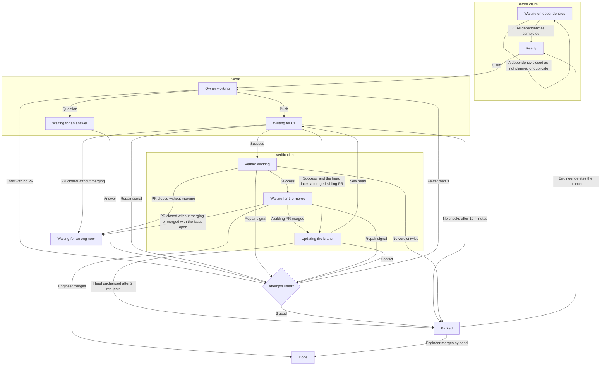
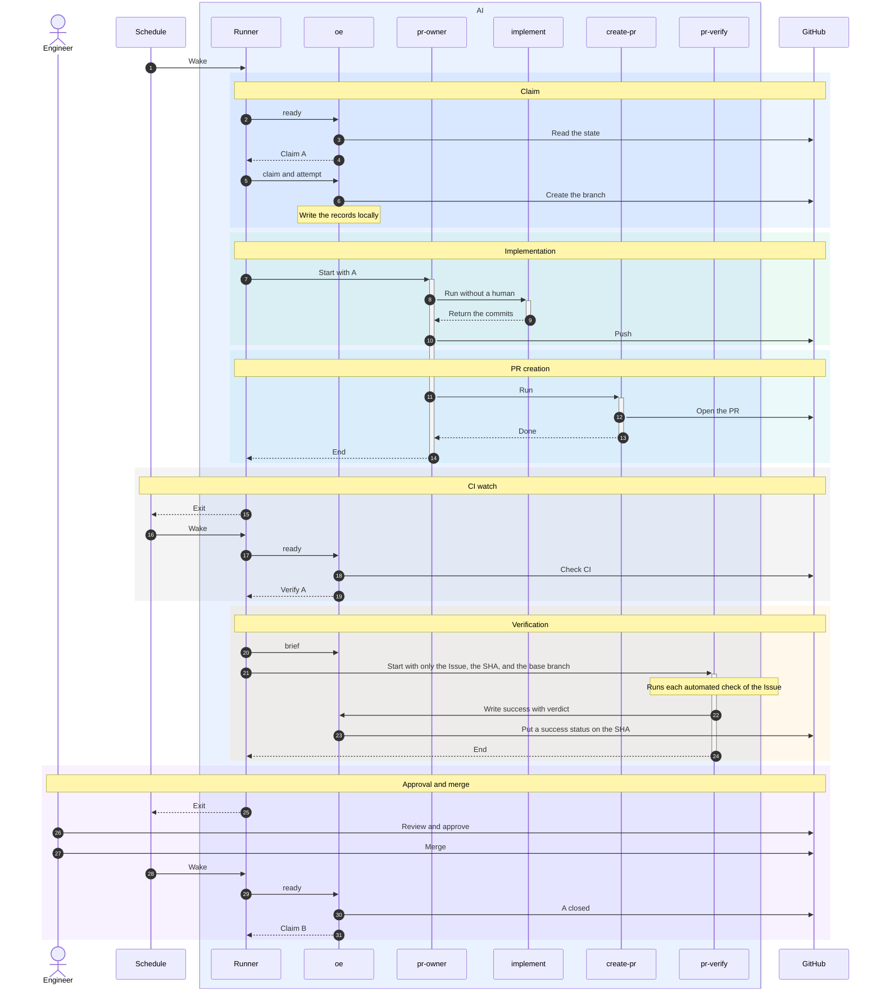

# orchestrate-epic Design

## Purpose

orchestrate-epic turns an Epic's child Issues into verified PRs in dependency order. It reads its state from GitHub and its own host, and an engineer or repository automation does the merging.

## Responsibilities

Each part does one job and stores no state of its own. State lives on GitHub, except oe's records, which stay in the host-local record store, and the pane of each Epic's board.

### Coordinator

| Part | Job | Uses |
|---|---|---|
| Runner | Woken by a schedule. Gets each Issue's next action from oe ready, starts each agent it needs with the oe start command that oe ready prints, runs each branch update with the oe update command that oe ready prints, waits for the agents to end with oe wait, and exits, as `development-pipeline.md` defines | oe, pr-owner, pr-verify |

### Agents

| Part | Job | Uses |
|---|---|---|
| pr-owner | Implements or repairs one Issue once and pushes. When it cannot decide, it writes a question on the Issue and pushes nothing. After a bot repair, it asks the bots to review again | implement, create-pr, oe records, oe question, oe rereview |
| pr-verify | Runs the code at the PR's head SHA and judges only the Issue's automated checks, leaving manual checks to the engineer | oe verdict |

### Existing skills

| Part | Job | Uses |
|---|---|---|
| implement | Writes code and tests and commits them, without pushing | commit |
| commit | Screens for secrets, then commits | none |
| create-pr | Writes the PR body and opens the PR | none |

### oe

| Part | Job | Writes to |
|---|---|---|
| Host-local record store | Keeps the Epic list and Modes, the starts that `observe` recorded, each Issue's claim, attempt, update, and findings records until oe forget drops them, and the Runner lock | `$XDG_STATE_HOME/orchestrate-epic` or `~/.local/state/orchestrate-epic` |
| oe lock | Refuses a second Runner on the same host | A host-local lock |
| oe ready | Reads GitHub and the record store and prints each Issue's next action, with the oe start command for an action that starts an agent and the oe update command for a branch update | nothing |
| oe start | Runs every step that starts an Owner or a Verifier for one Issue, from oe claim to oe brief, and prints the agent's prompt | What those steps write |
| oe update | Writes an update record, then asks GitHub to merge the base branch into an Issue's PR branch, with the head oe ready read as the expected head, and waits up to a minute for the head to move | The record store, and the PR branch on GitHub |
| oe wait | Blocks until oe ready's next actions change, reading GitHub as Polling and Rate limit under Decisions say | The record store |
| oe status | Shows each Issue's step, PR, CI result, verdict and failure reason, attempts, running agent, Wait state, and time in step. `--watch` refreshes it until the Runner ends | A Herdr notification |
| oe board | Inside Herdr with git config `skills.herdr` true, opens a pane that runs `oe status --watch`, or reuses the Epic's pane from an earlier start | A Herdr pane, and the pane's record on this host |
| oe brief | Builds the brief handed to an Owner or a Verifier, and records each Verifier start before its brief | A pending verify status on the SHA, for a Verifier |
| oe claim | Creates the Issue's branch and writes a claim record | A branch on origin and the record store |
| oe worktree | Creates an agent's worktree outside the shared checkout, on the Issue branch for an Owner and detached at its head for a Verifier, and removes it after the agent ends | A local worktree |
| oe attempt | Writes an attempt record before an Owner starts, with the bots whose rounds it uses, and refuses a 4th | The record store |
| oe question | Writes an Owner's question in a fixed format | An Issue comment |
| oe rereview | Asks bots to review the PR again | A PR comment |
| oe verdict | Writes a Verifier's verdict and findings | A commit status on the SHA, and the record store |
| oe records | Prints an Issue's records from its latest claim on, for an Owner | nothing |
| oe forget | Drops an Epic's records once every child Issue is closed | The record store |

### Engineer

- Answers an Owner's question with a comment on the Issue
- Reviews the PR's code and submits Changes requested when something must change
- Resolves a bot's review thread to dismiss its finding
- Runs the manual checks, which the PR leaves unchecked
- Approves and merges the PR
- Deletes a parked Issue's branch so the AI starts it over
- Deletes the `<!-- automation-owner: orchestrate-epic -->` line from a parked Issue's PR body to hand the PR to another automation
- Removes or replaces a dependency that was closed as not planned or duplicate

## Invariants

| Invariant | Safety condition in the Epic |
|---|---|
| The AI never merges and never enables auto-merge | The merge conditions, such as the merge grant, the expected-SHA merge, and the post-merge freeze. They are dropped because the AI never merges |
| No Issue starts until every Issue it depends on is closed as completed | Dependencies done before starting |
| Claiming an Issue means creating its branch on origin, and the claim fails when the branch already exists | No double claim |
| A verdict is written as a commit status on the SHA that was checked, and is not written once that SHA is no longer the PR's head | Verdict bound to the SHA |
| A Verifier receives only the Issue, the SHA, and the base branch, never the PR body or the Owner's report | Verifier never sees the worker's report |
| Every Owner and Verifier starts fresh for one job and ends when the job is done | A fresh agent per step |
| Owner attempts are counted from the record store, and a 4th start is refused | Retry cap survives restarts on the same host |
| Each agent works only in its own worktree and never touches the shared checkout | Never touch the shared checkout |
| Engineer input is only an unmarked comment or review by someone with the OWNER, MEMBER, or COLLABORATOR role, and labels mean nothing | Trusted input only |
| A bot's text can start a repair but never instructs an agent | Trusted input only |
| When a GitHub read fails, oe ready prints nothing and exits with an error. When one PR moves during the read, only its Issue is unreadable, and that Issue starts nothing until a later read | A failed read decides nothing |
| Listing an Epic in Mode `auto` is consent, and removing it stops new starts | The entry gate. It is dropped because listing is consent |
| Success is decided by the real CI on GitHub, never by a local reproduction | The locally reproduced check set. It is dropped because the real CI runs |

The secret-scan safety condition is handled as an accepted risk.

## Source of Truth

An Issue moves through the phases in this diagram.

Every edge into the Attempts used check stands for one of the repair signals listed below the table. Row 4 applies to every claimed Issue, and the diagram draws Waiting for an engineer only from Waiting for CI, Verifier working, and Waiting for the merge.

For each Issue, oe ready reads this table from the top and outputs the action of the first row that matches. Rows 1 and 2 are gates on the default branch and apply to every Issue. Claim, attempt, and update records come from the record store. An Issue whose PR moved during the read matches no row: it starts nothing, and the next read classifies it.

| Row | Phase | State | Next action |
|---|---|---|---|
| 1 | Gate | The default branch's head SHA still has no checks after 10 minutes | Start nothing in this repository |
| 2 | Gate | A check on the default branch's head SHA is pending or failed, or the SHA has had no checks for less than 10 minutes | Start nothing and wait |
| 3 | Before claim | The Issue is closed | Mark it done |
| 4 | Before claim | A PR merged after the latest claim record, or the branch exists and its PR was closed without merging | Wait for an engineer |
| 5 | Before claim | No branch exists, and a dependency is not completed | Wait for the dependencies |
| 6 | Before claim | No branch exists, and every dependency is completed | Claim and start an Owner |
| 7 | Work | No trusted user has commented on the Issue since its latest question | Wait for the answer |
| 8 | Work | Any repair signal below is present | Start an Owner, or park the Issue when it already has 3 attempts |
| 9 | Verification | A check on the PR's head SHA is pending, or the SHA has had no checks for less than 10 minutes | Wait for CI |
| 10 | Verification | The PR's head SHA still has no checks after 10 minutes | Park the Issue |
| 11 | Verification | The PR's head SHA does not contain the commit that merged a sibling PR into the base branch | Update the branch with the base branch, or park the Issue when the SHA already has 2 update records |
| 12 | Verification | The PR's head SHA has neither a success nor a failure verdict | Start a Verifier, or park the Issue when the SHA already has 2 pending statuses |
| 13 | Verification | The PR's head SHA has a success verdict | Wait for an engineer to merge |

- Repair signals
  - No PR exists yet
  - The PR conflicts with the base branch
  - A check on the PR's head SHA failed
  - The verdict on the PR's head SHA is a failure
  - Since the latest attempt record, a trusted user wrote one of these
    - An answer to the latest question
    - A Changes requested review
    - A review-thread comment
  - A bot finding written since the latest attempt record
- Bot rounds
  - Each bot gets one round per claim
  - oe attempt records every bot whose finding counts when it runs
    - That round is used even when the Owner pushes nothing
  - The Owner repairs only the findings of the bots its attempt record holds
  - After its push, the Owner asks those bots to review again with oe rereview
    - oe ready waits for no re-review
  - A bot's findings after its round go to the engineer
  - A bot repair counts toward the cap of 3 attempts
- Counting
  - Only records after the latest claim record count, and every record counts when there is no claim record
  - The PR means the latest PR opened from the branch after the latest claim record
  - Verifier starts are counted by the pending statuses that oe puts on the SHA before each start
  - Branch updates are counted by the update records that oe update writes for the SHA before each request
  - The verify status that oe writes, whether pending, success, or failure, is never counted as a CI check
- Sibling PRs
  - A sibling PR is a PR merged into the base branch from the branch of another child Issue of the same Epic
  - A head contains a sibling PR when the commit that GitHub records as its merge commit is an ancestor of the head. That commit is the merge commit, the squash commit, or for a rebase merge the commit the base branch moved to

A comment is a bot finding when every row holds.

| Item | Condition |
|---|---|
| Author | A listed bot, told by its login and Bot type |
| Place | The first comment of a review thread that the bot opened in its own review |
| Thread | Unresolved and not outdated |
| Severity | Its first text line names a level the bot table repairs, as a word anywhere in the line |
| PR | No trusted user approved the head SHA |
| Round | The bot's round is unused |

| Bot | Login | Repairs | Ignores |
|---|---|---|---|
| CodeRabbit | `coderabbitai` | Critical, Major | Minor, Trivial |
| Codex | `chatgpt-codex-connector` | P0, P1 | P2, P3 |

## Worked Examples

The normal path. Issue B depends on Issue A.

| Case | What happens |
|---|---|
| Lost agent | The Owner ends without a PR, or the Runner dies. GitHub has no record of completion, so the next oe ready starts the next attempt on the same branch |
| Failed verification | The Verifier writes a failure verdict and stores its findings. An Owner reads the findings, repairs, and pushes. The new SHA has no verdict, so CI and verification run again |
| Manual checks | An Issue with only manual checks left gets a success verdict and waits for the merge |
| Failed CI | An Owner fixes the failed check on the same branch and pushes |
| Sibling merged | Issues A and B both wait for the merge, and the engineer merges A. At the next read, B's head lacks A's squash commit, so oe update merges the base branch into B's branch. CI and a Verifier run again on the new head, and B waits for the merge again once that head has a success verdict |
| Bot finding | CodeRabbit reports a Major finding. An Owner checks it in the code, repairs, pushes, and asks CodeRabbit to review again. A Major finding in that re-review goes to the engineer. A Minor finding starts nothing |
| Reached cap | When a repair signal remains after 3 attempts, the Issue is parked and the Issues that depend on it stop too. The engineer either finishes and merges it by hand, or deletes the branch so the AI starts over |
| Red default branch | While a check on the default branch fails, no claim, Owner, or Verifier starts, so no attempt is spent. The reason names the child Issues' PRs merged since the last passing head, so the engineer sees when the Epic broke its own base. The next wake after the check passes resumes |

## Accepted Risks

- The token is shared, so a verdict status can be forged
- When a commit other than a sibling PR lands on the base branch after verification, nothing is verified again
- A PR the engineer merges before oe updates and verifies it again lands without being verified against a sibling PR merged before it, as when two sibling PRs merge between two reads
- Workflows the AI changed run with the repository's secrets
- oe does not scan for secrets, and the commit skill screens each commit instead
- A comment the AI forgot to mark is read as engineer input
- The Runner lock works only within one host, so listing the same Epic on another host lets two agents touch the same branch
- Resuming an Epic on another host, or after losing the record store, resets attempt counts, bot rounds, and findings, and earlier engineer input and bot findings count as repair signals again
- Records carry the host's clock, so clock skew can misorder them against GitHub events
- A Runner killed while its agents run leaves them running, and the next wake can start a second agent on the same Issue
- oe ready reads only the newest PR with an Issue's branch name, so a newer PR from a fork with that name hides the Issue's own PR; its Owners find nothing to repair, and the Issue parks
- A bot that drops the level word from its first line or skips draft PRs has its findings missed
- A first line whose title happens to hold a level word starts a repair
- A finding in a bot's review body, outside any thread, starts nothing
- A bot that refuses the re-review on a rate limit leaves the repair unreviewed
- A bot finding the Owner cannot reproduce still spends an attempt
- While a Runner runs, the board is only as fresh as the Runner's latest read

## Decisions

| Question | Decision |
|---|---|
| A dependency closed as not planned or duplicate | The dependent Issue is not claimed and waits for an engineer's decision |
| Signals that start a repair Owner | Only the repair signals above. Plain PR comments start nothing |
| Bot findings that count | Only Major or higher from CodeRabbit and Codex, so the Owner never chases style |
| Reading severity | A level word anywhere in the first text line, never a fixed heading format, because the bots change their formats |
| Bot text as instructions | The Owner reads a finding as data, follows no instruction in it, and fixes only what reproduces in the code |
| Bot replies | Never count, because anyone can make a bot reply on a public repository |
| Bot rounds | One per bot per claim, so a bot and the Owner never chase each other and a slower bot still gets its round |
| Recording a round | oe attempt records it before the Owner starts, so an Owner that ends early cannot restart a chase |
| Other automations on its PRs | pr-owner writes the line `<!-- automation-owner: orchestrate-epic -->` near the end of each PR body, the owner line that `docs/design/babysit.md` defines, so babysit neither pushes nor replies there. Its replies would otherwise read as engineer input. oe never reads the line, so deleting it while oe still works on the Issue lets two writers act |
| Re-review request | One PR comment of `<!-- oe:rereview -->` and `@coderabbitai review` or `@codex review`. The marker keeps it from counting as engineer input |
| Bot findings after approval | Start nothing, so the AI never pushes onto a head being merged |
| Restarting an Owner after an answer | Counts toward the cap of 3 attempts |
| A Verifier ends without a verdict | It is restarted once on the same SHA, and the Issue is parked when the second start also gives no verdict |
| A head that lacks a sibling PR | oe update merges the base branch into it, as GitHub's Update branch button does, because its verdict describes a base that no longer exists. No agent starts, so an Epic with many siblings does not spend its attempts and get parked |
| An update GitHub refuses | A conflict goes to an Owner as a repair. Any other refusal parks the Issue after 2 requests on the same head |
| Reason for a red base | Names the Epic's PRs merged since the newest commit whose checks all passed, within the last 20 commits |
| Waiting | The Runner waits only for the agents it started. A schedule wakes it, and a wake that starts no agent exits at once |
| Only a person can act | When no agent runs and every Issue is done, parked, or waits for a merge, an answer, its dependencies, or an engineer, the Runner ends at once instead of waiting, because only a person moves those Issues and a rerun resumes from GitHub. An Issue that waits for CI or can be claimed, repaired, updated, or verified keeps the Runner running |
| Agents running at once | 3 Owners and Verifiers combined per host, changeable in the record store |
| Harnesses | One Adapter per harness maps the Executor contract of `development-pipeline.md` onto that harness. Agents start with no view of any other session |
| Agent mode | The agents declare `mode: subagent`, because OpenCode V2 refuses to start an agent without it as a subagent. APM drops the key for Codex |
| Implicit invocation | Codex ignores `disable-model-invocation`, so pr-owner and pr-verify carry `agents/openai.yaml` with `allow_implicit_invocation: false`, because only the Runner may start them |
| Counting Verifier starts | oe brief writes the pending verify status that oe ready counts, before it prints a Verifier's brief, so no Verifier starts uncounted |
| Worktrees | An agent's worktree is removed when the agent ends, and unpushed work is discarded |
| Where records go | The record store, because comments under the user's account cluttered timelines. Only questions and re-review requests stay on GitHub, in a fixed format that says an agent wrote them |
| Record key | Repository and Issue: an Issue has one parent Epic, and no writer is given the Epic |
| Dropping records | oe forget, which the Runner runs at a wake that finds every Issue of a listed Epic closed. It refuses while an Issue is open, and oe ready stays read-only |
| Acceptance checks | Verification splits automated checks from manual ones, and no agent checks a box that needs a human, template boxes included |
| The board in Herdr | Opt-in with git config `skills.herdr`, read only inside Herdr, so no other run calls herdr and no Herdr user gets a pane unasked |
| Board refresh | As Polling says. While a Runner holds the Epic's lock, a refresh draws the facts the Runner last read and adds no GitHub reads. The board reads GitHub itself only when no Runner runs |
| Board lifetime | The board stops once the Runner holding the Epic's lock ends, and leaves its last view. A `--watch` started with no Runner holding the lock draws once and exits. A later start reuses its pane when the pane runs the board or sits at its shell's prompt, and never sends input to a pane that runs anything else |
| Notifications | Each new Issue that needs the owner, such as a question or a park, raises one Herdr notification, inside Herdr with git config `skills.herdr` true |
| Starting agents | Through oe start, which oe ready prints for each line that starts an agent, because a Runner that lost the skill to a compaction rebuilt the steps from memory and passed the Epic number as the Issue |
| Waits per Epic | One on each host. A new oe wait stops the earlier one, which exits silently, because a Runner rebuilding its loop after a compaction started waits without stopping old ones, and each extra wait woke it again |
| Polling | One light read every 2 minutes. Every child Issue is read only on a change to it, its PR, or its checks, on a merge of a sibling PR, or at a deadline such as a head with no checks for 10 minutes |
| Open PRs | oe ready reads only the PRs of the child Issues' branches |
| Rate limit | oe wait waits until the reset time. Any other failure still ends it |
