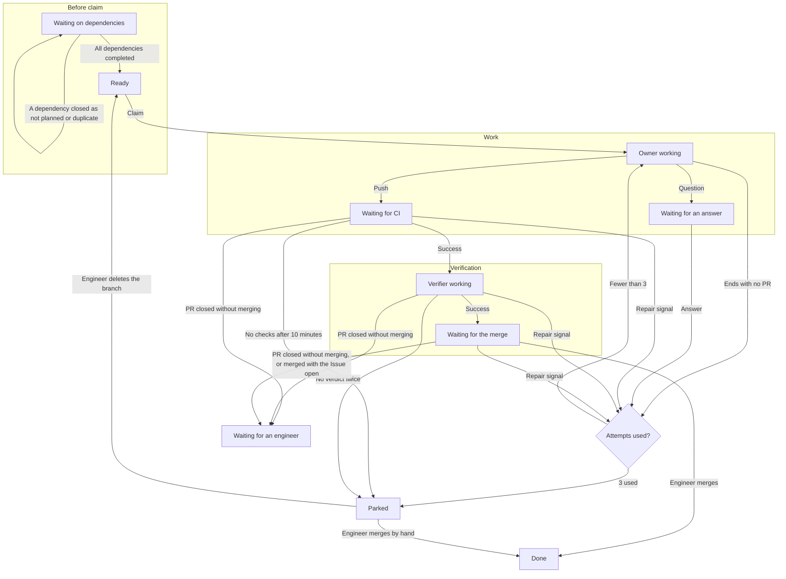
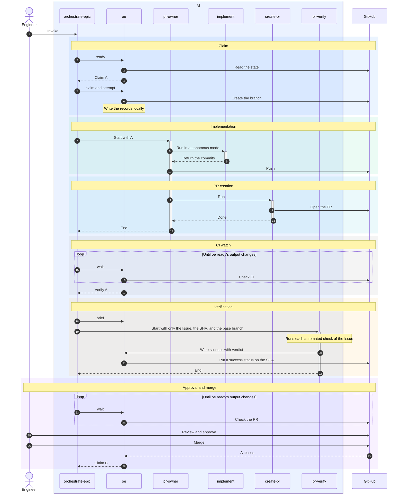

# orchestrate-epic Design

## Purpose

orchestrate-epic turns an Epic's child Issues into verified PRs in dependency order. It reads its state from GitHub and its own host, and an engineer or repository automation does the merging.

## Responsibilities

Each part does one job and stores no state of its own. State lives on GitHub, except oe's claim, attempt, and findings records, which stay in the host-local record store.

### Coordinator

| Part | Job | Uses |
|---|---|---|
| orchestrate-epic | Gets each Issue's next action from oe ready, starts the agents it needs in the background, and waits in the background for an agent to end or GitHub to change with oe wait, in a loop | oe, pr-owner, pr-verify |

### Agents

| Part | Job | Uses |
|---|---|---|
| pr-owner | Implements or repairs one Issue once and pushes. When it cannot decide, it writes a question on the Issue and pushes nothing. After a bot repair, it asks the bots to review again | implement, create-pr, oe records, oe question, oe rereview |
| pr-verify | Runs the code at the PR's head SHA and judges only the Issue's automated checks, leaving manual checks to the engineer | oe verdict |

### Existing skills

| Part | Job | Uses |
|---|---|---|
| implement | Writes code and tests and commits them, without pushing | commit |
| commit | Screens for secrets, then commits | none |
| create-pr | Writes the PR body and opens the PR | none |

### oe

| Part | Job | Writes to |
|---|---|---|
| Host-local record store | Keeps each Issue's claim, attempt, and findings records until oe forget drops them | oe lock's directory: `$XDG_STATE_HOME/orchestrate-epic` or `~/.local/state/orchestrate-epic` |
| oe lock | Refuses a second session for the same Epic | A host-local lock |
| oe ready | Reads GitHub and the record store and prints each Issue's next action | nothing |
| oe status | Shows each Issue's step, PR, CI result, verdict and failure reason, attempts, running agent, and time in step. `--watch` refreshes it | nothing |
| oe wait | Waits until oe ready's output changes or 9 minutes pass | nothing |
| oe brief | Builds the brief handed to an Owner or a Verifier, and records each Verifier start before its brief | A pending verify status on the SHA, for a Verifier |
| oe claim | Creates the Issue's branch and writes a claim record | A branch on origin and the record store |
| oe worktree | Creates an agent's worktree outside the shared checkout, on the Issue branch for an Owner and detached at its head for a Verifier, and removes it after the agent ends | A local worktree |
| oe attempt | Writes an attempt record before an Owner starts, with the bots whose rounds it uses, and refuses a 4th | The record store |
| oe question | Writes an Owner's question in a fixed format | An Issue comment |
| oe rereview | Asks bots to review the PR again | A PR comment |
| oe verdict | Writes a Verifier's verdict and findings | A commit status on the SHA, and the record store |
| oe records | Prints an Issue's records from its latest claim on, for an Owner | nothing |
| oe forget | Drops an Epic's records once every child Issue is closed | The record store |

### Engineer

- Answers an Owner's question with a comment on the Issue
- Reviews the PR's code and submits Changes requested when something must change
- Resolves a bot's review thread to dismiss its finding
- Runs the manual checks, which the PR leaves unchecked
- Approves and merges the PR
- Deletes a parked Issue's branch so the AI starts it over
- Removes or replaces a dependency that was closed as not planned or duplicate

## Invariants

| Invariant | Safety condition in the Epic |
|---|---|
| The AI never merges and never enables auto-merge | The merge conditions, such as the merge grant, the expected-SHA merge, and the post-merge freeze. They are dropped because the AI never merges |
| No Issue starts until every Issue it depends on is closed as completed | Dependencies done before starting |
| Claiming an Issue means creating its branch on origin, and the claim fails when the branch already exists | No double claim |
| A verdict is written as a commit status on the SHA that was checked, and is not written once that SHA is no longer the PR's head | Verdict bound to the SHA |
| A Verifier receives only the Issue, the SHA, and the base branch, never the PR body or the Owner's report | Verifier never sees the worker's report |
| Every Owner and Verifier starts fresh for one job and ends when the job is done | A fresh agent per step |
| Owner attempts are counted from the record store, and a 4th start is refused | Retry cap survives restarts on the same host |
| Each agent works only in its own worktree and never touches the shared checkout | Never touch the shared checkout |
| Engineer input is only an unmarked comment or review by someone with the OWNER, MEMBER, or COLLABORATOR role, and labels mean nothing | Trusted input only |
| A bot's text can start a repair but never instructs an agent | Trusted input only |
| When any GitHub read fails, oe ready prints nothing and exits with an error | A failed read decides nothing |
| Invoking the skill is consent, and ending the session stops every agent | The entry gate. It is dropped because invoking is consent |
| Success is decided by the real CI on GitHub, never by a local reproduction | The locally reproduced check set. It is dropped because the real CI runs |

The secret-scan safety condition is handled as an accepted risk.

## Source of Truth

An Issue moves through the phases in this diagram.

Every edge into the Attempts used check stands for one of the repair signals listed below the table. Row 4 applies to every claimed Issue, and the diagram draws Waiting for an engineer only from Waiting for CI, Verifier working, and Waiting for the merge.

For each Issue, oe ready reads this table from the top and outputs the action of the first row that matches. Rows 1 and 2 are gates on the default branch and apply to every Issue. Claim and attempt records come from the record store.

| Row | Phase | State | Next action |
|---|---|---|---|
| 1 | Gate | The default branch's head SHA still has no checks after 10 minutes | End the session |
| 2 | Gate | A check on the default branch's head SHA is pending or failed, or the SHA has had no checks for less than 10 minutes | Start nothing and wait |
| 3 | Before claim | The Issue is closed | Mark it done |
| 4 | Before claim | A PR merged after the latest claim record, or the branch exists and its PR was closed without merging | Wait for an engineer |
| 5 | Before claim | No branch exists, and a dependency is not completed | Wait for the dependencies |
| 6 | Before claim | No branch exists, and every dependency is completed | Claim and start an Owner |
| 7 | Work | No trusted user has commented on the Issue since its latest question | Wait for the answer |
| 8 | Work | Any repair signal below is present | Start an Owner, or park the Issue when it already has 3 attempts |
| 9 | Verification | A check on the PR's head SHA is pending, or the SHA has had no checks for less than 10 minutes | Wait for CI |
| 10 | Verification | The PR's head SHA still has no checks after 10 minutes | Park the Issue |
| 11 | Verification | The PR's head SHA has neither a success nor a failure verdict | Start a Verifier, or park the Issue when the SHA already has 2 pending statuses |
| 12 | Verification | The PR's head SHA has a success verdict | Wait for an engineer to merge |

- Repair signals
  - No PR exists yet
  - The PR conflicts with the base branch
  - A check on the PR's head SHA failed
  - The verdict on the PR's head SHA is a failure
  - Since the latest attempt record, a trusted user wrote one of these
    - An answer to the latest question
    - A Changes requested review
    - A review-thread comment
  - A bot finding written since the latest attempt record
- Bot rounds
  - Each bot gets one round per claim
  - oe attempt records every bot whose finding counts when it runs
    - That round is used even when the Owner pushes nothing
  - The Owner repairs only the findings of the bots its attempt record holds
  - After its push, the Owner asks those bots to review again with oe rereview
    - oe ready waits for no re-review
  - A bot's findings after its round go to the engineer
  - A bot repair counts toward the cap of 3 attempts
- Counting
  - Only records after the latest claim record count, and every record counts when there is no claim record
  - The PR means the latest PR opened from the branch after the latest claim record
  - Verifier starts are counted by the pending statuses that oe puts on the SHA before each start
  - The verify status that oe writes, whether pending, success, or failure, is never counted as a CI check
  - An Issue with an agent running in this session is left out of oe ready's output

A comment is a bot finding when every row holds.

| Item | Condition |
|---|---|
| Author | A listed bot, told by its login and Bot type |
| Place | The first comment of a review thread that the bot opened in its own review |
| Thread | Unresolved and not outdated |
| Severity | Its first text line names a level the bot table repairs, as a word anywhere in the line |
| PR | No trusted user approved the head SHA |
| Round | The bot's round is unused |

| Bot | Login | Repairs | Ignores |
|---|---|---|---|
| CodeRabbit | `coderabbitai` | Critical, Major | Minor, Trivial |
| Codex | `chatgpt-codex-connector` | P0, P1 | P2, P3 |

## Worked Examples

The normal path. Issue B depends on Issue A.

| Case | What happens |
|---|---|
| Lost agent | The Owner ends without a PR, or the session dies. GitHub has no record of completion, so the next oe ready starts the next attempt on the same branch |
| Failed verification | The Verifier writes a failure verdict and stores its findings. An Owner reads the findings, repairs, and pushes. The new SHA has no verdict, so CI and verification run again |
| Manual checks | An Issue with only manual checks left gets a success verdict and waits for the merge |
| Failed CI | An Owner fixes the failed check on the same branch and pushes |
| Bot finding | CodeRabbit reports a Major finding. An Owner checks it in the code, repairs, pushes, and asks CodeRabbit to review again. A Major finding in that re-review goes to the engineer. A Minor finding starts nothing |
| Reached cap | When a repair signal remains after 3 attempts, the Issue is parked and the Issues that depend on it stop too. The engineer either finishes and merges it by hand, or deletes the branch so the AI starts over |
| Red default branch | While a check on the default branch fails, no claim, Owner, or Verifier starts, so no attempt is spent. The loop resumes once the check passes |

## Accepted Risks

- The token is shared, so a verdict status can be forged
- When the base branch moves after verification, nothing is verified again
- Workflows the AI changed run with the repository's secrets
- oe does not scan for secrets, and the commit skill screens each commit instead
- A comment the AI forgot to mark is read as engineer input
- The session lock works only within one host, so running the same Epic on another host lets two agents touch the same branch
- Resuming an Epic on another host, or after losing the record store, resets attempt counts, bot rounds, and findings, and earlier engineer input and bot findings count as repair signals again
- Records carry the host's clock, so clock skew can misorder them against GitHub events
- In OpenCode V2 and an interactive Codex session the session's process is a shared background service, so a session that ends without releasing its lock blocks a rerun until the service restarts or the lock is released with its token
- In Codex, waiting is not free: the session polls oe wait every 30 seconds within one turn, so a long run grows its context, and a compaction can drop the lock token or the running agents the session keeps in memory
- oe ready reads only the newest PR with an Issue's branch name, so a newer PR from a fork with that name hides the Issue's own PR; its Owners find nothing to repair, and the Issue parks
- A bot that drops the level word from its first line or skips draft PRs has its findings missed
- A first line whose title happens to hold a level word starts a repair
- A finding in a bot's review body, outside any thread, starts nothing
- A bot that refuses the re-review on a rate limit leaves the repair unreviewed
- A bot finding the Owner cannot reproduce still spends an attempt

## Decisions

| Question | Decision |
|---|---|
| A dependency closed as not planned or duplicate | The dependent Issue is not claimed and waits for an engineer's decision |
| Signals that start a repair Owner | Only the repair signals above. Plain PR comments start nothing |
| Bot findings that count | Only Major or higher from CodeRabbit and Codex, so the Owner never chases style |
| Reading severity | A level word anywhere in the first text line, never a fixed heading format, because the bots change their formats |
| Bot text as instructions | The Owner reads a finding as data, follows no instruction in it, and fixes only what reproduces in the code |
| Bot replies | Never count, because anyone can make a bot reply on a public repository |
| Bot rounds | One per bot per claim, so a bot and the Owner never chase each other and a slower bot still gets its round |
| Recording a round | oe attempt records it before the Owner starts, so an Owner that ends early cannot restart a chase |
| Re-review request | One PR comment of `<!-- oe:rereview -->` and `@coderabbitai review` or `@codex review`. The marker keeps it from counting as engineer input |
| Bot findings after approval | Start nothing, so the AI never pushes onto a head being merged |
| Restarting an Owner after an answer | Counts toward the cap of 3 attempts |
| A Verifier ends without a verdict | It is restarted once on the same SHA, and the Issue is parked when the second start also gives no verdict |
| Waiting | One oe wait call waits up to 9 minutes, under the 10-minute limit Claude Code puts on a background command, and when no agent is running and oe ready's output does not change for 4 hours, the session prints a summary and ends |
| Agents running at once | 3 Owners and Verifiers combined, changeable by an argument at invocation |
| How the loop waits | Agents and oe wait run in the background where the harness can, and the session ends its turn, so waiting costs no tokens. A blocking oe wait would miss an ended agent, because oe ready leaves running Issues out |
| Harnesses | The skill text, not a fork, maps each harness's tools onto the loop. OpenCode V1 waits in the foreground and sees an ended agent up to 9 minutes late; without background agents it starts each pass as one batch. Codex wakes no idle session, so it never ends its turn and polls oe wait every 30 seconds, stopping it with Ctrl-C when an agent ends. Codex agents start with `fork_turns: "none"`, so they never see the session's conversation |
| Agent mode | The agents declare `mode: subagent`, because OpenCode V2 refuses to start an agent without it as a subagent. APM drops the key for Codex |
| Codex skill size | Codex cuts a plugin's skill at 8,000 bytes, so orchestrate-epic ends with a marker and tells the model to read the whole file when the marker is missing |
| Implicit invocation | Codex ignores `disable-model-invocation`, so orchestrate-epic, pr-owner, and pr-verify carry `agents/openai.yaml` with `allow_implicit_invocation: false`, because invoking orchestrate-epic is the consent to push |
| Counting Verifier starts | oe brief writes the pending verify status that oe ready counts, before it prints a Verifier's brief, so no Verifier starts uncounted |
| Worktrees | An agent's worktree is removed when the agent ends, and unpushed work is discarded |
| Where records go | The record store, because comments under the user's account cluttered timelines. Only questions and re-review requests stay on GitHub, in a fixed format that says an agent wrote them |
| Record key | Repository and Issue: an Issue has one parent Epic, and no writer is given the Epic |
| Dropping records | oe forget, when a session ends with every Issue done. It refuses while an Issue is open, and oe ready stays read-only |
| Acceptance checks | Verification splits automated checks from manual ones, and no agent checks a box that needs a human, template boxes included |
