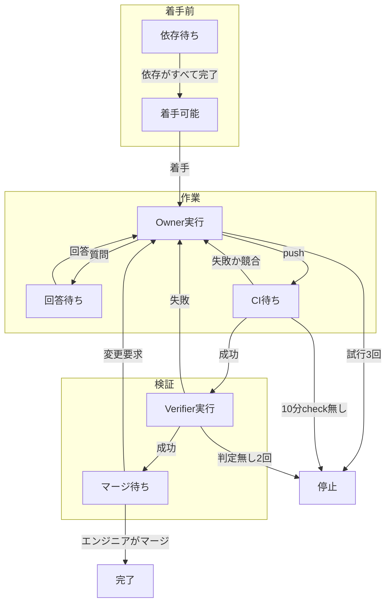
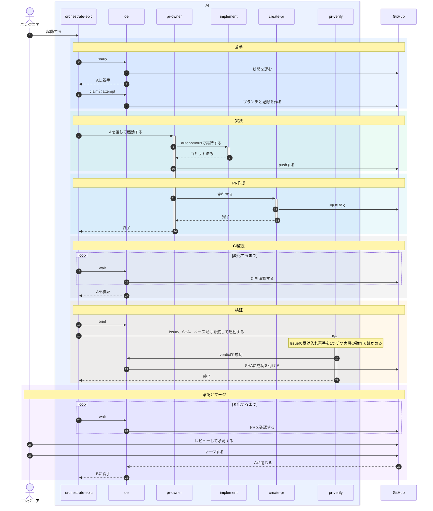

# orchestrate-epic設計

## 目的

Epicの子Issueを依存順に検証済みPRへ変え、状態はすべてGitHubから導き、マージはエンジニアかリポジトリの自動化に任せる。

## 責務

各部品は1つの仕事だけを持ち、状態を持たない。

### 進行役

| 部品 | 仕事 | 使う部品 |
|---|---|---|
| orchestrate-epic | 次の行動を得てエージェントを起動し、変化を待つことを繰り返す | oe、pr-owner、pr-verify |

### エージェント

| 部品 | 仕事 | 使う部品 |
|---|---|---|
| pr-owner | Issueを1段だけ進め、迷えば質問だけして何もpushしない | implement、create-pr、oe question |
| pr-verify | 1つのSHAが、Issueの受け入れ基準を実際の動作で満たすかを確かめる | oe verdict |

### 既存スキル

| 部品 | 仕事 | 使う部品 |
|---|---|---|
| implement | コードとテストを書いてコミットし、pushはしない | commit |
| commit | 秘密情報を検査してコミットする | なし |
| create-pr | PRを作る | なし |

### oe

| 部品 | 仕事 | 書き込み |
|---|---|---|
| oe lock | 同じEpicの2つ目のセッションを拒否する | ホスト内のロック |
| oe ready | Issueごとの次の行動を出す | なし |
| oe wait | CIや承認を監視し、oe readyの出力が変わるか時間切れまで待つ | なし |
| oe brief | エージェントへの指示を作る | なし |
| oe claim | 着手する | ブランチと着手記録 |
| oe worktree | 共有チェックアウトの外に作業場所を用意し、終了時に消す | ローカルのworktree |
| oe attempt | 試行を記録し、4回目を拒否する | 試行記録 |
| oe question | 質問を書く | Issueのコメント |
| oe verdict | 判定を書く | SHAのステータスとPRの指摘コメント |

### エンジニア

答え、レビューし、承認してマージし、ブランチを消してやり直させる。

## 不変条件

| 不変条件 | 対応するEpicの安全条件 |
|---|---|
| AIはマージも自動マージ有効化もしない | マージ許可などマージ系の条件はすべて不要になる |
| 依存先がすべて完了で閉じてから着手する | 依存の完了 |
| 着手はブランチ作成で行い、既にあれば失敗する | 二重着手の防止 |
| 判定は検証したSHAのコミットステータスで、そのSHAがPRの先頭のときだけ書く | 判定とSHAの結び付け |
| VerifierにはIssueとSHAとベースだけを渡す | Verifierは作業者の報告を見ない |
| エージェントは1段ごとに新しく起動して終わる | 段ごとに新しいエージェント |
| Ownerの試行はGitHubから数え、4回目は拒否する | 再起動しても残る試行上限 |
| エージェントは自分のworktreeだけで作業する | 共有チェックアウトに触れない |
| エンジニアの入力は信頼ユーザーのマーカーなしコメントだけで、ラベルは意味を持たない | 信頼できる入力だけを使う |
| GitHubの読み取りに失敗したら何も決めない | 読み取り失敗で判断しない |
| 起動が同意で、セッション終了ですべて止まる | 開始ゲートは不要になる |
| 本物のCIで判断する | ローカル再現の検査集合は不要になる |

秘密情報の検査は受容するリスクに対応する。

## 状態の導出

Issueは次の段階を進む。

oe readyはIssueごとに、上から順に最初に当てはまる行の行動を出す。

| 順 | 段階 | GitHubの状態 | 次の行動 |
|---|---|---|---|
| 1 | 関門 | 既定ブランチの先頭に10分経ってもcheckが無い | セッションを終える |
| 2 | 関門 | 既定ブランチのcheckが保留か失敗 | 何も始めない |
| 3 | 着手前 | Issueが閉じている | 完了 |
| 4 | 着手前 | 最新の着手後にマージ済みPRがあるか、閉じたPRだけのブランチがある | エンジニアを待つ |
| 5 | 着手前 | ブランチが無く、依存が未完了 | 依存を待つ |
| 6 | 着手前 | ブランチが無く、依存がすべて完了 | 着手してOwnerを起動する |
| 7 | 作業 | 未回答の質問がある | 回答を待つ |
| 8 | 作業 | 修理シグナルがある | Ownerを起動し、試行3回なら停止する |
| 9 | 検証 | PRのcheckが保留 | CIを待つ |
| 10 | 検証 | PRの先頭に10分経ってもcheckが無い | 停止する |
| 11 | 検証 | 判定が無い | Verifierを起動し、判定無しが2回なら停止する |
| 12 | 検証 | 成功判定がある | マージを待つ |

- 修理シグナル
  - PRが無い
  - 競合している
  - checkが失敗している
  - 判定が失敗している
  - 最新の試行より新しい信頼ユーザーの回答、変更要求レビュー、レビュースレッドのコメント
- 数え方
  - 記録は最新の着手記録より後のものだけを数え、着手記録が無ければすべて数える
  - Verifierの回数は、起動前にそのSHAへ付ける保留ステータスの数で数える
  - 自分の判定ステータスはcheckに含めない
  - 実行中のエージェントがいるIssueはセッション内で除く

## 具体例

正常系では、BはAに依存する。

| 場面 | 動き |
|---|---|
| エージェント消失 | GitHubに完了の印が無いので次の試行が同じブランチで始まり、セッションの再実行も同じ状態から再開する |
| 検証失敗 | 失敗判定と指摘コメントを受けてOwnerが修理し、新しい先頭でCIと検証をやり直す |
| CI失敗 | Ownerが同じブランチで修理する |
| 上限到達 | 3回で停止し、依存するIssueも待ち、エンジニアが手で仕上げるかブランチを消してやり直す |
| 既定ブランチの失敗 | 着手もOwnerもVerifierも始めないので試行を消費せず、成功に戻れば再開する |

## 受容するリスク

- 共有トークンでは判定を偽造できる
- ベースが動いても再検証しない
- AIが変えたワークフローが秘密情報付きで動く
- oeは秘密情報を検査せず、各コミットはcommitスキルが検査する
- マーカーを付け忘れたAIの書き込みはエンジニアの入力に見える
- セッションロックはホスト内だけなので、別ホストのセッションは拒否できない

## 決定事項

| 論点 | 決定 |
|---|---|
| 依存先が不要や重複で閉じた | 依存するIssueはエンジニアを待つ |
| 修理を起動するシグナル | 上の修理シグナルだけで、通常のPRコメントとbotのレビューは無視する |
| 回答後の再起動 | 試行上限3回に数える |
| Verifierが判定を出せない | 1回だけ再試行し、2回目で停止する |
| 待機 | oe waitは1回25分までで、4時間変化が無ければ要約を出して終わる |
| 並列数 | OwnerとVerifierの合計3で、引数で変えられる |
| worktree | エージェント終了時に消し、pushしていない作業は捨てる |
| 判定の指摘 | マーカー付きのPRコメントに書き、次のOwnerが読む |
