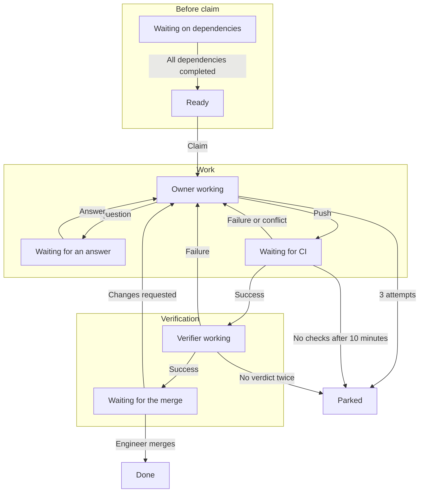
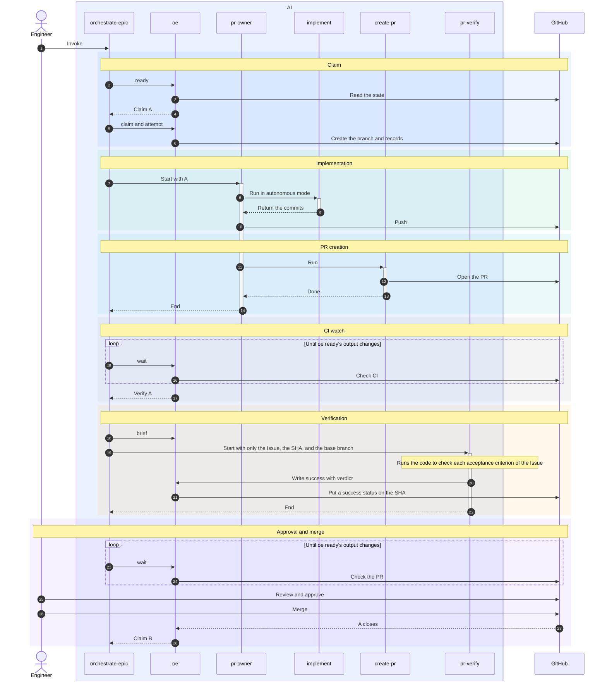

# orchestrate-epic Design

## Purpose

orchestrate-epic turns an Epic's child Issues into verified PRs in dependency order. It reads every state from GitHub, and an engineer or repository automation does the merging.

## Responsibilities

Each part does one job and stores no state of its own. All state lives on GitHub.

### Coordinator

| Part | Job | Uses |
|---|---|---|
| orchestrate-epic | Gets each Issue's next action from oe ready, starts the agents it needs, and waits for GitHub to change with oe wait, in a loop | oe, pr-owner, pr-verify |

### Agents

| Part | Job | Uses |
|---|---|---|
| pr-owner | Implements or repairs one Issue once and pushes. When it cannot decide, it writes a question on the Issue and pushes nothing | implement, create-pr, oe question |
| pr-verify | Runs the code at the PR's head SHA to check that it meets every acceptance criterion of the Issue | oe verdict |

### Existing skills

| Part | Job | Uses |
|---|---|---|
| implement | Writes code and tests and commits them, without pushing | commit |
| commit | Screens for secrets, then commits | none |
| create-pr | Writes the PR body and opens the PR | none |

### oe

| Part | Job | Writes to |
|---|---|---|
| oe lock | Refuses a second session for the same Epic | A host-local lock |
| oe ready | Reads GitHub and prints each Issue's next action | nothing |
| oe wait | Waits until oe ready's output changes or 25 minutes pass | nothing |
| oe brief | Builds the brief handed to an Owner or a Verifier | nothing |
| oe claim | Creates the Issue's branch and writes a claim record | A branch on origin and an Issue comment |
| oe worktree | Creates an agent's worktree outside the shared checkout and removes it after the agent ends | A local worktree |
| oe attempt | Writes an attempt record before an Owner starts, and refuses a 4th | An Issue comment |
| oe question | Writes an Owner's question | An Issue comment |
| oe verdict | Writes a Verifier's verdict and findings | A commit status on the SHA and a PR comment |

### Engineer

- Answers an Owner's question with a comment on the Issue
- Reviews the PR's code and submits Changes requested when something must change
- Approves and merges the PR
- Deletes a parked Issue's branch so the AI starts it over

## Invariants

| Invariant | Safety condition in the Epic |
|---|---|
| The AI never merges and never enables auto-merge | The merge conditions, such as the merge grant, the expected-SHA merge, and the post-merge freeze. They are dropped because the AI never merges |
| No Issue starts until every Issue it depends on is closed as completed | Dependencies done before starting |
| Claiming an Issue means creating its branch on origin, and the claim fails when the branch already exists | No double claim |
| A verdict is written as a commit status on the SHA that was checked, and is not written once that SHA is no longer the PR's head | Verdict bound to the SHA |
| A Verifier receives only the Issue, the SHA, and the base branch, never the PR body or the Owner's report | Verifier never sees the worker's report |
| Every Owner and Verifier starts fresh for one job and ends when the job is done | A fresh agent per step |
| Owner attempts are counted from the attempt records on GitHub, and a 4th start is refused | Retry cap survives restarts |
| Each agent works only in its own worktree and never touches the shared checkout | Never touch the shared checkout |
| Engineer input is only an unmarked comment or review by someone with the OWNER, MEMBER, or COLLABORATOR role, and labels mean nothing | Trusted input only |
| When any GitHub read fails, oe ready prints nothing and exits with an error | A failed read decides nothing |
| Invoking the skill is consent, and ending the session stops every agent | The entry gate. It is dropped because invoking is consent |
| Success is decided by the real CI on GitHub, never by a local reproduction | The locally reproduced check set. It is dropped because the real CI runs |

The secret-scan safety condition is handled as an accepted risk.

## Source of Truth

An Issue moves through the phases in this diagram.

For each Issue, oe ready reads this table from the top and outputs the action of the first row that matches. Rows 1 and 2 are gates on the default branch and apply to every Issue.

| Row | Phase | State on GitHub | Next action |
|---|---|---|---|
| 1 | Gate | The default branch's head SHA still has no checks after 10 minutes | End the session |
| 2 | Gate | A check on the default branch's head SHA is pending or failed | Start nothing and wait |
| 3 | Before claim | The Issue is closed | Mark it done |
| 4 | Before claim | A PR merged after the latest claim record, or the branch exists and its PR was closed without merging | Wait for an engineer |
| 5 | Before claim | No branch exists, and a dependency is not completed | Wait for the dependencies |
| 6 | Before claim | No branch exists, and every dependency is completed | Claim and start an Owner |
| 7 | Work | No trusted user has commented on the Issue since its latest question | Wait for the answer |
| 8 | Work | Any repair signal below is present | Start an Owner, or park the Issue when it already has 3 attempts |
| 9 | Verification | A check on the PR's head SHA is pending | Wait for CI |
| 10 | Verification | The PR's head SHA still has no checks after 10 minutes | Park the Issue |
| 11 | Verification | The PR's head SHA has neither a success nor a failure verdict | Start a Verifier, or park the Issue when the SHA already has 2 pending statuses |
| 12 | Verification | The PR's head SHA has a success verdict | Wait for an engineer to merge |

- Repair signals
  - No PR exists yet
  - The PR conflicts with the base branch
  - A check on the PR's head SHA failed
  - The verdict on the PR's head SHA is a failure
  - Since the latest attempt record, a trusted user wrote one of these
    - An answer to the latest question
    - A Changes requested review
    - A review-thread comment
- Counting
  - Only records after the latest claim record count, and every record counts when there is no claim record
  - Verifier starts are counted by the pending statuses that oe puts on the SHA before each start
  - The status oe verdict writes is never counted as a CI check
  - An Issue with an agent running in this session is left out of oe ready's output

## Worked Examples

The normal path. Issue B depends on Issue A.

| Case | What happens |
|---|---|
| Lost agent | The Owner ends without a PR, or the session dies. GitHub has no record of completion, so the next oe ready starts the next attempt on the same branch |
| Failed verification | The Verifier writes a failure verdict and a findings comment. An Owner reads the findings, repairs, and pushes. The new SHA has no verdict, so CI and verification run again |
| Failed CI | An Owner fixes the failed check on the same branch and pushes |
| Reached cap | When a repair signal remains after 3 attempts, the Issue is parked and the Issues that depend on it stop too. The engineer either finishes and merges it by hand, or deletes the branch so the AI starts over |
| Red default branch | While a check on the default branch fails, no claim, Owner, or Verifier starts, so no attempt is spent. The loop resumes once the check passes |

## Accepted Risks

- The token is shared, so a verdict status can be forged
- When the base branch moves after verification, nothing is verified again
- Workflows the AI changed run with the repository's secrets
- oe does not scan for secrets, and the commit skill screens each commit instead
- A comment the AI forgot to mark is read as engineer input
- The session lock works only within one host, so running the same Epic on another host lets two agents touch the same branch

## Decisions

| Question | Decision |
|---|---|
| A dependency closed as not planned or duplicate | The dependent Issue is not claimed and waits for an engineer's decision |
| Signals that start a repair Owner | Only the repair signals above. Plain PR comments and bot reviews start nothing |
| Restarting an Owner after an answer | Counts toward the cap of 3 attempts |
| A Verifier ends without a verdict | It is restarted once on the same SHA, and the Issue is parked when the second start also gives no verdict |
| Waiting | One oe wait call waits up to 25 minutes, and when oe ready's output does not change for 4 hours, the session prints a summary and ends |
| Agents running at once | 3 Owners and Verifiers combined, changeable by an argument at invocation |
| Worktrees | An agent's worktree is removed when the agent ends, and unpushed work is discarded |
| Where findings go | A marked PR comment, which the next Owner reads |
