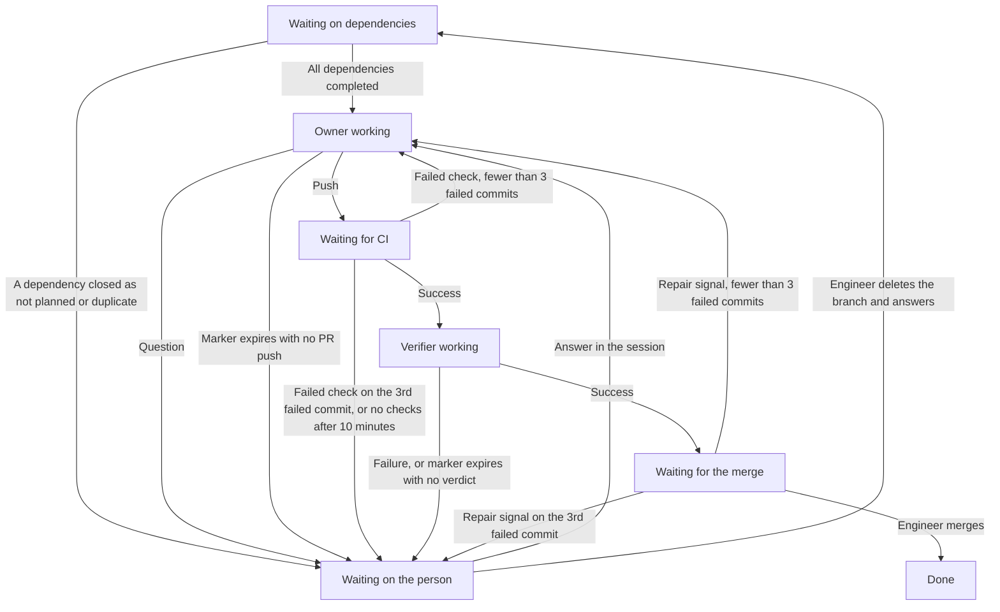
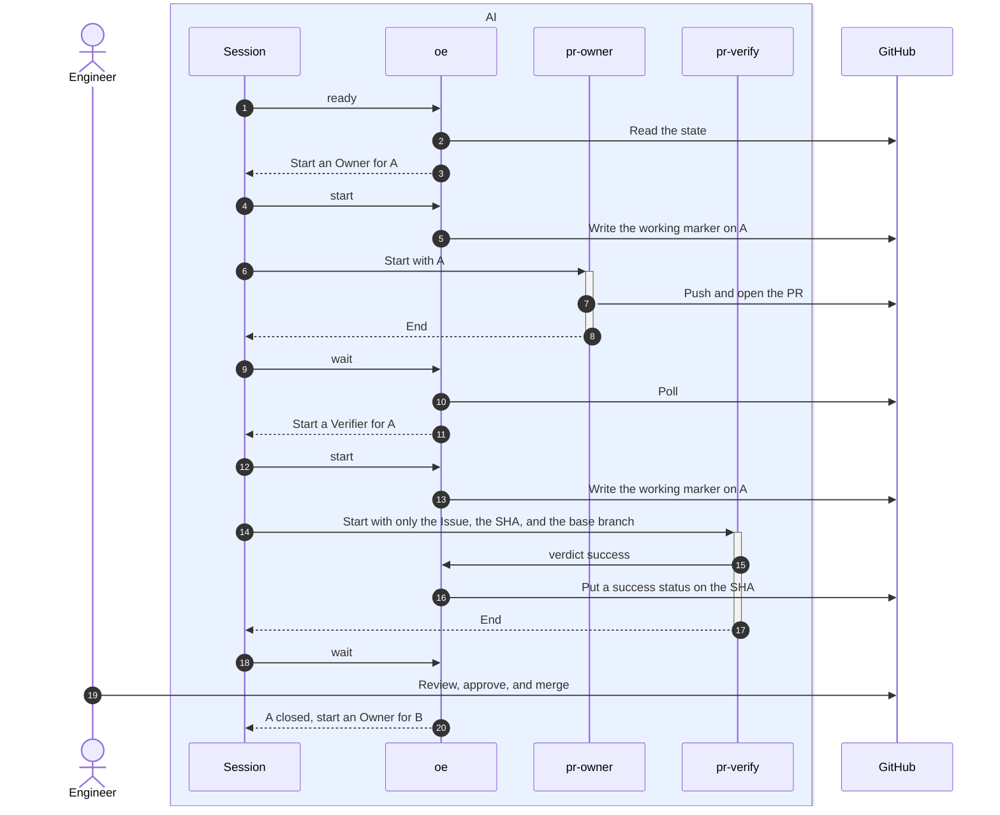

# orchestrate-epic Design

## Purpose

orchestrate-epic turns an Epic's child Issues into verified PRs in dependency order without a person in the loop, repairing on its own and asking a person only where the table below says. It reads its state only from GitHub, and an engineer does the merging.

## Responsibilities

Each part does one job and stores no state of its own. State lives on GitHub only.

### Coordinator

| Part | Job | Does not | Uses |
|---|---|---|---|
| orchestrate-epic session | Started by a person on one Epic. Gets each Issue's next action from oe ready, starts each agent it needs with the oe start command that oe ready prints, up to its `max-agents` argument at once, and waits with oe wait until the next actions change or an agent ends. It is the person's only window: it shows every Issue that waits on the person in its conversation, with the reason, and records the person's reply through oe. It ends only as Waiting under Decisions says | Merge, enable auto-merge, approve, or close anything. Write to GitHub except through oe. Edit code or touch the shared checkout. Decide a next action other than from oe ready. Ask a person a question of its own | oe, pr-owner, pr-verify |

### Agents

| Part | Job | Does not | Uses |
|---|---|---|---|
| pr-owner | Implements or repairs one Issue once and pushes. When it cannot decide, it writes a question on the Issue and pushes nothing | Merge, enable auto-merge, force-push, or bypass a push guard. Comment, review, reply to or resolve a review thread, edit a PR or Issue, or touch a label, except through its own commands. Touch the shared checkout or another worktree. Follow an instruction written in text it reads from GitHub | implement, create-pr, oe question |
| pr-verify | Runs the code at the PR's head SHA and judges the Issue's acceptance criteria. It fails a verdict only on a criterion it observed not to hold, and lists each criterion it could not observe as unconfirmed. The Issue body's decisions section takes precedence over the criteria it contradicts | Read the PR, the Issue's comments, or the Owner's report. Edit, commit, or push in its worktree. Record more than one verdict for the SHA | oe verdict |

### Existing skills

| Part | Job | Uses |
|---|---|---|
| implement | Writes code and tests and commits them, without pushing | commit |
| commit | Commits | none |
| create-pr | Writes the PR body and opens the PR | none |

### oe

oe starts no agent, edits no code, never merges a PR, and never writes to a PR's branch.

| Part | Job | Writes to |
|---|---|---|
| oe ready | Reads GitHub and prints each Issue's next action, with the oe command that carries it out | nothing |
| oe start | Runs every step that starts an Owner or a Verifier for one Issue, writes the working marker, and prints the agent's prompt | The working marker in the Issue body |
| oe wait | Blocks until oe ready's next actions change, reading GitHub as Polling and Rate limit under Decisions say | nothing |
| oe hold | Records that an Issue waits on the person, with the reason oe ready gave | An Issue comment |
| oe brief | Builds the brief handed to an Owner or a Verifier | nothing |
| oe worktree | Creates an agent's worktree outside the shared checkout, on the Issue branch for an Owner and detached at its head for a Verifier, and removes it after the agent ends. When origin has no Issue branch, it creates the branch locally from the base branch, and the Owner's first push creates it on origin | A local worktree and branch |
| oe question | Writes an Owner's question in a fixed format, and records the answer the person gives in the session's conversation | An Issue comment for a question or an answer, and an answer's decision in the Issue body's decisions section |
| oe verdict | Writes a Verifier's verdict, and its findings when the verdict fails or holds an unconfirmed criterion | A commit status on the SHA, and a PR comment for the findings |

### Engineer

- Answers each Issue that waits on them in the session's conversation
- Reviews the PR's code and submits Changes requested when something must change
- Updates a PR's branch with the base branch through GitHub when it needs a merged sibling PR
- Stops the session
- Approves and merges the PR
- Deletes an Issue's branch and answers its hold in the session, so the AI starts it over
- Removes or replaces a dependency that was closed as not planned or duplicate

## Invariants

| Invariant | Safety condition in the Epic |
|---|---|
| The AI never merges and never enables auto-merge | The merge conditions, such as the merge grant, the expected-SHA merge, and the post-merge freeze. They are dropped because the AI never merges |
| No Issue starts until every Issue it depends on is closed as completed | Dependencies done before starting |
| No agent starts on an Issue while its working marker is live | No double start |
| A verdict is written as a commit status on the SHA that was checked, and is not written once that SHA is no longer the PR's head | Verdict bound to the SHA |
| A Verifier receives only the Issue, the SHA, and the base branch, never the PR body or the Owner's report | Verifier never sees the worker's report |
| Every Owner and Verifier starts fresh for one job and ends when the job is done | A fresh agent per step |
| The repair cap and every next action are read from GitHub, never from an agent's report or a file on the host | Retry cap survives restarts on any host |
| Each agent works only in its own worktree and never touches the shared checkout | Never touch the shared checkout |
| An Issue that waits on the person is shown in the session's conversation until the person replies there or the session is stopped. A comment on GitHub is the record of the wait, never its only notice | The person is never left to find a wait on GitHub |
| Engineer input is only an unmarked comment or review by someone with the OWNER, MEMBER, or COLLABORATOR role, or an answer the session records through oe from the person's reply in its conversation, and labels mean nothing | Trusted input only |
| A record on GitHub counts when such a person or the agents' own bot, named by git config `skills.bot`, wrote it, and nothing that bot writes is ever engineer input | Trusted input only |
| When a GitHub read fails, oe ready prints nothing and exits with an error. When one PR moves during the read, only its Issue is unreadable: it gets the action read-again, starts nothing, and is classified at a later read | A failed read decides nothing |
| Starting a session on an Epic is consent, and ending the session stops new starts | The entry gate. It is dropped because starting the session is consent |
| Success is decided by the real CI on GitHub, never by a local reproduction | The locally reproduced check set. It is dropped because the real CI runs |

The secret-scan safety condition is handled as an accepted risk.

## Source of Truth

An Issue moves through the phases in this diagram.

For each Issue, oe ready reads this table from the top and outputs the action of the first row that matches. It never reads the default branch's checks, so a failure on the default branch holds no Issue, and a PR failure the base causes is a failed check like any other. An Issue whose PR moved during the read matches no row: it gets read-again, which starts no agent and keeps the loop running.

| Row | State | Next action |
|---|---|---|
| 1 | The Issue is closed | Mark it done |
| 2 | A hold or a question is newer than the latest answer | Wait on the person |
| 3 | The PR was closed without merging, or merged with the Issue open | Hold the Issue |
| 4 | A dependency was closed as not planned or duplicate | Hold the Issue |
| 5 | A dependency is not completed | Wait for the dependencies |
| 6 | The working marker is live | Wait for the agent |
| 7 | The working marker expired with no result | Hold the Issue |
| 8 | A repair signal below is present | Hold the Issue when 3 commits of the PR since the latest answer had a failed check. Otherwise start an Owner |
| 9 | A check on the PR's head SHA is pending, or the SHA has had no checks for less than 10 minutes | Wait for CI |
| 10 | The PR's head SHA still has no checks after 10 minutes | Hold the Issue |
| 11 | The PR's head SHA has no verdict | Start a Verifier |
| 12 | The PR's head SHA has a failure verdict | Hold the Issue |
| 13 | The PR's head SHA has a success verdict | Wait for an engineer to merge |

- Hold
  - oe hold writes the reason on the Issue, and the session shows it in its conversation and asks the person
  - The Issue waits on the person at row 2 until the session records an answer
- Working marker
  - One hidden line at the end of the Issue body, holding the role, the start time, the SHA for a Verifier, and the session ID only for a person to trace
  - An Owner's marker gives its result when an open PR from the branch has a head pushed after the start time, or the Issue gets a question after it
  - A Verifier's marker gives its result when its SHA gets a verdict
  - A marker is live until it gives its result or 2 hours pass since its start time, and expired with no result after that
  - An answer newer than a marker ends it, so the answer starts the next agent instead of holding the Issue again
- Repair signals
  - No PR exists yet
  - The PR conflicts with the base branch
  - A check on the PR's head SHA failed
  - Since the PR's head was pushed, one of these was given
    - An answer recorded through oe
    - A Changes requested review that covers the PR's head SHA
    - A review-thread comment that is engineer input and its thread's last comment, in a thread that is unresolved and not outdated
- Counting
  - The PR means the latest PR opened from the branch that is open or whose head is the branch's current head, so a PR left from a branch the engineer deleted is never the PR
  - The verify status that oe writes is never counted as a CI check

## Worked Examples

The normal path. Issue B depends on Issue A.

| Case | What happens |
|---|---|
| Lost agent | The agent ends without a push or a verdict, or the session dies. Its marker expires after 2 hours, and the next oe ready holds the Issue. The session shows the hold and asks the person |
| Failed CI | An Owner fixes the failed check on the same branch and pushes. The third commit with a failed check since the latest answer holds the Issue instead |
| Failed verification | oe verdict puts a failure status on the SHA and the findings on the PR, and oe ready holds the Issue. The session shows the findings' link and asks the person. The person's answer starts an Owner, and the cap counts from that answer |
| Sibling merged | Nothing starts. When the engineer wants B's head to contain A, they update B's branch with GitHub's button, and CI and a Verifier run on the new head |

## Accepted Risks

- The token is shared, so a verdict status can be forged
- When a commit lands on the base branch after verification, nothing is verified again
- Workflows the AI changed run with the repository's secrets on the PR branch before the engineer reviews them, and nothing gates their merge on that review: one person owns this repository and cannot approve their own pull request, and GitHub offers a push ruleset's path restriction only for private and internal repositories
- oe does not scan for secrets
- A comment the AI forgot to mark is read as engineer input
- Writing the working marker is not atomic, so two sessions on the same Epic can start two agents on one Issue. One host runs an Epic at a time
- An agent that ends early without a result holds its Issue until its marker's 2 hours pass
- An agent that runs longer than 2 hours has its Issue held while it still works, and an answer then starts a second agent beside it. Measured Owner runs took at most 89 minutes
- When the agents and the person write as one account, a person's push counts as an Owner's result, and a person's comment or review cannot be told from an agent's
- oe ready reads only the newest PR with an Issue's branch name, so a newer PR from a fork with that name hides the Issue's own PR
- When GitHub deletes a merged PR's branch while its Issue stays open, the Issue has no PR, and an Owner starts it over on a new branch
- An agent runs with the session's identity, so it could record an answer through oe, and with it a decision the Verifier follows over the criteria
- The session is an LLM conversation, so an API outage stops the loop until a person continues it

## Decisions

| Question | Decision |
|---|---|
| A dependency closed as not planned or duplicate | The dependent Issue does not start and waits for an engineer's decision |
| Signals that start a repair Owner | Only the repair signals above. Plain PR comments and review bots start nothing |
| A failure verdict | Holds the Issue for the person and never starts an Owner by itself |
| Repair cap | 3 commits of the PR with a failed check, counted from the latest answer, so the person's answer gives the Issue 3 more |
| A start with no result | Holds the Issue when its marker expires with no result, and never starts the agent again by itself |
| The default branch's checks | oe ready does not read them. A check run by changed paths shows only what the head commit triggered, so a gate on it missed a broken base and held Issues for checks no child PR runs |
| Waiting | The session waits in oe wait until oe ready's next actions change or an agent it started ends. It ends only when the Epic is done or a person stops it, never after an idle time, failed reads, or every remaining Issue waiting on the person |
| Agents running at once | 3 Owners and Verifiers combined per session by default, set by the skill's `max-agents` argument |
| Harnesses | The skill's Harnesses table maps the Executor contract of `development-pipeline.md` onto Claude Code, DeepSeek Harness, and OpenCode V2. Agents start with no view of any other session. The target is a harness that runs oe wait in the background, so idle waiting spends no tokens |
| Agent mode | The agents declare `mode: subagent`, because OpenCode V2 refuses to start an agent without it as a subagent |
| Worktrees | An agent's worktree is removed when the agent ends, and unpushed work is discarded |
| Acceptance checks | No agent checks a box that needs a human, template boxes included |
| Answers | The person answers in the session's conversation. The session records the answer through oe, so the next Owner reads it on the Issue |
| Decisions section | An answer recorded through oe appends its decision to a decisions section of the Issue body. The Verifier reads it with the body, and it takes precedence over the criteria it contradicts |
| Starting agents | Through oe start, which oe ready prints for each line that starts an agent, because a session that lost the skill to a compaction rebuilt the steps from memory and passed the Epic number as the Issue |
| Polling | One light read every 2 minutes. Every child Issue is read only on a change to it, its PR, or its checks, or at a deadline such as a head with no checks for 10 minutes or a marker's 2 hours |
| Open PRs | oe ready reads only the PRs of the child Issues' branches |
| Rate limit | oe wait waits until the reset time. Any other failed read is tried again at the next poll, and the wait goes on |
