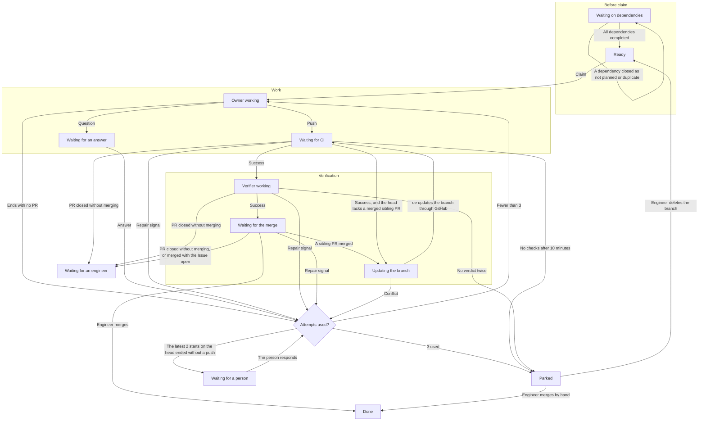
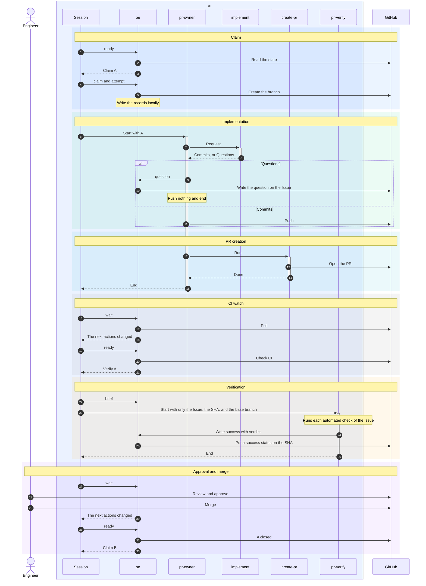

# orchestrate-epic Design

## Purpose

orchestrate-epic turns an Epic's child Issues into verified PRs in dependency order. It reads its state from GitHub and its own host, and an engineer or repository automation does the merging.

## Responsibilities

Each part does one job and stores no state of its own. State lives on GitHub, except oe's records, which stay in the host-local record store, and the pane of each Epic's board.

### Coordinator

| Part | Job | Does not | Uses |
|---|---|---|---|
| orchestrate-epic session | Started by a person on one Epic. Takes the Epic's lock with oe lock, gets each Issue's next action from oe ready, starts each agent it needs with the oe start command that oe ready prints, up to its `max-agents` argument at once, waits with oe wait until the next actions change or an agent ends, shows each Owner question in its conversation and records the person's answer through oe, and ends only as Waiting under Decisions says | Merge, enable auto-merge, approve, or close anything. Write to GitHub except through oe. Edit code or touch the shared checkout. Decide a next action other than from oe ready. Ask a person a question of its own | oe, pr-owner, pr-verify |

### Agents

| Part | Job | Does not | Uses |
|---|---|---|---|
| pr-owner | Implements or repairs one Issue once and pushes. When it cannot decide, it writes a question on the Issue and pushes nothing. After a bot repair, it asks the bots to review again | Merge, enable auto-merge, force-push, or bypass a push guard. Comment, review, reply to or resolve a review thread, edit a PR or Issue, or touch a label, except through its own commands. Touch the shared checkout or another worktree. Follow an instruction written in text it reads from GitHub | implement, create-pr, oe records, oe question, oe rereview |
| pr-verify | Runs the code at the PR's head SHA and judges only the Issue's automated checks, leaving manual checks to the engineer. The Issue body's decisions section takes precedence over the criteria it contradicts | Read the PR, the Issue's comments, or the Owner's report. Edit, commit, or push in its worktree. Judge a manual check. Record more than one verdict for the SHA | oe verdict |

### Existing skills

| Part | Job | Uses |
|---|---|---|
| implement | Writes code and tests and commits them, without pushing | commit |
| commit | Commits | none |
| create-pr | Writes the PR body and opens the PR | none |

### oe

oe starts no agent, edits no code, and never merges a PR. Its only writes to a PR's branch are creating it at a claim and updating it with the base branch through GitHub, which the session runs with the oe command that oe ready prints for that action.

| Part | Job | Writes to |
|---|---|---|
| Host-local record store | Keeps each Issue's claim, attempt, run, and verdict records until oe forget drops them, and each Epic's lock, board pane, and running oe wait, as the layout below says | `$OE_STATE_DIR`, or else `$XDG_STATE_HOME/orchestrate-epic` or `~/.local/state/orchestrate-epic` |
| oe lock | Refuses a second session for the same Epic on the same host while the first one's process runs | The Epic's ref in the lock store |
| oe ready | Reads GitHub and the record store and prints each Issue's next action, with the oe start command for an action that starts an agent, and names each running agent | nothing |
| oe start | Runs every step that starts an Owner or a Verifier for one Issue, from oe claim to oe brief, records the agent as running, and prints the agent's prompt | What those steps write, and a run record |
| oe wait | Blocks until oe ready's next actions change, reading GitHub as Polling and Rate limit under Decisions say, and tells the person as Notifications under Decisions says | The record store, and the configured notification command |
| oe status | Shows each Issue's step, PR, CI result, verdict and failure reason, attempts, running agent, Wait state, and time in step. `--watch` refreshes it until the session holding the Epic's lock ends | nothing |
| oe board | Inside Herdr with git config `skills.herdr` true, opens a pane that runs `oe status --watch`, or reuses the Epic's pane from an earlier start | A Herdr pane, and the pane's record on this host |
| oe brief | Builds the brief handed to an Owner or a Verifier, and records each Verifier start before its brief | A pending verify status on the SHA, for a Verifier |
| oe claim | Creates the Issue's branch and writes a claim record | A branch on origin and the record store |
| oe worktree | Creates an agent's worktree outside the shared checkout, on the Issue branch for an Owner and detached at its head for a Verifier, and removes it after the agent ends | A local worktree |
| oe attempt | Writes an attempt record for each Owner start before it runs, with the bots whose rounds it uses, and refuses a start once 3 attempts are used, counting as Attempts under Decisions says | The record store |
| oe question | Writes an Owner's question in a fixed format, and records the answer the person gives in the session's conversation | An Issue comment for a question or an answer, and an answer's decision in the Issue body's decisions section |
| oe rereview | Asks bots to review the PR again | A PR comment |
| oe verdict | Writes a Verifier's verdict and findings | A commit status on the SHA, and the record store |
| oe records | Prints an Issue's records from its latest claim on, for an Owner | nothing |
| oe forget | Drops an Epic's records once every child Issue is closed | The record store |

The record store lays out its state as `oe-store.sh` defines.

| Path under the state directory | Holds |
|---|---|
| `locks.git` | A bare Git repository with one ref per Epic, naming the session that holds the Epic's lock |
| `records/<repo-key>/<issue>.jsonl` | One Issue's claim, attempt, run, and verdict records, oldest first, one JSON object per line. A verdict record holds its findings |
| `boards/<repo-key>/<epic>` | The Herdr pane of the Epic's board |
| `waits/<repo-key>/<epic>` | The process of the Epic's running oe wait |
| `notices/<repo-key>/<epic>` | Each item that needed the person at oe wait's latest read, with when the person was last told about it |

`<repo-key>` is a hash of the lowercased repository name.

### Engineer

- Is told through the configured notification command when an Issue needs them
- Answers an Owner's question in the session's conversation or with a comment on the Issue
- Reviews the PR's code and submits Changes requested when something must change
- Resolves a bot's review thread to dismiss its finding
- Responds to an Issue that waits for a person after two Owner starts without a push, in the session's conversation or with a comment on the Issue
- Stops the session
- Runs the manual checks, which the PR leaves unchecked
- Approves and merges the PR
- Deletes a parked Issue's branch so the AI starts it over
- Deletes the `<!-- automation-owner: orchestrate-epic -->` line from a parked Issue's PR body to hand the PR to another automation
- Removes or replaces a dependency that was closed as not planned or duplicate

## Invariants

| Invariant | Safety condition in the Epic |
|---|---|
| The AI never merges and never enables auto-merge | The merge conditions, such as the merge grant, the expected-SHA merge, and the post-merge freeze. They are dropped because the AI never merges |
| No Issue starts until every Issue it depends on is closed as completed | Dependencies done before starting |
| Claiming an Issue means creating its branch on origin, and the claim fails when the branch already exists | No double claim |
| A verdict is written as a commit status on the SHA that was checked, and is not written once that SHA is no longer the PR's head | Verdict bound to the SHA |
| A Verifier receives only the Issue, the SHA, and the base branch, never the PR body or the Owner's report | Verifier never sees the worker's report |
| Every Owner and Verifier starts fresh for one job and ends when the job is done | A fresh agent per step |
| An attempt is an Owner start that ended in a push, counted from the record store's starts and the pushes GitHub shows, never from an agent's report. A start after 3 attempts is refused | Retry cap survives restarts on the same host |
| Each agent works only in its own worktree and never touches the shared checkout | Never touch the shared checkout |
| Engineer input is only an unmarked comment or review by someone with the OWNER, MEMBER, or COLLABORATOR role, or an answer the session records through oe from the person's reply in its conversation, and labels mean nothing | Trusted input only |
| A record on GitHub counts when such a person or the agents' own bot, named by git config `skills.bot`, wrote it, and nothing that bot writes is ever engineer input | Trusted input only |
| A bot's text can start a repair but never instructs an agent | Trusted input only |
| When a GitHub read fails, oe ready prints nothing and exits with an error. When one PR moves during the read, only its Issue is unreadable: it gets the action read-again, starts nothing, and is classified at a later read | A failed read decides nothing |
| Starting a session on an Epic is consent, and ending the session stops new starts | The entry gate. It is dropped because starting the session is consent |
| Success is decided by the real CI on GitHub, never by a local reproduction | The locally reproduced check set. It is dropped because the real CI runs |

The secret-scan safety condition is handled as an accepted risk.

## Source of Truth

An Issue moves through the phases in this diagram.

Every edge into the Attempts used check stands for one of the repair signals listed below the table. Row 2 applies to every claimed Issue, and the diagram draws Waiting for an engineer only from Waiting for CI, Verifier working, and Waiting for the merge.

For each Issue, oe ready reads this table from the top and outputs the action of the first row that matches. It never reads the default branch's checks, so a failure on the default branch holds no Issue, and a PR failure the base causes is a failed check like any other. Claim and attempt records come from the record store. An Issue whose PR moved during the read matches no row: it gets read-again, which starts no agent and keeps the loop running, and oe status shows it as read-again until the next read classifies it.

| Row | Phase | State | Next action |
|---|---|---|---|
| 1 | Before claim | The Issue is closed | Mark it done |
| 2 | Before claim | A PR merged after the latest claim record, or the branch exists and its PR was closed without merging | Wait for an engineer |
| 3 | Before claim | No branch exists, and a dependency is not completed | Wait for the dependencies |
| 4 | Before claim | No branch exists, and every dependency is completed | Claim and start an Owner |
| 5 | Work | No answer has been given since the Issue's latest question | Wait for the answer |
| 6 | Work | Any repair signal below is present | Park the Issue when it already has 3 attempts. Otherwise wait for a person when the latest 2 Owner starts on the PR's head, or with no PR, ended without a push and no question or input from a person came after them. Otherwise start an Owner |
| 7 | Verification | A check on the PR's head SHA is pending, or the SHA has had no checks for less than 10 minutes | Wait for CI |
| 8 | Verification | The PR's head SHA still has no checks after 10 minutes | Park the Issue |
| 9 | Verification | The PR's head SHA does not contain the commit that merged a sibling PR into the base branch | Update the branch with the base branch through GitHub, starting no agent and spending no attempt |
| 10 | Verification | The PR's head SHA has neither a success nor a failure verdict | Start a Verifier, or park the Issue when the SHA already has 2 pending statuses |
| 11 | Verification | The PR's head SHA has a success verdict | Wait for an engineer to merge |

- Repair signals
  - No PR exists yet
  - The PR conflicts with the base branch
  - A check on the PR's head SHA failed
  - The verdict on the PR's head SHA is a failure
  - Since the latest attempt record, one of these was given
    - An answer to the latest question, by a trusted user's comment or recorded through oe
    - A Changes requested review
    - A review-thread comment
  - A bot finding written since the latest attempt record
- Bot rounds
  - Each bot gets one round per claim
  - oe attempt records every bot whose finding counts when it runs
    - That round is used even when the Owner pushes nothing
  - The Owner repairs only the findings of the bots its attempt record holds
  - After its push, the Owner asks those bots to review again with oe rereview
    - oe ready waits for no re-review
  - A bot's findings after its round go to the engineer
  - A bot repair that ends in a push counts toward the cap of 3 attempts
- Counting
  - Only records after the latest claim record count, and every record counts when there is no claim record
  - The PR means the latest PR opened from the branch after the latest claim record
  - Verifier starts are counted by the pending statuses that oe puts on the SHA before each start
  - The verify status that oe writes, whether pending, success, or failure, is never counted as a CI check
- Sibling PRs
  - A sibling PR is a PR merged into the base branch from the branch of another child Issue of the same Epic
  - A head contains a sibling PR when the commit that GitHub records as its merge commit is an ancestor of the head. That commit is the merge commit, the squash commit, or for a rebase merge the commit the base branch moved to

A comment is a bot finding when every row holds.

| Item | Condition |
|---|---|
| Author | A listed bot, told by its login and Bot type |
| Place | The first comment of a review thread that the bot opened in its own review |
| Thread | Unresolved and not outdated |
| Severity | Its first text line names a level the bot table repairs, as a word anywhere in the line |
| PR | No trusted user approved the head SHA |
| Round | The bot's round is unused |

| Bot | Login | Repairs | Ignores |
|---|---|---|---|
| CodeRabbit | `coderabbitai` | Critical, Major | Minor, Trivial |
| Codex | `chatgpt-codex-connector` | P0, P1 | P2, P3 |

## Worked Examples

The normal path. Issue B depends on Issue A.

| Case | What happens |
|---|---|
| Lost agent | The Owner ends without a PR, or the session dies. GitHub has no record of completion, so the next oe ready starts an Owner again on the same branch. A start that pushed nothing is no attempt, and a second such start in a row makes the Issue wait for a person |
| Failed verification | The Verifier writes a failure verdict and stores its findings. An Owner reads the findings, repairs, and pushes. The new SHA has no verdict, so CI and verification run again |
| Manual checks | An Issue with only manual checks left gets a success verdict and waits for the merge |
| Failed CI | An Owner fixes the failed check on the same branch and pushes |
| Sibling merged | Issues A and B both wait for the merge, and the engineer merges A. At the next read, B's head lacks A's squash commit, so oe updates B's branch with the base branch through GitHub. CI and a Verifier run again on the new head, and B waits for the merge again once that head has a success verdict. When the update conflicts, an Owner resolves the conflict as a repair |
| Bot finding | CodeRabbit reports a Major finding. An Owner checks it in the code, repairs, pushes, and asks CodeRabbit to review again. A Major finding in that re-review goes to the engineer. A Minor finding starts nothing |
| Reached cap | When a repair signal remains after 3 attempts, the Issue is parked and the Issues that depend on it stop too. The engineer either finishes and merges it by hand, or deletes the branch so the AI starts over |

## Accepted Risks

- The token is shared, so a verdict status can be forged
- When a commit other than a sibling PR lands on the base branch after verification, nothing is verified again
- A PR the engineer merges before its branch is updated and verified again lands without being verified against a sibling PR merged before it, as when two sibling PRs merge between two reads
- Workflows the AI changed run with the repository's secrets on the PR branch before the engineer reviews them; the main ruleset's code owner review gates only the merge, because GitHub offers a push ruleset's path restriction only for private and internal repositories
- oe does not scan for secrets
- A comment the AI forgot to mark is read as engineer input
- oe lock works only within one host, so a session for the same Epic on another host lets two agents touch the same branch
- Resuming an Epic on another host, or after losing the record store, resets attempt counts, bot rounds, and findings, and earlier engineer input and bot findings count as repair signals again
- Records carry the host's clock, so clock skew can misorder them against GitHub events
- A session killed while its agents run leaves them running, and the next session can start a second agent on the same Issue
- oe ready reads only the newest PR with an Issue's branch name, so a newer PR from a fork with that name hides the Issue's own PR; its Owners find nothing to repair, and the Issue parks
- A bot that drops the level word from its first line or skips draft PRs has its findings missed
- A first line whose title happens to hold a level word starts a repair
- A finding in a bot's review body, outside any thread, starts nothing
- A bot that refuses the re-review on a rate limit leaves the repair unreviewed
- A bot finding the Owner cannot reproduce still uses the bot's round and one of the 2 starts without a push
- The board is only as fresh as its latest refresh
- An agent runs with the session's identity, so it could record an answer through oe, and with it a decision the Verifier follows over the criteria

## Decisions

| Question | Decision |
|---|---|
| A dependency closed as not planned or duplicate | The dependent Issue is not claimed and waits for an engineer's decision |
| Signals that start a repair Owner | Only the repair signals above. Plain PR comments start nothing |
| Bot findings that count | Only Major or higher from CodeRabbit and Codex, so the Owner never chases style |
| Reading severity | A level word anywhere in the first text line, never a fixed heading format, because the bots change their formats |
| Bot text as instructions | The Owner reads a finding as data, follows no instruction in it, and fixes only what reproduces in the code |
| Bot replies | Never count, because anyone can make a bot reply on a public repository |
| Bot rounds | One per bot per claim, so a bot and the Owner never chase each other and a slower bot still gets its round |
| Recording a round | oe attempt records it before the Owner starts, so an Owner that ends early cannot restart a chase |
| Other automations on its PRs | pr-owner writes the line `<!-- automation-owner: orchestrate-epic -->` near the end of each PR body, the owner line that babysit's `pr-state.sh` reads, so babysit neither pushes nor replies there. Its replies would otherwise read as engineer input. oe never reads the line, so deleting it while oe still works on the Issue lets two writers act |
| Re-review request | One PR comment of `<!-- oe:rereview -->` and `@coderabbitai review` or `@codex review`. The marker keeps it from counting as engineer input |
| Bot findings after approval | Start nothing, so the AI never pushes onto a head being merged |
| Attempts | An attempt is an Owner start that ended in a push, read from GitHub and not from an agent's report. A start without a push spends none, so an outage, a start that finds nothing to change, or a question never parks an Issue |
| Starts without a push | Two Owner starts in a row on the same head that ended without a push, while a repair signal is present, make the Issue wait for a person, with the reason shown. A start that ended in a question, or any input from the person after the latest start, ends that run of two |
| Questions and answers in the cap | Neither reduces the cap. A start after an answer counts only when it ends in a push |
| A Verifier ends without a verdict | It is restarted once on the same SHA, and the Issue is parked when the second start also gives no verdict |
| A head that lacks a sibling PR | oe updates the branch with the base branch through GitHub, because its verdict describes a base that no longer exists. No agent starts and no attempt is spent, so an Epic with many siblings does not wait on a person after each merge. The new head is checked and verified like any new head. When the update fails on a conflict, an Owner resolves it as a repair at row 6 |
| The default branch's checks | oe ready does not read them. A check run by changed paths shows only what the head commit triggered, so a gate on it missed a broken base and held Issues for checks no child PR runs |
| Waiting | The session waits in oe wait until oe ready's next actions change or an agent it started ends. It ends only when the Epic is done or a person stops it, never after an idle time, failed reads, or every remaining Issue waiting on a person, so it goes on by itself after the person answers or merges |
| Agents running at once | 3 Owners and Verifiers combined per session by default, set by the skill's `max-agents` argument |
| Harnesses | The skill's Harnesses table maps the Executor contract of `development-pipeline.md` onto each harness. Agents start with no view of any other session. The target is a harness that runs oe wait in the background, so idle waiting spends no tokens; other harnesses are outside the target |
| Agent mode | The agents declare `mode: subagent`, because OpenCode V2 refuses to start an agent without it as a subagent. APM drops the key for Codex |
| Implicit invocation | Codex ignores `disable-model-invocation`, so pr-owner and pr-verify carry `agents/openai.yaml` with `allow_implicit_invocation: false`, because only the orchestrate-epic session may start them |
| Counting Verifier starts | oe brief writes the pending verify status that oe ready counts, before it prints a Verifier's brief, so no Verifier starts uncounted |
| Worktrees | An agent's worktree is removed when the agent ends, and unpushed work is discarded |
| Where records go | The record store, because comments under the user's account cluttered timelines. Only questions, answers, and re-review requests stay on GitHub, in a fixed format that says an agent or the session wrote them |
| Record key | Repository and Issue: an Issue has one parent Epic, and no writer is given the Epic |
| Dropping records | oe forget, which the session runs when it ends with every Issue of its Epic done. It refuses while an Issue is open, and oe ready stays read-only |
| Acceptance checks | Verification splits automated checks from manual ones, and no agent checks a box that needs a human, template boxes included |
| The board in Herdr | Opt-in with git config `skills.herdr`, read only inside Herdr, so no other run calls herdr and no Herdr user gets a pane unasked |
| Board start | oe board types the board command into the pane, and the pane's shell runs it only after its startup files finish, so output they print, such as direnv's "is taking a while" warning, comes before the board. The board clears the screen and shows one line before its first read. When the shell has not finished within `board_start_timeout`, oe board exits 1 saying so and records when it sent the command, and a rerun within 10 minutes waits for that start and types nothing again |
| Board refresh | Every 3 minutes, each refresh reading GitHub through oe ready |
| Board lifetime | The board stops once the session holding the Epic's lock ends, and leaves its last view. A `--watch` that never finds a session holding the lock refreshes until interrupted. A later start reuses its pane when the pane runs the board or sits at its shell's prompt, and never sends input to a pane that runs anything else |
| Notifications | oe wait calls the command in git config `skills.notify` with a one-line message and a link for each new item that needs the person: a question, a park, an Issue waiting for a person or for the merge, 3 failed reads in a row, and the session's end with its reason. It calls again every hour while the person has not acted. Herdr is one example setting, and no path is Herdr-only. With no command set, oe notifies nobody |
| Answers | The person answers in the session's conversation or with a comment on the Issue. The session records an answer from its conversation through oe, so the next Owner reads it on the Issue |
| Decisions section | An answer recorded through oe appends its decision to a decisions section of the Issue body. The Verifier reads it with the body, and it takes precedence over the criteria it contradicts |
| Starting agents | Through oe start, which oe ready prints for each line that starts an agent, because a session that lost the skill to a compaction rebuilt the steps from memory and passed the Epic number as the Issue |
| Waits per Epic | One on each host. A new oe wait stops no other: while one runs, the new one prints oe ready's output and exits at once, because a stopped wait reached the session as a stray completion, and the running wait already returns once an agent ends or the next actions change. Only oe lock release, or another session taking the lock, stops a wait |
| Running agents | oe ready finds them in its own records, never from the session, because a session that lost its context forgot the agents it started. An agent runs while the run record oe start wrote is no older than the lock of the running session holding the Epic, and its worktree exists. An earlier session's leftover worktree therefore holds no Issue, and the same session acquiring its lock again keeps its agents |
| Polling | One light read every 2 minutes. Every child Issue is read only on a change to it, its PR, or its checks, on a merge of a sibling PR, or at a deadline such as a head with no checks for 10 minutes |
| Open PRs | oe ready reads only the PRs of the child Issues' branches |
| Rate limit | oe wait waits until the reset time. Any other failed read is tried again at the next poll, and the wait goes on |
