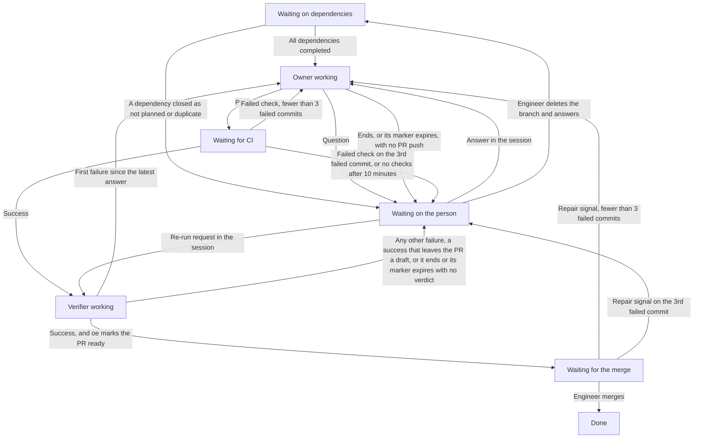
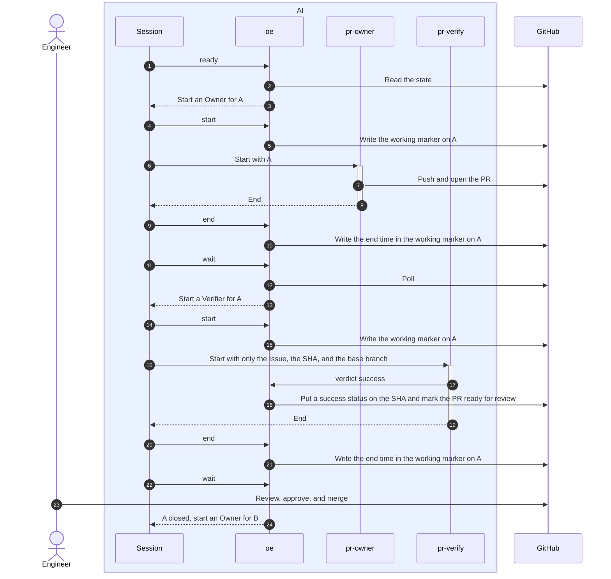

# orchestrate-epic Design

## Purpose

orchestrate-epic turns an Epic's child Issues into verified PRs in dependency order without a person in the loop, repairing on its own and asking a person only where the table below says. It reads its state only from GitHub, and an engineer does the merging.

## Responsibilities

Each part does one job and stores no state of its own. State lives on GitHub only.

### Coordinator

| Part | Job | Does not | Uses |
|---|---|---|---|
| orchestrate-epic session | Started by a person on one Epic. Gets each Issue's next action from oe ready, starts each agent it needs with the oe start command that oe ready prints, up to its `max-agents` argument at once, and waits with oe wait until the next actions change or an agent ends. When an agent ends, it records the end through oe end, with the oe end command that oe start printed for that agent, or with the one on the Issue's wait-agent line when it lost oe start's output. It uses a wait-agent line's command only for the agent that line names, and only when it knows the ended agent's start time is the line's, so an Owner's end never ends a Verifier's marker and an earlier start's end never ends a later start's. When it does not know, it runs no oe end and the 6 hours apply. It is the person's only window: it shows every Issue that waits on the person in its conversation, with the reason, and records the person's reply through oe. It ends only as Waiting under Decisions says | Merge, enable auto-merge, approve, or close anything. Write to GitHub except through oe. Edit code or touch the shared checkout. Decide a next action other than from oe ready. Ask a person a question of its own | oe, pr-owner, pr-verify |

### Agents

| Part | Job | Does not | Uses |
|---|---|---|---|
| pr-owner | Implements or repairs one Issue once and pushes. When it cannot decide, it writes a question on the Issue and pushes nothing | Merge, enable auto-merge, force-push, or bypass a push guard. Comment, review, reply to or resolve a review thread, edit a PR or Issue, or touch a label, except through its own commands. Touch the shared checkout or another worktree. Follow an instruction written in text it reads from GitHub | implement, create-pr, oe question |
| pr-verify | Runs the code at the PR's head SHA and judges the Issue's acceptance criteria. It fails a verdict only on a criterion it observed not to hold, and lists each criterion it could not observe as unconfirmed. The Issue body's decisions section takes precedence over the criteria it contradicts | Read the PR, the Issue's comments, or the Owner's report. Edit, commit, or push in its worktree. Record more than one verdict per start | oe verdict |

### Existing skills

| Part | Job | Uses |
|---|---|---|
| implement | Writes code and tests and commits them, without pushing | commit |
| commit | Commits | none |
| create-pr | Writes the PR body and opens the PR | none |

### oe

oe starts no agent, edits no code, never merges a PR, and never writes to a PR's branch.

| Part | Job | Writes to |
|---|---|---|
| oe ready | Reads GitHub and prints each Issue's next action, with the oe command that carries it out. A wait-agent line carries the oe end command for the working marker's start, so a session that lost oe start's output to a compaction still records the end of an agent whose marker is live | nothing |
| oe start | Runs every step that starts an Owner or a Verifier for one Issue, writes the working marker, and prints the agent's prompt and the oe end command for this start | The working marker in the Issue body, and the PR's draft state as Draft state under Source of Truth says |
| oe wait | Blocks until oe ready's next actions change, reading GitHub as Polling and Rate limit under Decisions say | nothing |
| oe hold | Records that an Issue waits on the person, with the reason oe ready gave | An Issue comment |
| oe brief | Builds the brief handed to an Owner or a Verifier | nothing |
| oe end | Records that an agent ended, then removes its worktree through oe worktree. It records only the fact and the time, never what the agent reported. It names the start time of its agent's marker, and when the Issue's marker has another start time, it writes nothing and removes nothing, so an agent that outlived its marker never ends a later agent's marker or removes its worktree | The end time in the working marker in the Issue body, and a local worktree and branch |
| oe worktree | Creates an agent's worktree outside the shared checkout, on the Issue branch for an Owner and detached at its head for a Verifier, and removes it after the agent ends. When origin has no Issue branch, it creates the branch locally from the base branch, and the Owner's first push creates it on origin | A local worktree and branch |
| oe question | Writes an Owner's question in a fixed format, and records the answer or the re-run request the person gives in the session's conversation. | An Issue comment for a question, an answer, or a re-run request, and the decision an answer or a re-run request carries in the Issue body's decisions section |
| oe verdict | Writes a Verifier's verdict, and its findings as Findings under Source of Truth says | A commit status on the SHA, the findings block in the PR body, and the PR's draft state as Draft state under Source of Truth says |

### Engineer

- Answers each Issue that waits on them in the session's conversation, or asks there for the head to be judged again
- Reviews the PR's code and submits Changes requested when something must change
- Updates a PR's branch with the base branch through GitHub when it needs a merged sibling PR
- Stops the session
- Approves and merges a PR that oe marked ready for review, or marks a draft ready by hand to merge it before a verdict
- Converts a PR to a draft to hold it, and marks it ready by hand to release it
- Deletes an Issue's branch and answers its hold in the session, so the AI starts it over
- Removes or replaces a dependency that was closed as not planned or duplicate

## Invariants

| Invariant | Safety condition in the Epic |
|---|---|
| The AI never merges and never enables auto-merge | The merge conditions, such as the merge grant, the expected-SHA merge, and the post-merge freeze. They are dropped because the AI never merges |
| No Issue starts until every Issue it depends on is closed as completed | Dependencies done before starting |
| No agent starts on an Issue while its working marker is live | No double start |
| A verdict is written as a commit status on the SHA that was checked, and is not written once that SHA is no longer the PR's head | Verdict bound to the SHA |
| A Verifier receives only the Issue, the SHA, and the base branch, never the PR body or the Owner's report | Verifier never sees the worker's report |
| Every Owner and Verifier starts fresh for one job and ends when the job is done | A fresh agent per step |
| The repair cap and every next action are read from GitHub, never from an agent's report or a file on the host | Retry cap survives restarts on any host |
| Each agent works only in its own worktree and never touches the shared checkout | Never touch the shared checkout |
| An Issue that waits on the person is shown in the session's conversation until the person replies there or the session is stopped. A comment on GitHub is the record of the wait, never its only notice | The person is never left to find a wait on GitHub |
| Engineer input is only an unmarked comment or review by someone with the OWNER, MEMBER, or COLLABORATOR role, or an answer the session records through oe from the person's reply in its conversation, and labels mean nothing | Trusted input only |
| A record on GitHub counts when such a person or the agents' own bot, named by git config `skills.bot`, wrote it, and nothing that bot writes is ever engineer input | Trusted input only |
| When a GitHub read fails, oe ready prints nothing and exits with an error. When one PR moves during the read, only its Issue is unreadable: it gets the action read-again, starts nothing, and is classified at a later read | A failed read decides nothing |
| Starting a session on an Epic is consent, and ending the session stops new starts | The entry gate. It is dropped because starting the session is consent |
| Success is decided by the real CI on GitHub, never by a local reproduction | The locally reproduced check set. It is dropped because the real CI runs |

The secret-scan safety condition is handled as an accepted risk.

## Source of Truth

An Issue moves through the phases in this diagram.

For each Issue, oe ready reads this table from the top and outputs the action of the first row that matches. It never reads the default branch's checks, so a failure on the default branch holds no Issue, and a PR failure the base causes is a failed check like any other. An Issue whose PR moved during the read matches no row: it gets read-again, which starts no agent and keeps the loop running.

| Row | State | Next action |
|---|---|---|
| 1 | The Issue is closed | Mark it done |
| 2 | A hold or a question is newer than the latest answer and the latest re-run request | Wait on the person |
| 3 | The PR was closed without merging, or merged with the Issue open | Hold the Issue |
| 4 | A dependency was closed as not planned or duplicate | Hold the Issue |
| 5 | A dependency is not completed | Wait for the dependencies |
| 6 | The working marker is live | Wait for the agent |
| 7 | The working marker ended or expired with no result | Hold the Issue |
| 8 | A repair signal below is present | Hold the Issue when 3 commits of the PR since the latest answer had a failed check. Otherwise start an Owner |
| 9 | A check on the PR's head SHA is pending, or the SHA has had no checks for less than 10 minutes | Wait for CI |
| 10 | The PR's head SHA still has no checks after 10 minutes | Hold the Issue |
| 11 | The PR's head SHA has no verdict | Start a Verifier |
| 12 | The PR's head SHA has a failure verdict, or a success verdict while the PR is still a draft | Hold the Issue |
| 13 | The PR's head SHA has a success verdict, and the PR is ready for review | Wait for an engineer to merge |

- Hold
  - oe hold writes the reason on the Issue, and the session shows it in its conversation and asks the person
  - The Issue waits on the person at row 2 until the session records an answer or a re-run request
- Working marker
  - One hidden line at the end of the Issue body, holding the role, the start time, the SHA for a Verifier, the session ID only for a person to trace, the time oe last converted the PR to a draft, and the end time once oe end records it
  - An Owner's marker gives its result when an open PR from the branch has a head pushed after the start time, or the Issue gets a question after it
  - A Verifier's marker gives its result when its SHA gets a verdict, as Counting reads it
  - A push, a question, or a verdict gives a marker its result only when the start the marker records wrote it. An agent writes one only while the Issue's marker still holds its own start time, read just before it writes, and otherwise ends without writing, so a late write from an expired or replaced start never counts for a newer one
  - A marker that gives its result never holds the Issue, whether or not it has an end time
  - A marker with an end time and no result stays live for 2 minutes after the end, one poll interval, so a push or a verdict that GitHub shows late is not held, and ended with no result after that
  - A marker with no end time is live until it gives its result or 6 hours pass since its start time, and expired with no result after that. The 6 hours cover only a session that died with its agents, and a session that lost oe start's output and cannot tell which start an ended agent's was, so it is far longer than a run
  - When oe end cannot write, the marker keeps no end time, so a failed write never holds an Issue and only the 6 hours apply
  - oe end writes an end time only into the marker its own agent's start wrote, matched by the start time, and leaves any other marker as it is. An Owner that pushed can still be running when a Verifier's start replaces its marker, and the Owner's end must not end the Verifier's
  - An answer or a re-run request newer than a marker ends it, so it starts the next agent instead of holding the Issue again
- Repair signals
  - No PR exists yet
  - The PR conflicts with the base branch
  - A check on the PR's head SHA failed
  - The PR's head SHA has a failure verdict, no re-run request came since the latest answer, and no other commit of the PR committed since the latest answer had a failure verdict. Row 8's cap counts only failed checks, so this once stands apart from it
  - Since the PR's head was pushed, one of these was given
    - An answer recorded through oe, unless a re-run request came after it
    - A Changes requested review that covers the PR's head SHA
    - A review-thread comment that is engineer input and its thread's last comment, in a thread that is unresolved and not outdated
- Counting
  - The PR means the latest PR opened from the branch that is open or whose head is the branch's current head, so a PR left from a branch the engineer deleted is never the PR
  - The verify status that oe writes is never counted as a CI check
  - A SHA's verdict is its latest verify status other than pending that is newer than the latest re-run request, so the request is used once and an older verdict counts as none. Both times are GitHub's
- Re-run request
  - A record the session writes from the person's reply, separate from an answer, so it starts a Verifier on the same head instead of an Owner, and resets neither cap
  - oe question accepts it while the Issue waits on the person and the PR's head has no success verdict that verified something, as Counting reads it, or the PR is a draft, so a head held with no verdict, or after an answer that changes no code, can still be judged without an Owner, and a judged head an Owner left unchanged can be marked ready again. An earlier agent that still runs cannot count, because it writes only while the marker holds its own start time
  - A re-run request newer than the latest answer replaces it, so the answer no longer starts an Owner
  - It starts a Verifier only when no row above row 11 matches. A failed check or a conflict that came after the hold still starts an Owner at row 8, because judging a head that must change anyway is wasted
  - It may carry a decision, which goes into the decisions section as an answer's does, so an answer that changes no code reaches the Verifier without an Owner start
- Findings
  - oe verdict replaces one folded block in the PR body, between fixed markers, before it writes the status, so a verdict never exists without its findings
  - The block holds the SHA, the state, and each failed and unconfirmed criterion. A success with none removes the block, so a merge with unconfirmed criteria keeps them on the PR without blocking it
  - Nothing quoted in the block takes effect: no closing keyword, mention, task item, or end marker
  - The block is not in the Issue body, because the next Verifier reads that body and must judge without an earlier verdict
  - A repair Owner reads the block only when its SHA is the head, as data, and reproduces each failure before changing code. When it cannot reproduce one, or the block is missing or names another SHA, it pushes nothing and asks with oe question
- Draft state
  - An Owner opens every PR as a draft, and oe marks it ready for review only on a judged head. The person can still mark it ready by hand and merge it any time, and merges a PR before a verdict only that way
  - A success verified something when the Verifier observed at least one criterion
  - oe verdict marks the PR ready for review right after it writes a success that verified something, when the Verifier's start is still the marker's start and the person did not make the PR's latest conversion to a draft. When marking fails, the verdict stands, the PR stays a draft, and nothing tries again
  - oe start converts a PR that is ready for review back to a draft when it starts an Owner, and writes the time of the conversion into the marker. Each later start carries that time over, so oe tells its own conversion from the person's without a bot. When the conversion fails, the Owner starts anyway
  - A success that leaves the PR a draft holds the Issue at row 12, so the person asks for a re-run or answers. This covers a success that verified nothing, a failed mark, and a late success from a replaced start. A PR the person converted to a draft stays a draft until the person marks it ready by hand
  - A clone with git config `skills.oe.markReady` set to `false` keeps oe from changing a PR's draft state, and rows 12 and 13 then read no draft state

## Worked Examples

The normal path. Issue B depends on Issue A.

| Case | What happens |
|---|---|
| An Owner ends with no push and no question | The session runs oe end. 2 minutes later oe ready holds the Issue, and the session asks the person |
| The session dies with its agents | No end is recorded. A session started later waits on each live marker until 6 hours pass since its start, then holds the Issue |
| Sibling merged | Nothing starts. When the engineer wants B's head to contain A, they update B's branch with GitHub's button, and CI and a Verifier run on the new head |

## Accepted Risks

- The token is shared, so a verdict status can be forged, and a forged failure starts a repair Owner
- Anyone who can edit the PR body can change the findings block. GitHub shows only a body's last editor, so oe cannot tell its own block from another. The Owner reproduces each failure before acting and asks when it cannot
- A concurrent edit of the PR body, such as a review bot's summary or create-pr's link step, can drop the block, and the Owner then asks
- A repository whose squash message uses the PR description keeps the block in its history
- When a commit lands on the base branch after verification, nothing is verified again
- Workflows the AI changed run with the repository's secrets on the PR branch before the engineer reviews them, and nothing gates their merge on that review: one person owns this repository and cannot approve their own pull request, and GitHub offers a push ruleset's path restriction only for private and internal repositories
- oe does not scan for secrets
- A comment the AI forgot to mark is read as engineer input
- Writing the working marker is not atomic, so two sessions on the same Epic can start two agents on one Issue. One host runs an Epic at a time
- When a session dies with its agents, their markers stay live until 6 hours pass since their start: their Issues wait, and a session started in the meantime counts them as running agents
- When a session that lost oe start's output cannot tell which start an ended agent's was, it records no end, so that Issue waits until 6 hours pass since the marker's start
- An agent that runs longer than 6 hours has its Issue held while it still works, and an answer then starts a second agent beside it; the first one writes nothing once the second start replaces its marker. Measured Owner runs took at most 89 minutes, and one under an older oe took about 3 hours
- An agent reads the marker and then writes, so a start that replaces the marker between the two lets one late write count for the newer start
- When the agents and the person write as one account, a person's push counts as an Owner's result, and a person's comment or review cannot be told from an agent's
- oe ready reads only the newest PR with an Issue's branch name, so a newer PR from a fork with that name hides the Issue's own PR
- When GitHub deletes a merged PR's branch while its Issue stays open, the Issue has no PR, and an Owner starts it over on a new branch
- An agent runs with the session's identity, so it could record an answer or a re-run request through oe, and with it a decision the Verifier follows over the criteria
- The session is an LLM conversation, so an API outage stops the loop until a person continues it
- A PR can be ready on an unjudged head, and nothing shows it: the person marked it ready, pushed, or updated its branch; a push landed between oe verdict's last head read and the mark, which takes no expected head; or oe start could not convert it to a draft
- A read between oe verdict's success and its mark holds the Issue, and the person replies though the PR then becomes ready
- Marking ready requests the code owners' reviews when a verdict succeeds, and reruns CI or review automation that runs on ready for review, whose failure starts a repair Owner. Whether marking ready again after a repair requests the code owners again is unconfirmed

## Decisions

| Question | Decision |
|---|---|
| Signals that start a repair Owner | Only the repair signals above. Plain PR comments and review bots start nothing |
| The default branch's checks | oe ready does not read them. A check run by changed paths shows only what the head commit triggered, so a gate on it missed a broken base and held Issues for checks no child PR runs |
| Waiting | The session waits in oe wait until oe ready's next actions change or an agent it started ends. It ends only when the Epic is done or a person stops it, never after an idle time, failed reads, or every remaining Issue waiting on the person |
| Agents running at once | 3 Owners and Verifiers combined per session by default, set by the skill's `max-agents` argument |
| Harnesses | The skill's Harnesses table maps the Executor contract of `development-pipeline.md` onto Claude Code, DeepSeek Harness, and OpenCode V2. Agents start with no view of any other session. The target is a harness that runs oe wait in the background, so idle waiting spends no tokens |
| Agent mode | The agents declare `mode: subagent`, because OpenCode V2 refuses to start an agent without it as a subagent |
| Worktrees | An agent's worktree is removed when the agent ends, and unpushed work is discarded |
| An agent's end | The session records it on GitHub through oe end, because the person decided that an Owner that pushes nothing asks the person at once, and the next action must still come from GitHub. A fixed deadline alone held an Issue for hours after an early end, and held it while a long run still worked |
| Acceptance checks | No agent checks a box that needs a human, template boxes included |
| Answers | The person answers in the session's conversation. The session records the answer through oe, so the next Owner reads it on the Issue |
| Decisions section | An answer or a re-run request recorded through oe appends its decision to a decisions section of the Issue body. The Verifier reads it with the body, and it takes precedence over the criteria it contradicts |
| Findings | In the PR body, never a comment: no oe code read the comment, and the person found it hard to read and no help in deciding. A check run is out, because the GitHub App has no `checks:write` |
| Draft state | Ready for review marks a judged head, because a merge often came seconds to minutes after CI, before a Verifier ended. A verdict required as a status check is out: the person keeps the right to merge any time, and a repository's rules may belong to another team. The opt-out exists because marking ready asks the code owners, who may be another team, to review at oe's timing |
| A failure verdict | Repaired by an Owner once per answer, because the person wants the agents to fix it and to be asked only when stuck. Two failures are never compared by criterion, because comparing a model's wording is unreliable |
| Starting agents | Through oe start, which oe ready prints for each line that starts an agent, because a session that lost the skill to a compaction rebuilt the steps from memory and passed the Epic number as the Issue |
| Polling | One light read every 2 minutes. Every child Issue is read only on a change to it, its PR, or its checks, or at a deadline such as a head with no checks for 10 minutes, 2 minutes after a marker's end, or a marker's 6 hours |
| Open PRs | oe ready reads only the PRs of the child Issues' branches |
| Rate limit | oe wait waits until the reset time. Any other failed read is tried again at the next poll, and the wait goes on |
