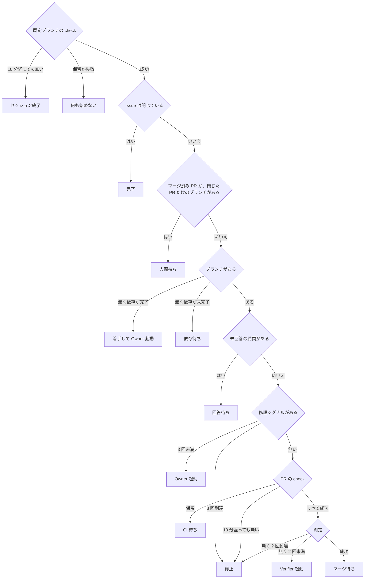
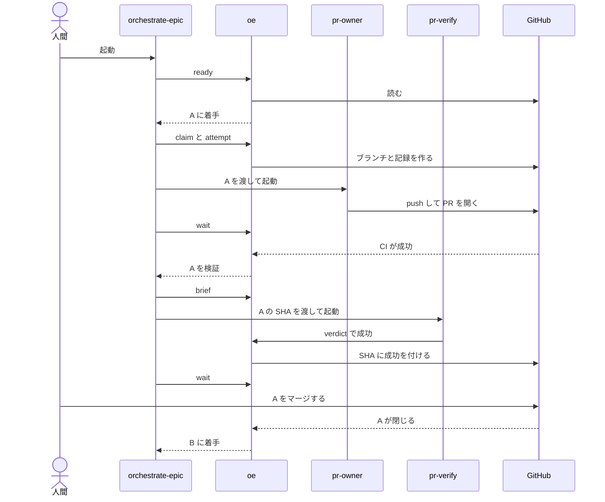

# orchestrate-epic 設計

## 目的

Epic の子 Issue を依存順に検証済み PR へ変え、状態はすべて GitHub から導き、マージは人間かリポジトリの自動化に任せる。

## 責務

各部品は 1 つの仕事だけを持ち、状態を持たない。

| 部品 | 仕事 | 使う部品 |
|---|---|---|
| orchestrate-epic | 次の行動を得てエージェントを起動し、変化を待つことを繰り返す | oe、pr-owner、pr-verify |
| pr-owner | Issue を 1 段だけ進めて push し、迷えば質問だけして何も push しない | implement、create-pr、oe question |
| implement | コードとテストを書いてコミットし、push はしない | commit |
| commit | 秘密情報を検査してコミットする | なし |
| create-pr | PR を作る | なし |
| pr-verify | 1 つの SHA を Issue の受け入れ基準で検証する | oe verdict |
| oe lock | 同じ Epic の 2 つ目のセッションを拒否する | なし |
| oe ready | GitHub を読み、Issue ごとの次の行動を出し、何も書かない | なし |
| oe claim | ブランチと着手記録を作る | なし |
| oe worktree | 共有チェックアウトの外に作業場所を用意し、終了時に消す | なし |
| oe attempt | 試行記録を書き、4 回目を拒否する | なし |
| oe brief | エージェントへの指示を作り、何も書かない | なし |
| oe question | 質問をマーカー付きで Issue に書く | なし |
| oe verdict | SHA に保留、成功、失敗のステータスを付け、指摘を PR に書く | なし |
| oe wait | oe ready の出力が変わるか時間切れまで待つ | oe ready |
| 人間 | 答え、レビューし、マージし、ブランチを消してやり直させる | なし |

## 不変条件

| 不変条件 | 対応する Epic の安全条件 |
|---|---|
| AI はマージも自動マージ有効化もしない | マージ許可などマージ系の条件はすべて不要になる |
| 依存先がすべて完了で閉じてから着手する | 依存の完了 |
| 着手はブランチ作成で行い、既にあれば失敗する | 二重着手の防止 |
| 判定は検証した SHA のコミットステータスで、その SHA が PR の先頭のときだけ書く | 判定と SHA の結び付け |
| Verifier には Issue と SHA とベースだけを渡す | Verifier は作業者の報告を見ない |
| エージェントは 1 段ごとに新しく起動して終わる | 段ごとに新しいエージェント |
| Owner の試行は GitHub から数え、4 回目は拒否する | 再起動しても残る試行上限 |
| エージェントは自分の worktree だけで作業する | 共有チェックアウトに触れない |
| 人間の入力は信頼ユーザーのマーカーなしコメントだけで、ラベルは意味を持たない | 信頼できる入力だけを使う |
| GitHub の読み取りに失敗したら何も決めない | 読み取り失敗で判断しない |
| 起動が同意で、セッション終了ですべて止まる | 開始ゲートは不要になる |
| 本物の CI で判断する | ローカル再現の検査集合は不要になる |

秘密情報の検査は受容するリスクに対応する。

## 状態の導出

- 修理シグナル
  - PR が無い
  - 競合している
  - check が失敗している
  - 判定が失敗している
  - 最新の試行より新しい信頼ユーザーの回答、変更要求レビュー、レビュースレッドのコメント
- 数え方
  - 記録は最新の着手記録より後のものだけを数え、着手記録が無ければすべて数える
  - Verifier の回数は、起動前にその SHA へ付ける保留ステータスの数で数える
  - 自分の判定ステータスは check に含めない
  - 実行中のエージェントがいる Issue はセッション内で除く

## 具体例

正常系では、B は A に依存する。

| 場面 | 動き |
|---|---|
| エージェント消失 | GitHub に完了の印が無いので次の試行が同じブランチで始まり、セッションの再実行も同じ状態から再開する |
| 検証失敗 | 失敗判定と指摘コメントを受けて Owner が修理し、新しい先頭で CI と検証をやり直す |
| CI 失敗 | Owner が同じブランチで修理する |
| 上限到達 | 3 回で停止し、依存する Issue も待ち、人間が手で仕上げるかブランチを消してやり直す |
| 既定ブランチの失敗 | 着手も Owner も Verifier も始めないので試行を消費せず、成功に戻れば再開する |

## 受容するリスク

- 共有トークンでは判定を偽造できる
- ベースが動いても再検証しない
- AI が変えたワークフローが秘密情報付きで動く
- oe は秘密情報を検査せず、各コミットは commit スキルが検査する
- マーカーを付け忘れた AI の書き込みは人間の入力に見える
- セッションロックはホスト内だけなので、別ホストのセッションは拒否できない

## 決定事項

| 論点 | 決定 |
|---|---|
| 依存先が不要や重複で閉じた | 依存する Issue は人間を待つ |
| 修理を起動するシグナル | 上の修理シグナルだけで、通常の PR コメントと bot のレビューは無視する |
| 回答後の再起動 | 試行上限 3 回に数える |
| Verifier が判定を出せない | 1 回だけ再試行し、2 回目で停止する |
| 待機 | oe wait は 1 回 25 分までで、4 時間変化が無ければ要約を出して終わる |
| 並列数 | Owner と Verifier の合計 3 で、引数で変えられる |
| worktree | エージェント終了時に消し、push していない作業は捨てる |
| 判定の指摘 | マーカー付きの PR コメントに書き、次の Owner が読む |
