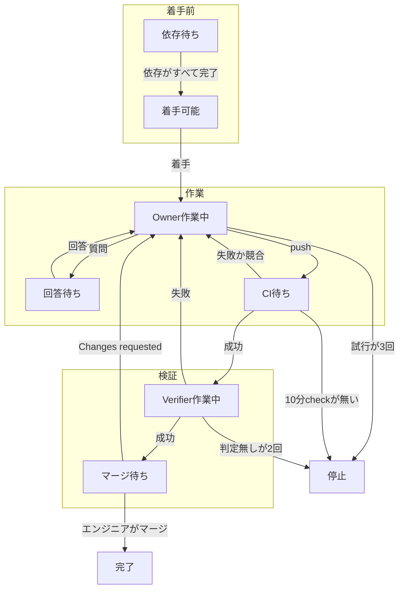
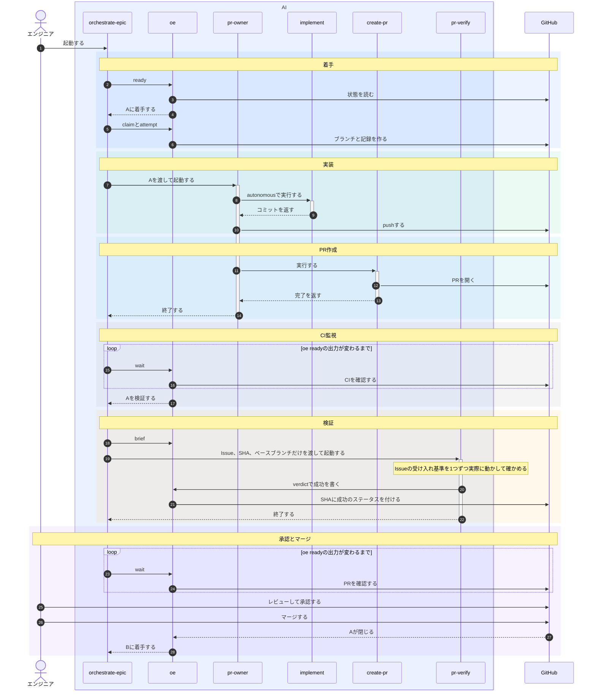

# orchestrate-epic設計

## 目的

orchestrate-epicは、Epicの子Issueを依存順に検証済みのPRにする。状態はすべてGitHubから読み取り、マージはエンジニアかリポジトリの自動化が行う。

## 責務

各部品は1つの仕事だけを行い、自分では状態を保存しない。状態はすべてGitHubにある。

### 進行役

| 部品 | 仕事 | 使う部品 |
|---|---|---|
| orchestrate-epic | oe readyで各Issueの次の行動を受け取り、必要なエージェントを起動し、oe waitでGitHubの変化を待つ。これを繰り返す | oe、pr-owner、pr-verify |

### エージェント

| 部品 | 仕事 | 使う部品 |
|---|---|---|
| pr-owner | 1つのIssueについて実装か修理を1回行い、pushする。判断できなければIssueに質問を書き、何もpushしない | implement、create-pr、oe question |
| pr-verify | PRの先頭SHAのコードがIssueの受け入れ基準をすべて満たすかを、実際に動かして確かめる | oe verdict |

### 既存スキル

| 部品 | 仕事 | 使う部品 |
|---|---|---|
| implement | コードとテストを書いてコミットする。pushはしない | commit |
| commit | 秘密情報を検査してからコミットする | なし |
| create-pr | PRの本文を書き、PRを開く | なし |

### oe

| 部品 | 仕事 | 書き込み先 |
|---|---|---|
| oe lock | 同じEpicの2つ目のセッションを拒否する | ホスト内のロック |
| oe ready | GitHubを読み、各Issueの次の行動を出力する | なし |
| oe wait | oe readyの出力が変わるか、25分経つまで待つ | なし |
| oe brief | OwnerとVerifierに渡す指示を作る | なし |
| oe claim | Issueのブランチを作り、着手記録を書く | originのブランチとIssueのコメント |
| oe worktree | 共有チェックアウトの外に作業用のworktreeを作り、エージェントの終了後に消す | ローカルのworktree |
| oe attempt | Ownerの起動前に試行記録を書き、4回目は拒否する | Issueのコメント |
| oe question | Ownerの質問を書く | Issueのコメント |
| oe verdict | Verifierの判定と指摘を書く | SHAのコミットステータスとPRのコメント |

### エンジニア

- Ownerの質問に、Issueのコメントで答える
- PRのコードをレビューし、直してほしければChanges requestedを出す
- PRを承認してマージする
- 停止したIssueのブランチを消し、AIに最初からやり直させる

## 不変条件

| 不変条件 | 対応するEpicの安全条件 |
|---|---|
| AIはマージせず、自動マージも有効にしない | マージ許可、SHA指定マージ、マージ後の凍結などマージ系の条件。AIがマージしないので不要になる |
| 依存先のIssueがすべて完了として閉じるまで、Issueに着手しない | 依存の完了 |
| 着手とはIssueのブランチをoriginに作ることで、ブランチが既にあれば着手は失敗する | 二重着手の防止 |
| 判定は検証したSHAのコミットステータスとして書き、そのSHAがPRの先頭でなくなっていれば書かない | 判定とSHAの結び付け |
| Verifierに渡すのはIssue、SHA、ベースブランチだけで、PRの本文やOwnerの報告は渡さない | Verifierは作業者の報告を見ない |
| OwnerもVerifierも仕事1回ごとに新しく起動し、仕事が終われば終了する | 段ごとに新しいエージェント |
| Ownerの試行回数はGitHub上の試行記録から数え、4回目の起動は拒否する | 再起動しても残る試行上限 |
| エージェントは自分用のworktreeだけで作業し、共有チェックアウトには触れない | 共有チェックアウトに触れない |
| エンジニアの入力として扱うのは、OWNER、MEMBER、COLLABORATORの権限を持つ人が書いたマーカーの無いコメントとレビューだけで、ラベルは何も意味しない | 信頼できる入力だけを使う |
| GitHubの読み取りに1つでも失敗したら、oe readyは何も出力せずに失敗で終わる | 読み取り失敗で判断しない |
| スキルの起動を同意とみなし、セッションを終えるとすべてのエージェントが止まる | 開始ゲート。起動が同意なので不要になる |
| 成否はGitHub上の本物のCIで判断し、ローカルでCIを再現しない | ローカルで再現する検査集合。本物のCIを使うので不要になる |

秘密情報の検査という安全条件は、受容するリスクとして扱う。

## 状態の導出

1つのIssueは次の図の段階を進む。

oe readyは各Issueについて、次の表を上から見て最初に当てはまった行の行動を出す。行1と行2は既定ブランチを見る関門で、すべてのIssueに効く。

| 順 | 段階 | GitHubの状態 | 次の行動 |
|---|---|---|---|
| 1 | 関門 | 既定ブランチの先頭SHAに、10分経ってもcheckが1つも無い | セッションを終える |
| 2 | 関門 | 既定ブランチの先頭SHAのcheckに、保留中か失敗のものがある | 何も始めずに待つ |
| 3 | 着手前 | Issueが閉じている | 完了とする |
| 4 | 着手前 | 最新の着手記録より後にマージ済みのPRがある。またはブランチがあり、そのPRが閉じられている | エンジニアを待つ |
| 5 | 着手前 | ブランチが無く、完了していない依存先がある | 依存先を待つ |
| 6 | 着手前 | ブランチが無く、依存先がすべて完了している | 着手してOwnerを起動する |
| 7 | 作業 | Issue上の最新の質問の後に、信頼ユーザーのコメントが無い | 回答を待つ |
| 8 | 作業 | 下の修理シグナルのどれかがある | Ownerを起動する。試行がすでに3回なら停止する |
| 9 | 検証 | PRの先頭SHAのcheckに、保留中のものがある | CIを待つ |
| 10 | 検証 | PRの先頭SHAに、10分経ってもcheckが1つも無い | 停止する |
| 11 | 検証 | PRの先頭SHAに、成功の判定も失敗の判定も無い | Verifierを起動する。保留ステータスがすでに2つあれば停止する |
| 12 | 検証 | PRの先頭SHAに成功の判定がある | エンジニアのマージを待つ |

- 修理シグナル
  - PRがまだ無い
  - PRがベースブランチと競合している
  - PRの先頭SHAのcheckが失敗している
  - PRの先頭SHAの判定が失敗している
  - 最新の試行記録より後に、信頼ユーザーが次のどれかを書いた
    - 最新の質問への回答
    - Changes requestedのレビュー
    - レビュースレッドのコメント
- 数え方
  - 数えるのは最新の着手記録より後の記録だけで、着手記録が1つも無ければすべての記録を数える
  - Verifierの起動回数は、oeが起動前にそのSHAへ付ける保留ステータスの数で数える
  - oe verdictが書くステータスは、CIのcheckとして数えない
  - このセッションでエージェントが動いているIssueは、oe readyの対象から外す

## 具体例

正常系の流れを示す。IssueのBはIssueのAに依存する。

| 場面 | 動き |
|---|---|
| エージェント消失 | OwnerがPRを作らずに終わるか、セッションが落ちる。GitHubには完了の記録が無いので、次のoe readyが同じブランチで次の試行を始める |
| 検証失敗 | Verifierが失敗の判定と指摘コメントを書く。Ownerが指摘を読んで修理し、pushする。新しいSHAには判定が無いので、CIと検証をやり直す |
| CI失敗 | Ownerが同じブランチで失敗したcheckを直し、pushする |
| 上限到達 | 3回試行しても修理シグナルが残るとIssueは停止し、依存するIssueも止まる。エンジニアは手で仕上げてマージするか、ブランチを消してやり直させる |
| 既定ブランチの失敗 | 既定ブランチのcheckが失敗している間は、着手もOwnerもVerifierも始めないので試行は減らない。checkが成功に戻れば再開する |

## 受容するリスク

- トークンを共有するので、判定のステータスを偽造できる
- 検証の後にベースブランチが進んでも、検証をやり直さない
- AIが変更したワークフローも、リポジトリの秘密情報を使って動く
- oeは秘密情報を検査せず、各コミットはcommitスキルが検査する
- AIがマーカーを付け忘れたコメントは、エンジニアの入力として読まれる
- セッションロックは同じホストの中でしか効かないので、別のホストで同じEpicを動かすと、2つのエージェントが同じブランチを触りうる

## 決定事項

| 論点 | 決定 |
|---|---|
| 依存先が不要または重複として閉じた | 依存するIssueには着手せず、エンジニアの判断を待つ |
| 修理を起動するシグナル | 上の修理シグナルだけで、PRの通常コメントとbotのレビューでは起動しない |
| 質問に回答した後のOwnerの再起動 | 試行3回の上限に数える |
| Verifierが判定を出さずに終わった | 同じSHAで1回だけ再起動し、2回目も判定が無ければ停止する |
| 待機時間 | oe waitは1回25分まで待ち、oe readyの出力が4時間変わらなければ、要約を出してセッションを終える |
| 同時に動くエージェント数 | OwnerとVerifierの合計で3とし、起動時の引数で変えられる |
| worktree | エージェントが終わったらそのworktreeを消し、pushしていない作業は捨てる |
| 判定の指摘の置き場所 | マーカー付きのPRコメントに書き、次のOwnerがそれを読む |
