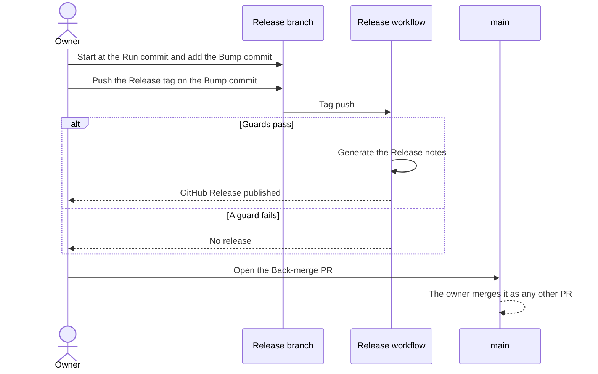

# Release Flow

## Overview

Documented installs follow releases, and `main` is the owner's early-access track. A release ships a commit the owner has already run, not whatever merged last.

| Responsible for | Not responsible for |
|---|---|
| Turning a commit the owner ran into a tagged release with generated notes | When to release, which the owner chooses |
| The version each documented install route resolves | How work merges into `main`, which stays as it is |
| Making the Claude Code plugin version name its content | A release schedule or its automation |

## Domain Model

| Concept | Definition |
|---|---|
| Early-access track | `main`, which the owner installs through APM or npx skills without naming a version |
| Run commit | A commit on `main` the owner has run and chooses to release. It is the single parent of its Release tag's commit. `v1.2.0`, the last tag made on `main`, is its own Run commit |
| Release branch | A branch that starts at the Run commit and holds the Bump commit on top |
| Bump commit | The one commit a release adds to the Run commit. It sets the new version in both manifests, the marketplace entry's `ref`, and the npx skills tag in the README |
| Release tag | `v<version>` on the Bump commit. Immutable releases keep it on that content |
| Previous release | The published GitHub Release with the highest version below this one |
| Release range | The commits after the Previous release's Run commit, up to this release's Run commit, leaving out the commits Back-merge PRs added to `main`. The version bump and the Release notes both count this range |
| Release notes | Notes the release workflow generates with git-cliff for the Release range, opening with one entry per breaking commit: its `BREAKING CHANGE` or `BREAKING-CHANGE` footer text, or its subject when it has neither |
| Back-merge PR | The pull request that brings the Bump commit from the Release branch into `main` |

| Route | Documented install resolves | Without a version |
|---|---|---|
| APM | The newest Release tag within the current major version, through a `#^<major>.0.0` range | `main` |
| GitHub CLI | The latest release, its default | The latest release |
| npx skills | The exact Release tag, `#v<version>` | `main` |
| Claude Code plugin | The Release tag that the marketplace entry's `ref` on `main` names, so it moves when the Back-merge PR merges | The same; this route has no early-access track |

## Scenarios

### Cutting a release

The owner has run `main` for some time and wants other users to get that commit.

## Invariants

- The release workflow publishes a tag only when all of these hold:
    - The tag's commit has one parent, the Run commit, which is reachable from `main` and descends from the Previous release's Run commit.
    - The Bump commit changes nothing but the version in both manifests, the marketplace entry's `ref`, and the npx skills tag in the README.
    - Each of those equals the tag, with the manifests omitting its `v`.
- The version and the marketplace entry's `ref` on `main` never move to an older release: a Back-merge PR that would move them back is not merged.

## References

- [The decision record](https://github.com/maro114510/skills/discussions/905#discussioncomment-19671463) for the checked premises, each route's behavior, and the decisions
- [Host and maintain a marketplace](https://code.claude.com/docs/en/plugins/host-marketplace.md) for a marketplace entry's `ref`
