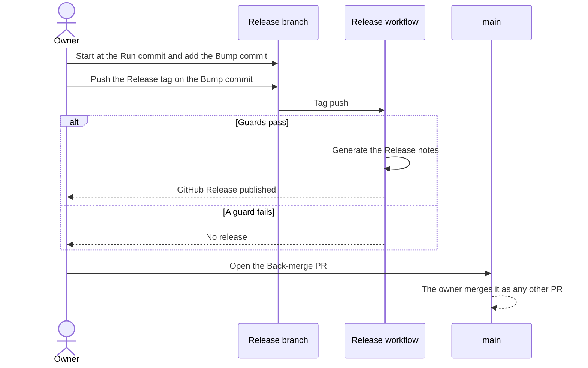

# Release Flow

## Overview

Documented installs follow releases, and `main` is the owner's early-access track. A release ships a commit the owner has already run, not whatever merged last.

| Responsible for | Not responsible for |
|---|---|
| Turning a commit the owner ran into a tagged release with generated notes | When to release, which the owner chooses |
| The version each documented install route resolves | How work merges into `main`, which stays as it is |
| Making the Claude Code plugin version name its content | A release schedule or its automation |

## Domain Model

| Concept | Definition |
|---|---|
| Early-access track | `main`. The owner installs it without naming a version |
| Run commit | A commit on `main` the owner has run and chooses to release. It is the parent of its Release tag's commit |
| Release branch | A branch that starts at the Run commit and holds one Bump commit on top |
| Bump commit | The only commit a release adds to the Run commit. It sets the new version in both manifests, sets the marketplace entry's `ref` to the new tag, and sets the version in the README's install commands |
| Release tag | `v<version>` on the Bump commit. Immutable releases keep it on that content |
| Release notes | Notes the release workflow generates with git-cliff for the commits after the previous release's Run commit, opening with the `BREAKING CHANGE` footer text of each breaking commit among them |
| Back-merge PR | The pull request that brings the Bump commit from the Release branch into `main` |

How each documented route names a version:

| Route | Documented install resolves |
|---|---|
| APM | The newest release tag within the current major version, through a `#^<major>.0.0` range |
| GitHub CLI | The latest release, its default |
| npx skills | The exact release tag, `#v<version>` |
| Claude Code plugin | The Release tag the marketplace entry's `ref` on `main` names |

## Scenarios

### Cutting a release

The owner has run `main` for some time and wants other users to get that commit.

### Installing

A user other than the owner installs as the README says and gets a release. The owner gets `main` by installing through APM or npx skills without a version; the Claude Code plugin always installs the Release tag its `ref` names. The Claude Code plugin reads its marketplace entry from `main`, so it moves to a new release only when the Back-merge PR merges.

## Invariants

- The Run commit is reachable from `main`, and the Release tag's commit differs from the Run commit only by the Bump commit. The release workflow refuses a tag that breaks either, in place of today's check that the tag commit itself is reachable from `main`, because a squash or rebase merge of the Back-merge PR never makes it so.
- The version in both manifests at the Release tag equals the tag without its `v`, and the marketplace entry's `ref` there names that tag, so a plugin version always names the content it installs.
- The commits a release counts, for its version bump and its notes, start after the previous release's Run commit, not at the previous Release tag, which `main` never contains.

## References

- [The decision record](https://github.com/maro114510/skills/discussions/905#discussioncomment-19671463) for the checked premises, each route's behavior, and the decisions
- [Host and maintain a marketplace](https://code.claude.com/docs/en/plugins/host-marketplace.md) for a marketplace entry's `ref`
