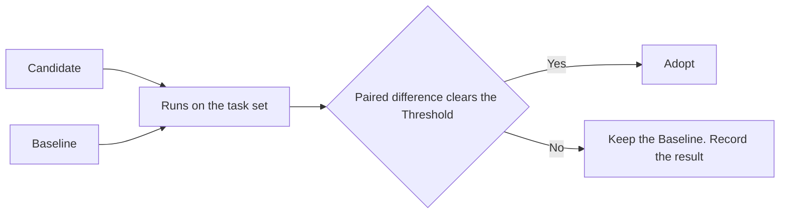

# Skill Evaluation

## Overview

A change to a skill is adopted only when a paired comparison shows it helps. Reading the new text is not evidence.

| Responsible for | Not responsible for |
|---|---|
| Judging one candidate against the current version on the same tasks | Measuring the pipeline, which `development-pipeline.md` covers with Attention |
| Keeping the threshold fixed before the runs | Finding candidates |

## Domain Model

| Concept | Definition |
|---|---|
| Candidate | A changed skill, agent definition, or shared rule file |
| Baseline | The current version of the same file |
| Task set | Fixed inputs drawn from past failures and successes, with a should-trigger and a should-not-trigger half for a description change |
| Run | One execution of one task by one version on a pinned model and harness in a fresh environment |
| Grader | A deterministic assertion where one exists, otherwise a person. A model grader is calibrated against a person first |
| Threshold | The minimum paired difference and the number of runs per task, fixed before the first run |
| Correction rate | Share of a skill's sessions in local history whose next person message corrects the agent |

| Measure | Read from |
|---|---|
| Pass rate per task, all runs passing | Grader |
| Trigger rate on each half of the task set | Session log |
| Tokens and duration | Harness log |
| Correction rate before and after adoption | Local session history, aggregated, never shared raw |

## Scenarios

### Adopting a change

A maintainer believes a change to a skill helps.

## Invariants

- Candidate and Baseline run the same tasks on the same pinned model and harness.
- The Threshold and the run count are fixed before the first run.
- A change that raises the rate of reverts or of changes requested after review is not adopted, whatever it saves.
- Raw session history stays on the host. Only aggregates leave it.

## References

- `development-pipeline.md` for Attention, the pipeline's own measure
