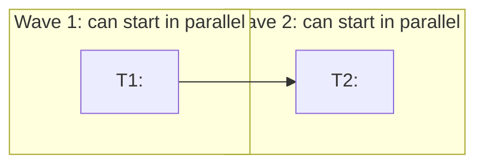
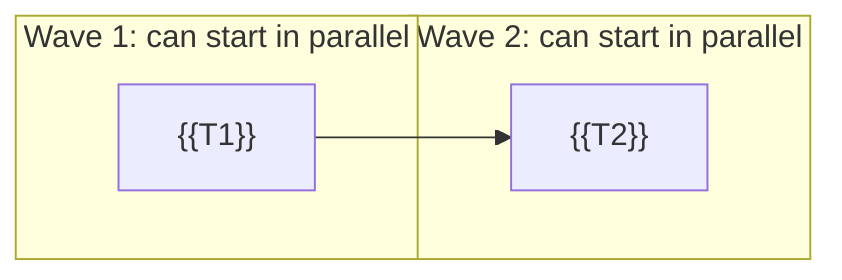
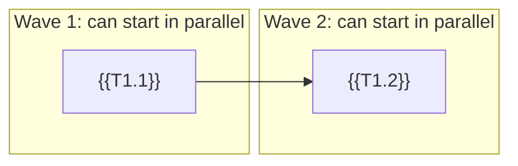

# Templates (en)

## Step 1.5: Clarification Question Format

Write each question as `references/question.md` says, and start its decision line with the label of its unclear axis: `[Granularity]`, `[Acceptance criteria]`, `[Specification]`, or `[Premise]`.

End the message with these lines:

````
I'll continue creating Issues once all questions are answered.
If you want to proceed with the specification still undecided, reply "proceed anyway" (I'll add a [NEEDS CONFIRMATION] tag and continue).
````

## Step 1.5: Warning Format

Output this when the user instructs to proceed with unresolved items:

````
[!] The following specifications are still undecided; Issues will be created anyway. The relevant sections in the Issue bodies will be tagged [NEEDS CONFIRMATION].

- <Undecided item 1>
- <Undecided item 2>
````

## Step 1.5: Design Change Stop Format

Output this when a Step 1.5 answer changes a merged Design Doc or implementation plan that the Issues cite, then stop:

````
[!] No Issue was created. The answers change <document>, which has already merged: <the change>.
Merge that design change first, then run this skill again.
````

## Step 3: Summary Format

Output this block and ask for approval. This is the main checkpoint for catching invented or misplaced content before it's written into a real Issue, and — by default — the *only* checkpoint before creation: Step 4.5's full-body re-display is skipped unless the user asks for it (see Step 4.5), so this summary must carry enough substance (background, full verification list) that approving it is equivalent to approving the final bodies.

Tasks that differ only in one value, such as a service name, may be shown as one full entry plus a table of each task's id, title, and value, since approving that still covers every body.

Use the same 12-task threshold as the Epic body template below: Mermaid for 12 or fewer tasks, the wave table for more. This preview must render in the same form the Epic will actually use — never show a Mermaid graph here if Step 4 is going to render a table, or vice versa.

In any Mermaid node label, a double quote in a title must be written as `#quot;` — never a raw `"` or a backslash-escaped `\"` (backslash escaping breaks rendering).

````
## Issue structure to be created

### Epic (parent Issue; only when structure.md decides an Epic is created)
**Title**: <Epic title>
**Summary**: <purpose in one line>
**Background**: <what led to needing this Epic, in 1-2 sentences>
**Scope (included)**: <bullet> / <bullet>
**Scope (not included)**: <only if applicable: items the source defers, puts out of scope, or assigns to another Epic, and exclusions the conversation named. Give each item left out of the source with the wording that excludes it, as "<item> — source: "<excluding wording>"". Omit this line entirely if there are none>
**Target state**: <what must be true when every child Issue is done, in one line>
**Verification**: <how to confirm the whole Epic is done, built from the children's verification below, plus any check of the whole Epic that a person runs>

(Only if the number of tasks discussed differs from the number of child Issues: **Restructured from the conversation**: <which tasks were split/merged and why, in 1-2 sentences>)

(Only if applicable: **Epic split suggestion**: The dependency graph splits into independent groups and the count is large, so <proposed split> as separate Epics could also work instead of one Epic. Proceed with a single Epic anyway?)

(When no Epic is created, write instead: **No Epic**: <the reason, such as "no task depends on another and no grouping was asked for">. Show every task below as a standalone Issue and skip the dependency preview.)

### Dependency preview (only with an Epic; temporary IDs; real Issue numbers are assigned after creation)



(For 13 or more tasks, use the table below instead of the graph above)

| Wave | Temp ID | Title | Depends on |
|------|---------|-------|------------|
| 1 | T1 | <title> | none |
| 2 | T2 | <title> | T1 |

### Child Issues (N total)

#### T1: <title> (Wave 1 / Depends on: none)
- Background: <why this task is needed, its relation to the Epic, in one line>
- Requirements: <bullet> / <bullet>
- Specs: <bullet> (write "none" if nothing was decided)
- Target state: <what must be true when done, in one line>
- Verification: <bullet>, each observable from a checkout or CI, or none, noting that pr-verify then has nothing to judge
- Full list: <document path and section> (only when this task uses the point option)

#### T2: <title> (Wave 2 / Depends on: T1)
- Background: <one line>
- Requirements: <bullet>
- Specs: none
- Target state: <one line>
- Verification: <bullet>

Only when a Tn was promoted to a container, show it in this shape instead — Requirements/Specs/Verification live only on the Tn.m side.

#### T3: <title> (container / Wave 1 / Depends on: none)
- Background: <why this theme needs to be its own grouping, in one line>
- Scope: <e.g. covers T3.1, T3.2>

##### T3.1: <title> (Wave 1 / Depends on: none)
- Background/Requirements/Specs/Target state/Verification, same shape as a regular child Issue

##### T3.2: <title> (Wave 2 / Depends on: T3.1)
- Same as above

### Person Issues (M total; not sub-issues of the Epic)

Only when the plan explicitly requires a manual verification tied to an implementation Issue, such as a check on a real device. Deployment and other operational work never appears here. Omit this section when there is none.

#### P1: <title, such as "Check the --shout flag on a real device"> (Blocked by: T1, T2)
- Background: <why the verification needs a person, such as a real device no CI runner has, in one line>
- What to do: <manual verification the plan requires> / <bullet>

Only when you have additions beyond the source, write the next section and the closing line that starts with "Additions are included". With no additions, write neither.

### Proposed additions
None of these is in the Tn entries above.
- A1: <requirement, spec, or check to add, or a new task> — for: <Tn or new task> — reason: <one line>

OK to proceed to writing the Issue bodies with this structure, dependencies, requirement/spec, and verification drafts?
Additions are included only when your reply names them, such as "include A1". An approval that names no addition includes none of them.
Reply "create them" to go straight from here through Step 4 (body generation) to creation. If you want to see the full Issue body text before creation, say "show me the draft" instead.
Let me know if anything needs to be added, removed, retitled, or corrected (dependencies, requirements, specs).
````

## Epic body (Step 4)

Only when an Epic is created. Use the Mermaid variant when there are 12 or fewer child Issues; otherwise use the table variant.

### Mermaid variant (≤12 child Issues)

````markdown
## Background

{The context that created this Epic — specific details from the conversation}

## Purpose

{What will be achieved when this Epic is complete}

## Scope

**Included:**
- {List child Issue titles}

**Not included:**
- {Intentionally excluded items — only ones actually discussed. Omit this subsection entirely if the conversation never named an exclusion; don't invent one just to fill the template.}

## Dependencies & Parallel Execution Plan



## Acceptance Criteria

### Target State
{What must be true when all child Issues are done}

### Verification
{How to confirm completion — E2E or integration checks, including any check of the whole Epic that a person runs}
````

### Table variant (>12 child Issues)

Replace the `## Dependencies & Parallel Execution Plan` section with:

````markdown
## Dependencies & Parallel Execution Plan

There are many child Issues, so this is shown as a table instead of a graph. Issues in the same Wave can be worked on in parallel.

| Wave | Issue | Title | Depends on |
|------|-------|-------|------------|
| 1 | {{T1}} | <title> | none |
| 1 | {{T4}} | <title> | none |
| 2 | {{T2}} | <title> | {{T1}} |
````

## Container Tn body (Step 4)

Use only when Step 2 promoted a `Tn` to a container. It has no Requirements, Specs, or Acceptance Criteria — a scaled-down version of the Epic shape covering only its own grandchildren `Tn.m`. Mermaid for 12 or fewer grandchildren; past that, the table — rarely reached in practice, but the same threshold as the Epic.

````markdown
## Background

{Why this theme needs to be its own grouping — its relation to the original Tn's scope, in 1-2 sentences}

## Scope

**Included:**
- {List grandchild Issue titles}

## Dependencies & Execution Plan


````

No Requirements / Specs / Verification section here — those live only on each `Tn.m` body. The diagram shows only this container's own grandchildren, never mixed with another `Tn`'s.

## Child Issue body (Step 4)

Both a non-container `Tn` (leaf) and a `Tn.m` (grandchild) use this shape.

````markdown
## Background

{Why this task is needed, how it connects to the Epic — 1-3 sentences}

## Requirements

- {Observable/functional requirement grounded in the conversation. No implementation detail.}
- {Up to 5 bullets total}

## Specs

- {Concrete technical decision already settled in the conversation}
- {Up to 5 bullets. Omit this entire section if nothing was actually settled — never invent one.}

## Dependencies

{Name each dependency by its title, never by its temporary `Tn` id, which readers never see. For a `Tn`: "Can start after <title> is done. See the Epic for the full dependency picture.", or "None (can start in parallel)" when it has no dependency or there is no Epic / For a `Tn.m`: "Can start after <title> is done. See the parent Issue for the full dependency picture within it." or "None (can start in parallel)". Don't write step-by-step reasoning or detail here.}

## Acceptance Criteria

### Target State
{What must be true when done — concrete and verifiable}

### Verification

- {Check observable from a checkout or CI: assert what, run which command}

{Up to 5 bullets. If it takes more than 5 to cover the real scenarios, that's a signal this Issue should be split — see Step 2 — unless an upstream authoritative document owns the full list: then keep 5 bullets chosen by failure mode rather than happy path, and add one prose line after the bullets (never a sixth bullet) pointing to that document as the authoritative full list. The pointer option is unavailable when no such document exists.}
````

**Banned in every section above:** lettered step sequences (`a→b→c→d`), pseudocode, function signatures, multi-level nested bullets. If a task genuinely needs that much detail to specify, split it into more child Issues, or add a single line linking to an existing design doc — never restate the doc inline.

## Person Issue body (Step 4)

Every `Pn` uses this shape. It is not a sub-issue of the Epic; Step 5 sets its blocked-by relations.

````markdown
## Background

{Why this verification needs a person, such as a real device no CI runner has, and the titles of the implementation Issues it waits for — 1-2 sentences}

## What to do

- {Manual verification the plan explicitly requires, such as a check on a real device; never a deployment or other operational work}
````

## Step 4.5: Body Review Format

Only used when the user explicitly asked to see the full draft (see Step 4.5 in SKILL.md). Show all Issue bodies in the following format and ask for approval:

````markdown
## Issue Body Review

`{{Tn}}` and `{{Tn.m}}` are temporary placeholders. `{{Tn}}` is replaced with the real Issue number (e.g. #123) in the Epic once the Tn Issues are created; `{{Tn.m}}` is replaced the same way in a container Tn's own body once its grandchildren are created.

### Epic: <title> (only when an Epic is created)

<Full Epic body ({{Tn}} placeholders left as-is)>

---

### Child Issue T1: <title>

<Full child Issue T1 body>

---

### Child Issue T2: <title>

<Full child Issue T2 body>

---

Only show the following when a Tn was promoted to a container.

### Child Issue T3 (container): <title>

<Full T3 body ({{T3.m}} placeholders left as-is)>

### Grandchild Issue T3.1: <title>

<Full grandchild Issue T3.1 body>

---

Only show the following when a person Issue exists.

### Person Issue P1: <title>

<Full person Issue P1 body>

---

I'll create the Issues above. The Epic is created first, then each Tn with the Epic's number as its parent, then — for any container Tn — its Tn.m grandchildren with that Tn's number as their parent, then each person Issue with no parent, blocked by the Issues it waits for, so the creation order is Epic → Tn → Tn.m → person Issue.
Let me know which part needs changes. If everything looks good, reply "create them".
````

## Step 6: Completion Report

````
## Created

### Epic (only when an Epic was created; otherwise write "No Epic: <reason>" and list the Issues below as standalone)
- #<number> <title>  (<URL>)
  (The Epic's number is lower than the child Issues' since it was created first; the child Issues follow in wave order<, and every grandchild comes after all of them — only when a container exists><, and every person Issue comes last — only when a person Issue exists>.)

### Child Issues
- #<number> <title>
- #<number> <title> (container)
  - #<number> <title> (grandchild)
  - #<number> <title> (grandchild)
...

(Only when a person Issue exists:
### Person Issues (not sub-issues of the Epic)
- #<number> <title> — blocked by #<number>, #<number>)

The Epic and each Tn, and any container Tn and its grandchild Issues, are linked via `gh issue create --parent` sub-issue relationships.
Dependencies are set as Blocked-by/Blocking relationships via `--blocked-by` — grandchild-to-grandchild dependencies only within the same parent Tn.
You can check both in the Issue sidebar on GitHub (Sub-issues / Relationships).
The Epic body's dependency diagram (or table), and any container Tn's own dependency diagram, now use the real Issue numbers.

(Only when a create failed:
### Not created
- <title>: <the error gh printed>. <Issues that should depend on it, by number> are not blocked by it. Create it by hand with parent #<Epic or container> and blocked-by <its own dependencies, by number>, add it as blocked-by to those Issues, and replace its "(creation failed)" in the Epic body with its number.
- For a failed person Issue instead: <title>: <the error gh printed>. Create it by hand with no parent and blocked-by <the Issues it waits for, by number>.)

````
