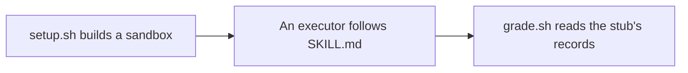

# create-pr evaluation harness

Compares SKILL.md before and after a change on three fixed scenarios, without reaching GitHub.



| Scenario | Arguments | Exercises |
|---|---|---|
| A | none | A Japanese template and an unpushed branch |
| B | `lang en` | A stale local `main`, an upstream behind HEAD, and an unrelated `Closes` on `origin/main` |
| C | `lang en` | A stacked branch with `gh-merge-base`, without a template |

## Run

```bash
bash skills/create-pr/eval/setup.sh A /tmp/cpr-eval/A [<skill-dir>]
claude -p "$(cat /tmp/cpr-eval/A/prompt.md)" --output-format json --no-session-persistence \
  --permission-mode acceptEdits --add-dir <skill-dir> --allowedTools "Bash,Read,Glob,Grep"
bash skills/create-pr/eval/grade.sh A /tmp/cpr-eval/A
```

- Run `claude -p` in the sandbox's `repo`, or give `prompt.md` to a fresh OpenCode subagent
- Rebuild the sandbox before every run

## Isolation

| Case | Blocked |
|---|---|
| The real `gh` runs in the sandbox | Yes |
| A URL the stub printed is replayed | Yes |
| The executor sets `GH_REPO` or `GH_HOST`, passes `--repo`, or runs `gh api` | No |

## Baseline

One run per cell on 2026-10-30, against SKILL.md at `741c121`.

| Harness | Model | A | B | C |
|---|---|---|---|---|
| OpenCode 1.19.5 | claude-opus-5-5 | All PASS | All PASS | All PASS |
| Claude Code 2.1.314 | claude-sonnet-5-5 | All PASS | All PASS | All PASS |

- A single FAIL is a signal rather than proof, since each cell is one run
- The executor sees the checklist it is graded on
